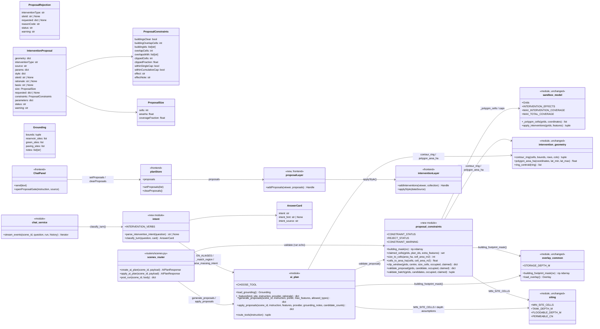
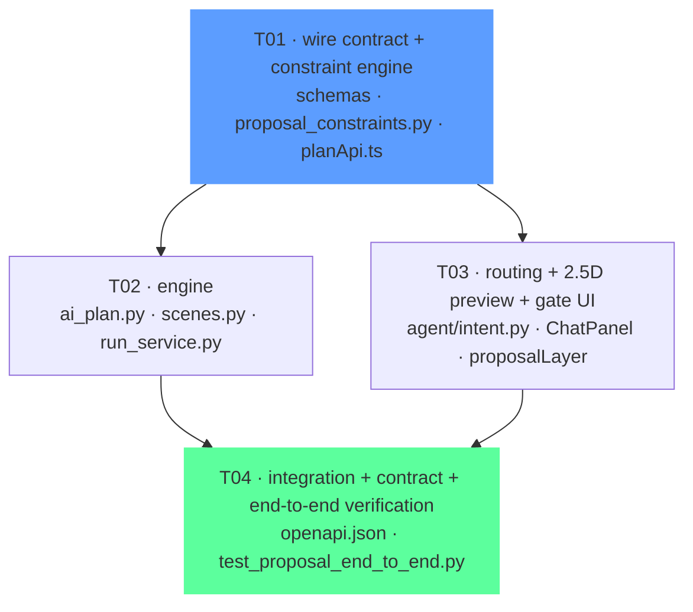

# Design — LLM intervention proposals (input constraints, proposal payload, 2.5D, routing, simulation)

**Author:** 高见远 (Architect) · **Date:** 15 Oct 2026 · **Branch:** `feature/intervention-loop` (merge `c00a266`)
**Status:** design only — no application code in this document.

**Scope.** The user's todo, verbatim:

```
LLM input: Add coordinate selection and size constraints — goal: do not touch existing buildings and prevent overlaps.
LLM output: Intervention type, intervention coordinates, intervention size, and other parameters, presented to the user in the proposal.
Intervention generation: Generate the corresponding 2.5D blocks based on the model output.
To verify: 1. Whether all types of interventions are generated correctly; 2. AI routing assignment (currently some outputs that should be intervention proposals are still being returned as result cards); 3. Simulation calculation of intervention plans.
Extensions: 1. Optimize UI display; 2. Optimize the LLM workflow.
```

**What already exists** (measured on `c00a266`, not assumed):

| Piece | Where | State |
|---|---|---|
| Confirm gate (`apply:false` → proposals, unpersisted) | `routers/scenes.py:253-332`, `ai_plan.generate_proposals` | **works** |
| Apply (`/ai-plan/apply` → draft plan) | `routers/scenes.py:335-370`, `ai_plan.apply_proposals` | **works** |
| Proposal wire model | `schemas/intervention.py:162` `InterventionProposal` | `site_id`/`rationale`/`basis` only — no size, no constraints |
| 2.5D style per kind | `ai_plan.STYLE_FOR_KIND` (all five kinds carry `extrusionHeight`) | **works** for *stored* features |
| Stored-feature renderer | `view/interventionLayer.ts` (`applyStyle` reads `style.extrusionHeight`) | **works** |
| Legend | `components/InterventionLegend.tsx` (mirrors `STYLE_FOR_KIND` by hand) | **works** |
| Chat routing | `ChatPanel.tsx:91` `looksLikeIntervention` (12 verbs) → `:635` `intent==="intervention"` → `openProposalGate` | **fragile** (see §4) |
| Intent from the model | `agent/answer.py:87` `AnswerCard.intent`/`intent_hint`, `agent/prompts.py:69-95` | **works only with a live model** |
| Building mask | `scripts/_overlay_common.building_footprint_mask(ov)` (396 surveyed footprints) | **exists, used by `siting.py` and `placement_footprints` — *not* by `ai_plan.load_grounding`** |
| Run/scoring | `POST /scenes/{id}/run` → `run_service.run_scenario` → `apply_interventions` | **works** |
| Coverage caps | `sandbox_model.MAX_INTERVENTION_COVERAGE=0.25`, `MAX_TOTAL_COVERAGE=0.40` | **works** (measured on the *union*, so they do **not** forbid overlap) |

---

# Part A — System design

## 1. Implementation approach

### 1.1 The three real problems

1. **A proposal can be illegal and nothing says so.** `ai_plan.load_grounding()` builds its three candidate pools from *raw* class masks and the wet grid:

   ```python
   mask = depth >= 0.35                                  # reservoirs — the wet grid is solved on bare earth
   for comp in _components_cells(ov.class_mask("green"), 120, 4)   # green
   for comp in _components_cells(ov.class_mask("paved"), 150, 4)   # paving
   ```

   `siting.py` (the *other* pool builder) removes buildings from `hard_standing()`, but `load_grounding` does not. Consequences, all real today: a reservoir site can sit on a roof (STATUS already records 3,142 wet cells being drawn on roofs); a `permeable_paving` site is by definition the *paved* class, and buildings are paved, so the paving pool can contain a building. "Do not touch existing buildings" is therefore **not enforced anywhere on the proposal path** — neither in the prompt nor in code.

2. **Overlap is not forbidden, only bounded.** `apply_interventions` measures coverage on the **union** (`claimed | set(cells)`) precisely so overlapping features are not double-counted. That is correct arithmetic and the *wrong* predicate for the user's requirement: two proposals can legitimately overlap and the ledger will happily score the union. Nothing in the proposal path tests proposals against the already-staged set at all.

3. **Routing depends on a live model that is not configured.** `.env` has no key (measured 15 Oct), so the chat card is assembled by `run_card.py` and `intent` stays at its safe default `"question"` (`answer.py:87`). The only thing that can then route an instruction to the proposal gate is the client's 12-verb regex — a second, smaller vocabulary than the server's (`dig`, `create`, `grow`, `increase greenery`, `retain` are all absent). The user's complaint — "some outputs that should be intervention proposals are still being returned as result cards" — is exactly this.

### 1.2 Decisions (and why)

| # | Decision | Why |
|---|---|---|
| D1 | **Constraints live in code, and the prompt only *asks*.** The tool schema tells the model the rules; `proposal_constraints.py` re-derives every number from the rasters. | The project's standing rule: the model supplies an assumption, never a result; grounding is code (`STATUS.md`, "Grounding is code, never the model"). A model that promises "no buildings touched" has told us nothing. |
| D2 | **The model may propose a centre + a size; it never emits a polygon.** The server snaps the centre to a cell (`Grids.cell_of`), builds the window, clips it to legal ground, and contours the *cell mask* through `intervention_geometry.contour_ring`. | One definition of one geometry (`intervention_geometry` is the only contour path; `_polygon_cells` the only rasteriser). A model-written polygon is rasterised by centre-test into a *different* cell set than the one it drew, so the picture and the number would disagree — the exact failure `siting.py`'s docstring was written about. §2.3 states what breaks with the polygon option. |
| D3 | **Building exclusion is a cell-level predicate with zero tolerance**, evaluated against `building_footprint_mask(ov)`. | A tolerance in metres would be a second geometry (buffers, projections) that the ledger does not share. A cell either has a surveyed footprint in it or it does not; the mask is already the project's one answer and is what `siting.py`/`placement_footprints` use. |
| D4 | **Two violation responses, chosen by how the model expressed the request.** Site-based → **re-site** (reject, name the reason, offer the next candidate from the same pool). Coordinate-based → **clip**, and reject when the clip is material (> 25 % removed) or the remainder is < `MIN_SITE_CELLS`. | A *site* is an evidence-bearing object; clipping it makes a different object, so re-siting is honest. A *coordinate request* is an intent to occupy ground; removing the cells a building stands on is the constraint, not a change of intent — but a quarter of the footprint vanishing is a different proposal and must be refused, not silently delivered. |
| D5 | **Rejections are returned, never dropped.** `AIPlanResponse.rejected[]` carries one entry per refused proposal with `status` + `warning` + `reasonCode`. | The project's rule for refusals (`candidatesRefused` in `suggest.py`; the 25 % cap's "the refusal reason in the sanity-check pattern", PRD §4). A silently shorter list is indistinguishable from a model that returned less. |
| D6 | **Routing authority moves to the server, deterministically.** A new `agent/intent.py::classify_turn` runs the deterministic parsers and *can raise* `intent` to `"intervention"`; the model can never lower it. | With no model configured, the template card must still route. The client regex stays as a latency fast path only, and its vocabulary is pinned to the server's by a generated fixture (§4.3). |
| D7 | **No new dependencies.** All predicates are numpy boolean masks over the existing grid. | `intervention_geometry.py` already made this argument for marching squares; a clipping library would be a second opinion about the same cells. |
| D8 | **A proposal declares its own ledger effect before the user accepts it.** `constraints.effect ∈ {class_change, cn_only, none}`. | `drainage`, `road` and `massing_height` have `to: None` in `INTERVENTION_EFFECTS`, so `apply_interventions` *skips* them. A block that appears in the scene and moves no number reads as a bug unless the gate said so first. |

### 1.3 What is deliberately not built

- No basin *shaping* (the flat-top 2.5D block stays; plan v2 §3.2 defers the profile work). D8's `extrusionMeaning` is the only height change.
- No new placement engine: `placement_footprints()` stays the one generator of *new massing*; the proposal placement path is a separate, intervention-kind path.
- No change to `compare()`, `scenario.evaluate`, or any orphan endpoint (PRD §1.1 keeps them API-only).

## 2. The three designs in detail

### 2.1 Input constraints (the exact predicates)

All three predicates are pure functions over the loaded grid; none of them calls a model, reads a clock, or writes anything.

**Grid constants** (from `load_grids()`; `Grids` is frozen and cached):
`rows=117`, `cols=148`, `cells=17,316`, `cell_area_m2=25.12`, site `43.5 ha`, `bounds=(113.9922, 22.431, 113.9994, 22.4363)`.

| Constraint | Predicate | Tolerance | On violation |
|---|---|---|---|
| **No building** | `covered ∩ building_mask = ∅`, where `building_mask = building_footprint_mask(load_overlay())` is `True` iff a cell centre falls under one of the 396 surveyed footprints (`rasters/buildings_hsk.json` → `design_metrics.rasterise_height(footprints_from_geojson(...)) > 0`) | **0 cells.** A footprint edge clipping one cell is a violation. | Site-based → re-site. Coordinate-based → clip; reject if clip > 25 % of the window or remainder < 40 cells. |
| **No overlap** | `covered ∩ claimed = ∅`, where `claimed = ⋃ _polygon_cells(grids, f["geometry"]["coordinates"])` over (a) every feature of the plan ids named in the request, defaulting to the scene's staged plan (`pins.staged_plan_id(scene_id)`), and (b) every proposal already accepted earlier in this same batch | **0 cells.** Edge-adjacency is allowed (sharing an edge is not sharing a cell); a 1-cell overlap is a violation. | Reject, with `overlapsWith: [siteId | "proposal#n"]` and the overlapping cell count. Never clipped — an overlap is another feature's ground, and clipping would silently re-site the *other* one too. |
| **Size within the caps** | `MIN_SITE_CELLS (40) ≤ covered ≤ floor(0.25 · 17,316) = 4,329`; and `|claimed ∪ covered| ≤ floor(0.40 · 17,316) = 6,926` | exact cell counts | Reject, stating the requested size, the legal maximum and the cells already claimed. |

`MIN_SITE_CELLS` is **imported from `siting.py`**, not re-declared: "a component smaller than this is noise rather than a project" is one rule.

**The window, exactly — this is what the caps above are measured on.** A coordinate-based placement asks for `N = sizeCells`. The window is **exactly `N` cells**, built by a deterministic N-nearest-cell scan outward from the snapped centre `Grids.cell_of(lon, lat)`, ties broken by a fixed `(row, col)` key, so the same request yields the same window on every host and **never depends on set/dict iteration order**. The window is then clipped to legal ground (buildings, already-claimed cells), contoured, and the **survivors** are `size.cells`. So the window holds **`N` cells pre-clip** and **`size.cells ≤ N` post-clip** — equal when nothing was clipped, less when the clip removed cells, never more. **The window is never a bounding square:** `ceil(sqrt(N))` cells per side would serve **49** cells for a request of 39 (silently slipping past the 40-cell floor) and **4,356** for a request of 4,329 (refusing the legal maximum) — precisely the off-by-a-square that T01's four boundaries (39 / 40 / 4,329 / 4,330) are written to catch, and that yan's boundary suite must be testing against *this* rule rather than one implementation's accident.

**Where each predicate is enforced — both places, on purpose:**

1. **In the prompt / tool schema (a request).** `build_prompt()`'s payload gains a `constraints` block so the model is told the rules and the budget before it answers:
   ```json
   "constraints": {
     "must_not_overlap_buildings": true,
     "must_not_overlap_staged": true,
     "min_cells": 40, "max_cells": 4329, "cumulative_remaining_cells": 6926,
     "staged_plan_cells": 0, "staged_plan_bbox": null,
     "note": "Propose a centre and a size only. The system snaps and clips your placement to legal ground; it refuses a placement that loses more than 25% of its area, and refuses any site that touches a building."
   }
   ```
2. **In `proposal_constraints.py` (a guarantee).** Every proposal — including one the heuristic produced and one the model produced — passes through `validate_proposal()` before it is returned or persisted. A provider that ignores the payload cannot leak an illegal feature, the same defence `generate_proposals`' `allowed_set` post-filter already uses.

**Also fixed at the source (the cheapest half of the fix):** `ai_plan.load_grounding()` subtracts `building_footprint_mask(ov)` from **all three** masks before component labelling, and appends the excluded cell count to `grounding.notes`:

```python
occupied = building_footprint_mask(ov)          # None when no city model is present
if occupied is not None:
    mask &= ~occupied                            # reservoirs
    green_mask &= ~occupied                      # green
    paved_mask &= ~occupied                      # paving
    g.notes.append(f"existing buildings excluded from candidate sites ({int(occupied.sum())} cells)")
```

Without this, the validator would reject the very sites the catalogue offers — a proposal list that is always empty, and a *worse* failure than the one being fixed. Fix the pool, then guard the door.

**What the user is told.** Each proposal carries `constraints` (§2.2); each refusal carries a `rejected[]` entry whose `warning` names the predicate in words, e.g.
`"PROPOSAL_REJECTED: this placement overlaps 34 cells already staged by the 'Staged scenario' plan; move it or remove the conflicting intervention first."`

### 2.2 Proposal payload (the wire shape)

`InterventionProposal` gains four additive blocks. `geometry`, `interventionType`, `source`, `params`, `style`, `siteId`, `rationale`, `basis` keep their current meaning so the existing gate and `applyAiPlan` keep working.

```json
{
  "geometry": {"type": "Polygon", "coordinates": [[[113.99310, 22.43402], "..."]]},
  "interventionType": "water_reservoir",
  "source": "ai",
  "params": {
    "basis": "deepest connected basin in the computed wet grid, contoured to its true cell mask",
    "rationale": "the lowest ground in the north half",
    "instruction": "add a retention basin in the north",
    "provider": "claude",
    "status": "draft_pending_human_review"
  },
  "style": {"color": "#1f6feb", "opacity": 0.55, "extrusionHeight": 14.0},
  "siteId": "water_reservoir#0",
  "rationale": "the lowest ground in the north half",
  "basis": "deepest connected basin in the computed wet grid, contoured to its true cell mask",

  "size": {"cells": 512, "areaHa": 1.29, "coverageFraction": 0.02957},

  "requested": {"centre": {"lon": 113.99512, "lat": 22.43410}, "sizeCells": 600},

  "constraints": {
    "buildingsClear": true,
    "buildingOverlapCells": 0,
    "buildingIds": [],
    "overlapCells": 0,
    "overlapsWith": [],
    "clippedCells": 88,
    "clippedFraction": 0.1467,
    "withinSingleCap": true,
    "withinCumulativeCap": true,
    "effect": "class_change",
    "effectNote": "an open water surface stores water"
  },

  "parameters": {
    "storageDepthM": {
      "value": 1.5, "unit": "m", "status": "ASSUMPTION",
      "source": "scripts/_overlay_common.STORAGE_DEPTH_M['water'] (class default), an assumption, not a survey"
    }
  },

  "status": "PROPOSAL_ACCEPTED",
  "warning": "Screening proposal: geometry is the contoured cell mask of the chosen site on the 5 m grid. Depth is a class assumption; a run will score it."
}
```

Field rules (exact):

| Field | Type | Rule |
|---|---|---|
| `size.cells` | int | `len(_polygon_cells(grids, geometry.coordinates))` — the **served** cell set, holes subtracted. **Post-clip by definition**: it is what survived the window clip, so for a coordinate-based proposal `size.cells ≤ requested.sizeCells`, with `<` iff the clip removed cells. It is *never* rounded up from the ask, and it is the number the caps (§2.1) are measured on. |
| `size.areaHa` | float | `polygon_area_ha(coordinates, lat_min, lat_max)`, rounded to 2 dp (holes subtracted) |
| `size.coverageFraction` | float | `cells / 17,316`, 5 dp |
| `requested` | object \| null | the model's raw ask (`{"centre": {lon, lat}, "sizeCells": n}`), echoed verbatim. **`requested.sizeCells` is the pre-clip window size — the ask**; `size.cells` is the post-clip served count. A difference between the two is **always the clip, never a rounding-up**, which is what makes `constraints.clippedCells` auditable. `null` for a site-based proposal. Never used to derive geometry after validation. |
| `constraints.effect` | enum | `class_change` (kind has `to`) · `cn_only` (kind has `cn`) · `none` (kind skipped by `apply_interventions`; `effectNote` carries `INTERVENTION_EFFECTS[kind]["why"]`) |
| `constraints.clippedFraction` | float | `1 - kept/window`; `0.0` for a site-based proposal |
| `parameters` | object | only the parameters `apply_interventions` actually reads for this kind (`storageDepthM` for `water_reservoir`/`flood_storage`/`underground_tank`; `curveNumber` is *not* read — see open question Q4). Each entry carries `value`/`unit`/`status`/`source`. |
| `status` | UPPER_SNAKE | `PROPOSAL_ACCEPTED` \| `PROPOSAL_REJECTED` (rejections travel in `rejected[]`, not in `proposals[]`) |
| `warning` | string | non-empty on every proposal, always |

**The model's coordinates are a request, never the served geometry.** When a proposal carries `requested`, that centre and size are what the model *asked for*; `geometry` is what the server produced from them after snapping to a cell, clipping to legal ground and contouring the resulting cell mask. The two can differ (that is what `constraints.clippedCells` reports), and the proposal is never rendered, persisted or scored from `requested` — which is exactly why `requested` is kept: the ask stays auditable, and a test can assert that the served geometry is the legal subset of the ask rather than the ask itself.

Batch response (`AIPlanResponse`, additive):

```json
{
  "planId": null, "features": 2, "provider": "claude", "types": ["water_reservoir", "green_space"],
  "groundingNotes": ["...", "existing buildings excluded from candidate sites (4102 cells)"],
  "proposals": [ "..." ],
  "rejected": [
    {"interventionType": "permeable_paving", "siteId": "permeable_paving#1",
     "requested": null, "reasonCode": "BUILDING_OVERLAP", "buildingOverlapCells": 61,
     "status": "PROPOSAL_REJECTED",
     "warning": "this paving site contains 61 cells under surveyed buildings; it is not available as a site"}
  ]
}
```

`reasonCode` is a closed set — `BUILDING_OVERLAP`, `OVERLAPS_STAGED`, `OVER_SINGLE_CAP`, `OVER_CUMULATIVE_CAP`, `TOO_SMALL`, `CLIP_TOO_LARGE`, `NO_LEGAL_GROUND`, `NO_EFFECT`, `NOT_A_SITE`. It exists so the UI can group refusals without parsing English, and so a test can assert *which* predicate fired.

**Site vs coordinate, side by side.** The tool schema (`CHOOSE_TOOL`) keeps `selections[]` and each item gains one optional key:

```json
{
  "site_id": "water_reservoir#0",
  "intervention_type": "water_reservoir",
  "rationale": "...",
  "placement": {"centre": {"lon": 113.99512, "lat": 22.43410}, "size_cells": 600}
}
```
`placement` absent → the site's contour, exactly today's behaviour (backward compatible; no existing caller changes). `placement` present and `site_id` absent → a coordinate-based proposal: the window is **exactly `size_cells` cells** — §2.1's deterministic N-nearest scan from `Grids.cell_of(lon, lat)`, **not** a `ceil(sqrt(...))` bounding square — then clipped to legal ground and contoured. `placement` present *with* a `site_id` → `site_id` wins for the *evidence* string only; the geometry is the placement (the model said "here", so "here" is what is validated).

### 2.3 What breaks with the other option (a model-written polygon)

If the model emitted `geometry` directly: `apply_interventions` would rasterise it with `_polygon_cells` → `_ring_cells`, whose `inside()` test is on **cell centres**, so the polygon the user saw and the cells the ledger scores are different sets (a boundary passing between two centres converts one and not the other; a self-intersecting ring converts whatever even-odd says). The gate would draw the polygon; the run would score the cells; the two would differ by an amount nobody can bound. Also: a polygon has no natural size cap — the model would have to be trusted to respect 25 %, which is precisely the "trust the model's arithmetic" posture D1 forbids. And a polygon cannot be *clipped* without a polygon-clipping library (a new dependency, D7). Centre + size + server-side clip makes all three problems disappear at once, which is why it is the recommendation.

### 2.4 2.5D generation (before and after confirmation)

| Moment | What is drawn | How | Where |
|---|---|---|---|
| **Before confirm** (proposal state, unpersisted) | each proposal polygon as a **draft block**: `STYLE_FOR_KIND` colour, `opacity × 0.5`, `extrusionHeight × 0.4`, dashed white outline | new `view/proposalLayer.ts::addProposals(viewer, proposals)` → its own `GeoJsonDataSource`; reuses the exported `applyStyle` from `interventionLayer.ts` (one style implementation) | `SandboxViewer.tsx` mounts/destroys it from `planStore.proposals` |
| **After confirm** (applied) | the real 2.5D block at the full `extrusionHeight` | unchanged path: `/ai-plan/apply` → `planStore.refreshPlans` + `selectPlan` → `addInterventions` | already works today |

Draft geometry is the **served** geometry (already clipped and contoured), so what the user sees before confirming is exactly what will be persisted and scored. Nothing is drawn from `requested`.

`STYLE_FOR_KIND` gains one additive key per kind so the legend can say what a height *means*:

```python
STYLE_FOR_KIND = {
    "water_reservoir":  {..., "extrusionHeight": 14.0, "extrusionMeaning": "structure"},
    "green_space":      {..., "extrusionHeight": 6.0,  "extrusionMeaning": "canopy"},
    "flood_storage":    {..., "extrusionHeight": 1.5,  "extrusionMeaning": "depression"},
    "permeable_paving": {..., "extrusionHeight": 2.0,  "extrusionMeaning": "surface"},
    "drainage":         {..., "extrusionHeight": 3.0,  "extrusionMeaning": "structure"},
    "road":             {..., "extrusionHeight": 2.0,  "extrusionMeaning": "surface"},
}
```

`InterventionLegend.tsx` renders `14 m · structure` and gains a `Draft (unconfirmed)` row when a proposal preview is on screen.

**The legend is also missing a kind today.** `STYLE_FOR_KIND` carries **six** kinds; `InterventionLegend.tsx`'s `ENTRIES` carries **five** — **`flood_storage` has no legend row**, so a floodable park is drawn in a colour the legend does not explain. Reported by xu, confirmed by reading both files (the six keys at `ai_plan.py:851-862`, the five rows at `InterventionLegend.tsx:27-31`). T03's legend edit adds the row; T04 adds the parity test below. This is the "every kind the API can emit has a legend row" acceptance criterion the PRD attaches to the 2.5D story.

The legend's `ENTRIES` array is a hand-copy of `STYLE_FOR_KIND` with the comment "there is no runtime check". The design keeps the copy — a runtime fetch would put a network call in a legend — and adds a **parity test**: `backend/tests/test_legend_parity.py` (T04) scans `InterventionLegend.tsx` for its `kind: '...'` literals and asserts **set equality** with `STYLE_FOR_KIND`, plus each kind's colour and height. **Set equality, not a per-row check**: a one-directional test (every legend row is valid) passes while a kind is missing, which is precisely the bug that is in the file now. The scan follows `test_scenario.py`'s own precedent — its "no new or changed module imports time or random" check already greps a source file with a regex. A generated JSON fixture plus a TypeScript test was considered and rejected: the failure mode is a *set* question, and the artifact would be one more thing to keep in step.

### 2.5 Routing (why proposals come back as result cards, and the exact fix)

Four causes, in order of how much they explain the complaint:

| # | Cause | Evidence | Fix |
|---|---|---|---|
| R1 | **No model configured → the card's `intent` defaults to `"question"`** | `answer.py:87` default; `.env` has no key (measured 15 Oct); `run_card.py` writes `intent="question"` by design | Server-side deterministic classifier (`intent.py`) sets `intent`/`intent_hint` **after** the card is parsed, so the template path routes too |
| R2 | **The client's vocabulary is smaller than the server's** | `ChatPanel.tsx:91` — 12 verbs; server `EN_ALIASES` + `parse_intent` recognise more nouns, and `prompts.py` explicitly invites `dig/build/create/plant/grow/fill` | Widen the fast path to the server list, pinned by a generated fixture (`contracts/intent_vocabulary.json`) |
| R3 | **`FIT_PHRASES` forces `FIT_TOOL`, whose result is never parsed** | `ai_plan.py:1798`; PRD §1.2 decides it is dropped | Drop `FIT_TOOL` from the tool list and the `route_tools` branch (T02, one file) |
| R4 | **`route_tools` forces `MASSING_TOOL` on any height word** | `ai_plan.py:1800`; "add a green space and make the blocks taller" routes to massing | Out of scope here; recorded as open question Q5 |

**The exact rule** — new file `backend/app/agent/intent.py`:

```python
def classify_turn(question: str, card: AnswerCard) -> AnswerCard:
    """Return the card with intent/intent_hint decided by code, not only by the model.

    Precedence (first match wins), and the model can never *lower* the intent:
      1. parse_intervention_intent(question)  -> intent="intervention", intent_hint=<normalised>
      2. card.intent == "intervention"        -> keep the model's intent AND its hint
      3. parse_massing_intent(question)       -> intent="question" (massing is not a proposal)
      4. question is interrogative            -> "question"
      5. otherwise                            -> "ambiguous"
    """
```

and `parse_intervention_intent(question) -> str | None` in the same module: noun from `EN_ALIASES` (unchanged vocabulary — one authority) **and** a verb from

```
add|place|create|build|dig|plant|grow|fill|retain|retrofit|convert|replace|install|put|increase|expand
remove|delete|drop|take out
```

plus a region resolved by the existing `_match_region` (reused, not re-implemented). It returns the normalised imperative `"add <type> in <region>"` / `"remove the <type> near <region>"`, which is exactly the shape `prompts.py` already demands of `intent_hint` — so the client needs no new parsing. `[]`/`None` when no verb is recognised, so "what changed?" still routes to the chat.

**Wiring point, named:** `backend/app/agent/chat_service.py::stream_events`, immediately after `_card_from(...)` builds the card from the model draft and before the `answer` event is emitted:

```python
card = _card_from(draft, facts, revised=revised)
card = classify_turn(question, card)      # deterministic; raises "question" -> "intervention" only
```

and the same call in the no-model branch that returns `template_card(...)`/`_no_run_card()` — that branch is the one that matters today (R1).

`AnswerCard` gains one additive field so the routing is auditable: `intent_source: Literal["parser", "model", "both"] = "parser"`. The chat renders nothing new for it; the test asserts it.

**Client side, named:** `ChatPanel.tsx::send` keeps its fast path (it saves a 2–5 s SSE round trip) but `looksLikeIntervention` is replaced by `looksLikeIntervention(text, INTENT_VOCABULARY)` reading `frontend/src/api/intentVocabulary.ts`, whose contents are generated from the backend by `contracts/intent_vocabulary.json`. The `answer` handler (`ChatPanel.tsx:635`) is unchanged and remains the authority. Net effect: with no model, `intent="intervention"` now arrives from the server (R1 fixed), and the fast path no longer silently drops `dig`/`create`/`grow` (R2 fixed).

### 2.6 Simulation of applied plans

The applied set is scored by the existing path; nothing new computes a number.

```
POST /api/scenes/{id}/ai-plan/apply      -> a draft plan (source="ai", every feature status="draft")
planStore.refreshPlans + selectPlan      -> GET /plans/{id}/interventions
POST /api/scenes/{id}/run {planId}       -> run_service.run_scenario
                                            -> apply_interventions(grids, intervention_features_many([planId]))
                                            -> SCS-CN generation + level-pool fill + routed cascade
                                            -> per-axis deltas, overlays, sanityChecks
```

Three things this design adds to that path:

1. **The constraint report travels with the run.** `POST /run`'s response gains `constraints` — one entry per *applied* feature: `{id, kind, buildingsClear, overlapCells, clippedCells, coverageFraction, effect}` — recomputed from the same functions, so the user can see the input constraints held through to the scored scenario. This is the acceptance evidence for "do not touch buildings / prevent overlaps": a run whose `interventionsApplied` all carry `buildingsClear: true, overlapCells: 0`.
2. **A no-effect kind is named, not hidden.** `drainage`/`road`/`massing_height` produce `interventionsSkipped` entries with `INTERVENTION_EFFECTS[kind]["why"]` today. D8 puts the same sentence in the proposal *before* the user accepts it, so the gate never promises a number the run will not produce.
3. **Draft status is stated.** ADR-030 keeps machine geometry at `status="draft"`; the run scores it (screening) and the response's `status`/`warning` say so. Nothing here promotes a draft to validated — that stays a human decision, and the UI says "Status: draft" at the gate (already implemented in `ChatPanel.tsx:330`).

No combined score and no verdict anywhere: the run returns per-axis signed deltas; the proposal gate lists proposals in provider order and **never ranks them** (a ranked proposal list is one edit from a grade — PRD §5 risk table).

## 3. File list

**Created**

| Path | Purpose | Owner |
|---|---|---|
| `backend/app/services/proposal_constraints.py` | the three predicates and the size algebra: `building_mask`, `claimed_cells`, `size_to_cells`, `cells_to_area_ha`, `clip_window`, `validate_proposal`, `validate_batch` | T01 · qin (building now) |
| `backend/app/agent/intent.py` | `parse_intervention_intent`, `classify_turn` | T03 |
| `backend/tests/test_proposal_constraints.py` | predicate unit tests (builds its own adversarial fixtures) | T02 · kou |
| `backend/tests/test_intent_routing.py` | classifier + no-model routing tests | T03 |
| `backend/tests/test_proposal_contract.py` | wire-shape + OpenAPI contract tests | **yan** — not a task deliverable; she owns the file and it is T01's acceptance test |
| `backend/tests/test_proposal_end_to_end.py` | instruction → proposal → apply → run → ledger equality | T04 · team-lead |
| `backend/tests/test_legend_parity.py` | scans `InterventionLegend.tsx` for kind **set equality** with `STYLE_FOR_KIND` (§2.4) | T04 · team-lead |
| `contracts/intent_vocabulary.json` | generated: the one verb/noun list, consumed by the frontend fixture test | T03 |
| `frontend/src/view/proposalLayer.ts` | the unpersisted draft-block layer | T03 |
| `frontend/src/api/intentVocabulary.ts` | the fast-path vocabulary (mirrors the fixture) | T03 |
| `frontend/src/api/intentVocabulary.test.ts` | drift test against `contracts/intent_vocabulary.json` | T03 |

**Edited**

| Path | Change | Owner |
|---|---|---|
| `backend/app/schemas/intervention.py` | `ProposalSize`, `ProposalRequested`, `ProposalConstraints`, `ProposalRejection`, `ParameterEntry`; `InterventionProposal` gains `size`/`requested`/`constraints`/`parameters`/`status`/`warning` | T01 · qin |
| `backend/app/schemas/plan.py` | `AIPlanResponse.rejected: list[ProposalRejection]` | T01 · qin |
| `frontend/src/api/planApi.ts` | `InterventionProposal` gains the four blocks; `AiPlanResult.rejected` | T01 · qin |
| `backend/app/services/ai_plan.py` | `CHOOSE_TOOL.selections[].placement`; `load_grounding` subtracts the building mask from all three pools; `generate_proposals` validates and returns `rejected`; `FIT_TOOL` dropped from `route_tools` | T02 · kou |
| `backend/app/routers/scenes.py` | `create_ai_plan` passes `rejected` through; `post_run` adds the `constraints` echo | T02 · kou |
| `backend/app/services/run_service.py` | `run_scenario` returns the per-feature `constraints` echo (pure re-derivation) | T02 · kou |
| `backend/app/agent/chat_service.py` | `classify_turn` wired into both the model and the template branch of `stream_events` | T03 |
| `backend/app/agent/answer.py` | `AnswerCard.intent_source`; `ANSWER_SCHEMA` gains `intent_source` | T03 |
| `backend/app/agent/prompts.py` | `SYSTEM` intent rule states the deterministic classifier exists; `RUN_SYSTEM` unchanged | T03 |
| `frontend/src/components/ChatPanel.tsx` | fast path reads the shared vocabulary; gate renders `size`/`constraints`/`parameters`/refusals | T03 |
| `frontend/src/view/interventionLayer.ts` | `export function applyStyle` (no behaviour change) | T03 |
| `frontend/src/view/SandboxViewer.tsx` | mount/destroy the proposal preview layer | T03 |
| `frontend/src/components/InterventionLegend.tsx` | adds the **missing `flood_storage` row**, `extrusionMeaning`, and a `Draft (unconfirmed)` row | T03 |
| `frontend/src/state/planStore.ts` | `proposals` slice: `setProposals`, `clearProposals` | T03 |
| `contracts/openapi.json` | regenerated (`cd backend && python -m app.export_openapi`) | T04 · team-lead |
| `docs/STATUS.md` | record the two predicates, the routing rule, and the FIT_TOOL decision | T04 · team-lead |

**Forbidden to every task:** `backend/app/services/intervention_geometry.py`, `backend/app/services/siting.py`, `backend/app/services/pins.py`, `backend/app/services/scene_service.py`, `backend/app/db.py`, `frontend/src/view/footprintLayer.ts`, all existing test files (including `backend/tests/test_proposal_contract.py`, which is yan's), and any file owned by another task in §8.

## 4. Data structures and interfaces



Sidecar: [`docs/class-intervention-proposals.mermaid`](class-intervention-proposals.mermaid).

**Signature contract for the size helpers (so nobody re-derives a square):** `size_to_cells(area_ha, cell_area_m2)` converts **area → a cell count** and does **not** build a window; `clip_window(grids, centre, size_cells, occupied, claimed)` builds the **exactly-`size_cells`** deterministic N-nearest window (§2.1) and returns the clipped result — its `size_cells` argument is the *count*, not a side length. There is no `sqrt` anywhere on this path.

## 5. Program call flow

```mermaid
sequenceDiagram
    autonumber
    actor U as Planner
    participant CP as ChatPanel (React)
    participant API as chat/stream (SSE)
    participant CS as agent.chat_service
    participant INT as agent.intent
    participant SC as routers/scenes (ai-plan)
    participant AP as ai_plan
    participant PC as proposal_constraints
    participant PL as view/proposalLayer
    participant ST as planStore
    participant RUN as run_service

    U->>CP: "dig a retention basin in the north"
    Note over CP: fast path (widened vocabulary) may skip the SSE
    CP->>API: POST /chat/stream {question}
    API->>CS: stream_events(question, run)
    CS->>CS: provider call -> draft card (may be template, no key)
    CS->>INT: classify_turn(question, card)
    INT->>AP: parse_intervention_intent() via EN_ALIASES + _match_region
    INT-->>CS: intent="intervention", intent_hint="add a water reservoir in the north"
    CS-->>CP: answer event (card, intent_source="parser")
    CP->>CP: intent==="intervention" -> openProposalGate(intent_hint)
    CP->>SC: POST /scenes/{id}/ai-plan {apply:false}
    SC->>AP: generate_proposals(scene_id, instruction)
    AP->>AP: load_grounding() -> pools MINUS building_footprint_mask
    AP->>AP: provider.propose() -> selections (site_id, optional placement)
    loop each selection, in provider order
        AP->>PC: validate_proposal(grids, candidate, occupied, claimed)
        PC->>PC: cells = _polygon_cells(geometry)
        PC->>PC: buildings: cells & occupied == {} ?
        PC->>PC: overlap: cells & claimed == {} ?
        PC->>PC: size: 40 <= |cells| <= 4329 and |claimed|cells| <= 6926 ?
        alt illegal
            PC-->>AP: {status: PROPOSAL_REJECTED, reasonCode, warning}
            AP->>AP: rejected.append(...)
        else legal
            PC-->>AP: {status: PROPOSAL_ACCEPTED, constraints, size}
            AP->>AP: claimed |= cells
        end
    end
    AP-->>SC: {features, rejected, provider, groundingNotes}
    SC-->>CP: AIPlanResponse {proposals, rejected}
    CP->>ST: setProposals(proposals)
    ST->>PL: addProposals(viewer, proposals)
    PL-->>U: draft 2.5D blocks (dashed, translucent) + refusal list
    U->>CP: tick 2 of 3, press Apply
    CP->>SC: POST /scenes/{id}/ai-plan/apply {proposals: accepted}
    SC->>AP: apply_proposals(...)
    AP->>AP: scene_service.create_plan (source="ai", status="draft")
    SC-->>CP: {planId, features, types}
    CP->>ST: clearProposals(); refreshPlans(); selectPlan(planId)
    ST->>PL: (preview disposed)
    Note over ST: addInterventions draws the real 2.5D blocks at full extrusion
    U->>RUN: POST /scenes/{id}/run {planId}
    RUN->>RUN: apply_interventions -> SCS-CN -> level pool -> routed cascade
    RUN-->>U: per-axis deltas + overlays + sanityChecks + constraints echo
```

Sidecar: [`docs/sequence-intervention-proposals.mermaid`](sequence-intervention-proposals.mermaid).

## 6. Anything unclear / assumptions

- **The model does not know the staged plan's cells.** `constraints` in the prompt carries counts and a bbox, not the mask (the mask is 17,316 booleans — sending it would cost more tokens than the site catalogue that already broke `qwen2.5:3b`). The model may therefore propose an overlapping placement; the validator refuses it and names the conflict. Assumed acceptable: the refusal is a first-class UI object, not an error.
- **`building_footprint_mask` is the authority, and it is a raster.** A building whose footprint is smaller than a 5 m cell may leave no True cell, and a proposal could in principle cover that building. Assumed acceptable and stated: the mask is the same one `siting.py`, `placement_footprints` and the render mask use, and inventing a second, vector-precise test would be the second geometry the project forbids.
- **`Grids.cell_of` is the only lon/lat → cell map.** A centre exactly on a cell boundary resolves by the same truncation every other caller uses; no rounding is added.
- **Assumed:** the frontend `planStore` can hold an unpersisted proposal list without a server round trip (the confirm gate already keeps proposals in `ChatPanel` message state; moving them to the store is the mechanical part).
- **Assumed:** `rejected[]` is additive to `AIPlanResponse`; no existing client reads unknown keys.

---

# Part B — Task decomposition

## 7. Required packages

**None.** Everything added here is `numpy` + the existing FastAPI/Pydantic/React/Cesium stack:

```
- numpy (present): boolean masks, cell arithmetic
- fastapi / pydantic (present): the additive schema fields
- cesium + MUI (present): the preview layer and the legend row
```
No polygon-clipping library (D7). If a future slice needs true polygon operations, that is a design decision to re-open, not a package to add quietly.

## 8. Task list (ordered by dependency)

### T01 — Proposal wire contract + constraint engine (infrastructure) — **P0**

| | |
|---|---|
| **Owner** | **qin** — in progress (building to §4 now; the signatures below are frozen, see Part D) |
| **Created** | `backend/app/services/proposal_constraints.py` |
| **Edited** | `backend/app/schemas/intervention.py`, `backend/app/schemas/plan.py`, `frontend/src/api/planApi.ts` |
| **Not owned by this task** | `backend/tests/test_proposal_contract.py` is **yan's** file. It is T01's *acceptance test* but not a T01 deliverable: she writes it against §2.1/§2.2, T01 makes it pass. |
| **Dependencies** | — |
| **Deliverable** | The frozen wire shape (§2.2) as Pydantic models + TS types, and `validate_proposal(grids, candidate, occupied, claimed) -> dict` implementing §2.1 exactly, with the closed `reasonCode` set and `validate_batch` for the per-batch claimed-set loop |
| **Acceptance** | `python tests/test_proposal_contract.py` (yan's) green; a proposal over a synthetic building cell is rejected with `reasonCode=BUILDING_OVERLAP`; a proposal overlapping a claimed cell is rejected with `OVERLAPS_STAGED`; the four caps boundaries (39/40/4329/4330 cells) behave as specified |

### T02 — Engine: constrained placement, building-free pools, no-effect disclosure — **P0**

| | |
|---|---|
| **Owner** | **kou** — starts once the `place`-op fix lands |
| **Edited** | `backend/app/services/ai_plan.py`, `backend/app/routers/scenes.py`, `backend/app/services/run_service.py` |
| **Created** | `backend/tests/test_proposal_constraints.py` |
| **Dependencies** | T01 |
| **Deliverable** | `CHOOSE_TOOL.selections[].placement`; `load_grounding()` minus buildings on all three pools + a note; `generate_proposals` returns `rejected`; `FIT_TOOL` dropped from `route_tools` (PRD §1.2, confirmed by the lead); `/ai-plan` passes `rejected` through; `/run` echoes the per-feature constraint report |
| **Acceptance** | `python tests/test_ai_plan.py` and `python tests/test_contract.py` stay green; a new test asserts the paving pool contains no cell under a building (the pool, not the validator); `rejected` is non-empty for an over-cap instruction and empty for a legal one |
| **May be dropped if time runs short** | the `placement` block only (Q2). The validator, the pool fix and `rejected[]` ship regardless. |

### T03 — Routing + 2.5D preview + gate UI — **P0**

| | |
|---|---|
| **Owner** | **wei** (task #8) — starts after T01 (the lead's note: "T03 follows T01") |
| **Created** | `backend/app/agent/intent.py`, `backend/tests/test_intent_routing.py`, `contracts/intent_vocabulary.json`, `frontend/src/view/proposalLayer.ts`, `frontend/src/api/intentVocabulary.ts`, `frontend/src/api/intentVocabulary.test.ts` |
| **Edited** | `backend/app/agent/chat_service.py`, `backend/app/agent/answer.py`, `backend/app/agent/prompts.py`, `frontend/src/components/ChatPanel.tsx`, `frontend/src/components/InterventionLegend.tsx` (**adds the missing `flood_storage` row** — the six-vs-five gap xu reported, §2.4 — plus `extrusionMeaning` and a `Draft (unconfirmed)` row), `frontend/src/view/interventionLayer.ts` (export `applyStyle`), `frontend/src/view/SandboxViewer.tsx`, `frontend/src/state/planStore.ts` |
| **Dependencies** | T01 (types only — codes against the frozen §2.2, not against T02's code) |
| **Deliverable** | §2.5's classifier and wiring; §2.4's preview layer and legend (including the `flood_storage` row that is missing today); the gate renders `size`/`constraints`/`parameters`/refusals |
| **Acceptance** | With no model key, "dig a retention basin in the north" produces `intent="intervention"` and a gate (test, not a manual check); "what changed?" produces `intent="question"`; `npm test` green including the vocabulary drift test; a proposal renders as a draft block and disappears on Dismiss; the legend renders a row for every kind in `STYLE_FOR_KIND` — **six, including `flood_storage`** |

### T04 — Integration, contract, and the end-to-end verification — **P0**

| | |
|---|---|
| **Owner** | Team lead (or whichever engineer is free first), after T02 **and** T03 |
| **Created** | `backend/tests/test_proposal_end_to_end.py`, `backend/tests/test_legend_parity.py` |
| **Edited** | `contracts/openapi.json` (regenerate), `docs/STATUS.md` |
| **Dependencies** | T02, T03 |
| **Deliverable** | The three "To verify" items as executable checks (below), the legend-parity test (§2.4 — set equality between `STYLE_FOR_KIND` and `InterventionLegend.tsx`), the regenerated contract, and the STATUS entry |
| **Acceptance** | `cd backend && python -m app.export_openapi && python -m pytest -q tests/test_openapi_contract.py` clean; `python tests/test_proposal_end_to_end.py` green; `python tests/test_legend_parity.py` green **and red when a legend row is deleted** (a parity test that cannot fail is not a test); `npm run verify:chat` unchanged |

**The three "To verify" items, as checks:**

1. **All types generate correctly** (`test_proposal_end_to_end.py`): for each kind in `POOL_FOR_KIND`, an instruction naming it yields ≥ 1 proposal with the right `interventionType`, a non-null `geometry` whose `_polygon_cells` count equals `size.cells`, and a non-empty `warning`. `drainage` and `road` yield `constraints.effect == "none"` and a `warning` naming why. **Nothing is asserted about the model** — the provider is `heuristic`, which is the deterministic baseline the module already promises to beat.
2. **Routing assignment** (`test_intent_routing.py`): the four R1–R4 causes each get a case; specifically, with no provider configured the card that reaches the client carries `intent="intervention"` for a corpus of ≥ 12 intervention phrasings (including `dig`, `create`, `grow`, `retain`) and `intent="question"` for a corpus of question phrasings. `intent_source` is asserted.
3. **Simulation of applied plans** (`test_proposal_end_to_end.py`): apply 2 accepted proposals → `intervention_features_many([planId])` → `ledger_for_scenario` runs; every applied feature's `constraints.buildingsClear is True` and `overlapCells == 0`; the ledger's `interventionsApplied` equals the accepted count and `interventionsSkipped` is empty for class-change kinds. The **ledger-equality property**: applying the accepted set equals a plan that contains exactly those features and nothing else, compared as whole dicts.

## 9. Shared knowledge

```
- NO new dependencies. numpy only. A polygon-clipping library is a design decision, not a dependency.
- ONE definition of geometry: contour through app/services/intervention_geometry.py;
  rasterise through sandbox_model._polygon_cells. Never a second point-in-polygon test.
- ONE definition of a cell map: Grids.cell_of. Never round a lon/lat anywhere else.
- ONE building authority: _overlay_common.building_footprint_mask(ov).
- ONE size floor: siting.MIN_SITE_CELLS (imported, never re-typed).
- Caps: MAX_INTERVENTION_COVERAGE 0.25 single, MAX_TOTAL_COVERAGE 0.40 cumulative — imported from sandbox_model.
- Deterministic: no time, no random, no model call in any predicate, size, clip or classification.
  Provider output order is the only order; ties break on provider order, never on dict/set iteration.
- Honesty labels: every proposal and every rejection carries an UPPER_SNAKE `status` and a non-empty `warning`.
- Never a combined score, never a pass/fail verdict, never a ranked proposal list.
- Additive only to ai_plan.py: generate_proposals/apply_proposals/_feature signatures do not change;
  `placement` is an optional key on an existing tool item; a payload without it behaves exactly as today.
- The model supplies an assumption, never a result: every number in a proposal is re-derived by code.
- Tests build their own adversarial fixtures; never assert that bad data exists in the store (STATUS constraint).
- New tests follow the standalone runner style (`python tests/test_x.py`) and call isolate_store() from tests/_tmpstore.py.
- After any router or schema change: cd backend && python -m app.export_openapi, and commit contracts/openapi.json.
- On Windows set PYTHONUTF8=1.
- Do not commit: the branch stays uncommitted until the lead green-lights (PRD §6).
```

## 10. Task dependency graph



T02 and T03 run **in parallel** after T01 and touch no common file. T04 is the only task that may regenerate the contract, so the contract has one writer.

---

# Part C — Open questions for the lead

**All seven answered on 15 Oct — see [Part D](#part-d--decisions-answered-by-the-lead-15-oct).** The questions are kept verbatim as the record of what was decided and why; the answers below them are authoritative where the two differ.

| # | Question | My recommendation |
|---|---|---|
| Q1 | The todo asks the **LLM** for coordinates and size, which relaxes Decision 11 ("the model only selects sites, never coordinates"). Is that the intent, or does "coordinate selection" mean the *user* picks coordinates (draw)? | Accept the relaxation **only** in the centre+size form, with the server snapping/clipping (D2). The model still never emits a polygon. If the lead reads it as "the user draws", §2.1–2.2 shrink to the building/overlap validators and the placement block is dropped. |
| Q2 | Is the coordinate path needed for the demo, or is site-selection + a size cap enough? | Ship the validator and the pool fix regardless (they fix a real defect); treat the `placement` block as the second half of T02 and drop it if time is short. The `rejected[]` contract stays either way. |
| Q3 | `FIT_TOOL` — PRD §1.2 says drop it. Dropping touches `ai_plan.py` (T02's file). Confirm T02 owns it. | Yes: T02 owns it, in the same commit as the routing-relevant `route_tools` change. |
| Q4 | `apply_interventions` reads `INTERVENTION_EFFECTS["permeable_paving"]["cn"] = 72.0` and **ignores** a caller-supplied `params.curveNumber`. Should the proposal's `parameters.curveNumber` be honoured (a one-line additive change to `sandbox_model.py`) or reported as unread? | Report it as unread in the proposal (`status: ASSUMPTION`, source = the fixed effect) and **do not** change `sandbox_model.py` in this slice — a per-intervention CN changes published numbers and deserves its own decision. |
| Q5 | `route_tools` forces `MASSING_TOOL` on height words, so "add a green space and make the blocks taller" never reaches the proposal path. In scope? | Out of scope for this todo; recorded so it is not rediscovered. If the demo needs it, the fix is one precedence line in `route_tools` (T02's file). |
| Q6 | The preview draws draft blocks with `opacity × 0.5` and `extrusionHeight × 0.4`. Acceptable, or outline-only until confirmed? | Translucent + dashed. An outline-only draft is invisible against the terrain in the oblique default view. |
| Q7 | Does the run's new `constraints` echo belong in `POST /run` (T02 edits `run_service.py`) or in the gate only? | In `/run`: it is the acceptance evidence that the constraints held *through to the scored scenario*, and `run_service.py` has no other writer. |

---

# Part D — Decisions (answered by the lead, 15 Oct)

This document is **the branch's spec**. The seven answers, and what each changes here:

| # | Decision | Effect on this document |
|---|---|---|
| **Q1** | **Relaxation confirmed, in the centre+size form only.** The todo is explicit that the LLM outputs "intervention coordinates, intervention size", so the model *does* propose placement. D2 stands: the model emits a centre and a size, the server snaps/clips/contours, and the model **never** emits a polygon. | §2.2 gained a paragraph: the model's coordinates are a *request*, never the served geometry, and `requested` exists so the ask stays auditable. D2 unchanged. |
| **Q2** | **Confirmed.** Validator + pool fix ship regardless; the `placement` block is the second half of T02 and may be dropped if time runs short. `rejected[]` stays either way. | T02 gained a "may be dropped if time runs short" row (placement only). |
| **Q3** | **Confirmed: T02 owns dropping `FIT_TOOL`** from `route_tools`, in the same commit as the routing-relevant change. | T02's deliverable now names the lead's confirmation. |
| **Q4** | **Confirmed: do NOT change `sandbox_model.py` for a per-intervention CN.** Report `curveNumber` as unread (`ASSUMPTION`, source = the fixed effect). | Recorded as follow-up **F1** below, not as a task. |
| **Q5** | **Out of scope, recorded.** | Recorded as follow-up **F2** below, not as a task. |
| **Q6** | **Confirmed: translucent + dashed.** | §2.4 unchanged. |
| **Q7** | **Confirmed: the constraints echo belongs in `/run`**, as the evidence that the constraints held through to the scored scenario. | T02's `run_service.py` edit stands. |

## D.1 Coordination notes from the lead

1. **`backend/tests/test_proposal_contract.py` is yan's file, not T01's.** She is writing it now against §2.1/§2.2, and it is T01's *acceptance test* but not a T01 deliverable. Removed from T01's Created list (§8) and annotated as hers in §3; T01's acceptance criterion is that *her* test goes green.
2. **T01 is being built right now by qin**, exactly to the §4 signatures: `backend/app/services/proposal_constraints.py` plus the additive fields on `InterventionProposal` and `rejected[]` on `AIPlanResponse`, and the TS types in `frontend/src/api/planApi.ts`. **T02 → kou** once the `place`-op fix lands; **T03 follows T01.** Owners are recorded in §3 and §8.

## D.2 §4 signature freeze — corrections made now, before qin's build is far along

Re-reading §4 against §2.1 turned up five imprecisions. All are **corrections to the doc**, and all are now the frozen form (qin should build these):

| Was | **Is (frozen)** | Why |
|---|---|---|
| `building_cells(ov) np.ndarray` | `building_mask(ov) -> np.ndarray \| None` | one name for the one building authority; `None` when `buildings_hsk.json` is absent, so the caller must handle "no city model" rather than receiving an all-False mask that reads as "no buildings exist" |
| `claimed_cells(grids, plan_ids, extra) set` | `claimed_cells(grids, plan_ids, extra_features=None) -> set[tuple[int, int]]` | `extra_features` named; `plan_ids` empty/None means "no staged plan" |
| `size_to_cells(cells, area_ha) int` | `size_to_cells(area_ha, cell_area_m2) -> int` | the old form took a cell count *and* an area and returned an int — ill-typed. Area → cells is the direction the caps need. It converts area → cells and **does not build a window** |
| — | `clip_window(grids, centre, size_cells, occupied, claimed) -> dict` | builds the **exactly-`size_cells`** deterministic N-nearest window (§2.1) from the snapped centre and returns the clipped result. Its argument is a **count, never a side length**, so no caller re-derives `ceil(sqrt(N))` — the square construction is the off-by-a-square bug the T01 boundaries catch |
| — | `cells_to_area_ha(cells, cell_area_m2) -> float` | the reverse, for `size.areaHa`; one place does the conversion, not two |
| `validate_proposal(grids, proposal, occupied, claimed) dict` | `validate_proposal(grids, candidate, occupied, claimed) -> dict` | `candidate` is the feature dict under test (geometry + optional `requested` + `siteId`); it is not yet a proposal, so the old name promised more than the input was |
| — | `validate_batch(grids, candidates, occupied, claimed) -> tuple[list, list]` | owns the per-batch `claimed \|= cells` loop, so `generate_proposals` stays a thin caller and the batch rule lives in one place |
| — | constants `CONSTRAINT_STATUS`, `REJECT_STATUS`, `CONSTRAINT_WARNING` | the module's one UPPER_SNAKE status pair + non-empty warning, per the honesty-label rule |

**`validate_proposal` return contract (exact keys, so nothing has to be guessed):**

```python
{
  "status": "PROPOSAL_ACCEPTED" | "PROPOSAL_REJECTED",
  "warning": str,                      # non-empty always
  "reasonCode": str | None,            # closed set, §2.2; None iff accepted
  "constraints": dict,                 # ProposalConstraints, §2.2
  "size": dict,                        # ProposalSize, §2.2
  "geometry": dict | None,             # the SERVED polygon: the clipped contour for a
                                       # placement, the candidate's own geometry for a site;
                                       # None iff rejected
}
```

Nothing else in §4 changes: the class diagram, the call flow and the TS types in §2.2 are as written.

## D.3 Follow-ups recorded, not tasks

| # | Follow-up | Trigger |
|---|---|---|
| **F1** | A per-intervention Curve Number (`params.curveNumber` honoured by `apply_interventions`) — moves published numbers, so it needs its own decision and its own diff. | after the demo; owner unassigned |
| **F2** | `route_tools` precedence for massing words (`"add a green space and make the blocks taller"`) — one precedence line. | if the demo needs a mixed instruction; owner unassigned |
| **F3** | **The 63/65 run was functional, not timing — and it is already fixed.** The two reds were `tests/test_scenario.py:166` "three placements actually add three envelopes" (`placed 0`) and `:175` "placement moves the shade axis, not just the count" (`shade delta 0.0`). Both trace to the generator expression in `intervention_geometry.connected_components` — a **shared helper**, so every 8-connected caller was affected, not just the `place` op (so it is *not* a `place`-op defect). kou fixed it; the suite is **65/65 on three consecutive runs**. Recorded so the next reader does not hunt a timing problem: this was a real functional bug that is now closed, not a flaky suite and not a proposal-path regression. | closed — kou's `connected_components` fix |
| **F4** | **`test_scenario.py` carries two absolute wall-clock assertions, contradicting `STATUS.md` — a latent fragility, not the cause of any red.** `tests/test_scenario.py:438` (`_eval_seconds < 1.0`) and `:444` (`_time.time() - _t1 < 1.0`) are absolute bounds inside the scenario suite, while `STATUS.md:229` claims timing assertions use *host-measured ratios rather than absolute wall-clock bounds* — the doc and the implementation disagree. Current headroom is large (the same suite reports `evaluate()` at ~0.037 s against a 1.0 s budget, a ~27× margin), so this does not explain the 63/65 above; it is only a fragility that would bite under catastrophic load. **The fix is a test change, not a design change** — restate the two checks as ratios (the `STATUS.md` claim) or move them out of the scenario suite — and it belongs to whoever owns `test_scenario.py`, **not to T01–T04**. | before the demo if the suite is ever run under heavy parallel load; owner unassigned |
