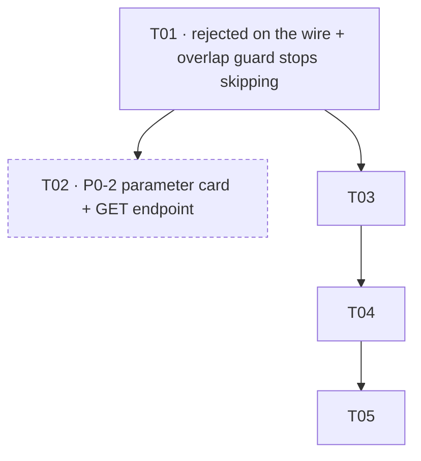
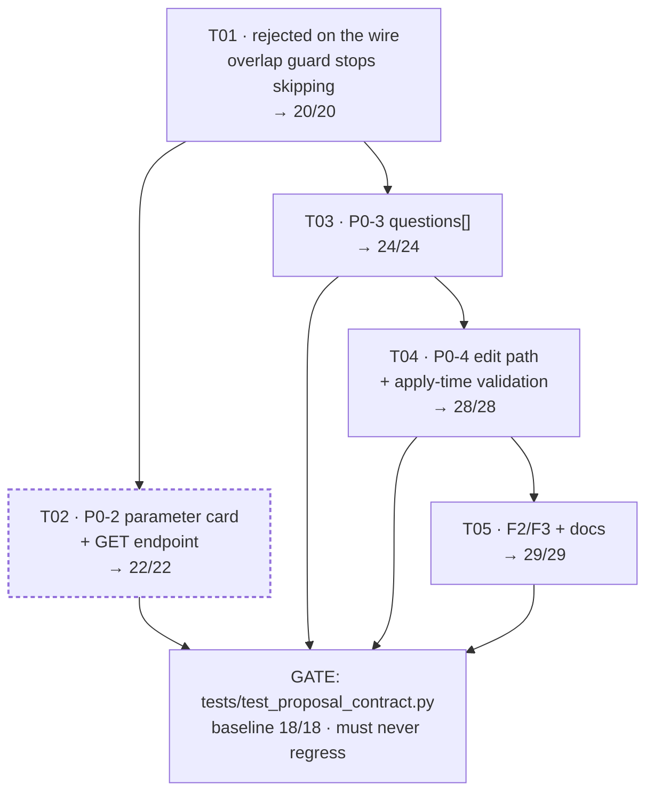

# Phase 2 DESIGN — parameter card, questions[], editable assumptions

**Author:** 高见远 (Gao), Architect · **Date:** 18 Oct 2026
**Repo:** `Hack4sdg/T1` · **Branch:** `feature/intervention-loop` · **HEAD:** `cd7a87a` (Phase 1 landed)
**Scope:** P0-2 (§2 parameter card) · P0-3 (`questions[]`) · P0-4 (editable assumptions) · Phase 1 findings 1–3
**Baseline:** `tests/test_proposal_contract.py` **18/18** · frontend `npx vitest run` **98/98** · no new deps · `scipy < 1.14`
**Target:** **29/29** backend gating suite, 98/98 frontend, frozen contract unchanged except where flagged in §7.

This is a **decision document**. No production code was written. Every line number below was read on
`cd7a87a`, not reasoned about. Where the briefing I inherited is wrong or incomplete, I say so and rule
according to what I measured.

---

## 0. Measured facts this design rests on

| # | Measurement | Value |
|---|---|---|
| M1 | `AIPlanResponse.rejected` exists in the schema | `schemas/plan.py:152`, docstring: *"a refusal is carried, never dropped"* |
| M2 | `grep -c rejected app/routers/scenes.py` | **0** — the field is never populated at any of the three return sites (`:292`, `:305`, `:325`) |
| M3 | `generate_proposals` returns `rejected` | `ai_plan.py:2336` and `:2355`, both branches |
| M4 | `apply_proposals` validation | **none.** `ai_plan.py:2402-2411` projects the client's dict onto 5 stored fields and calls `scene_service.create_plan`. No `validate_batch`. |
| M5 | `InterventionProposal.params` | `dict[str, Any]`, free-form (`schemas/intervention.py:70`) |
| M6 | ⇒ **a client can already set `params.storageDepthM` to any value today** and it is persisted verbatim, while the gate's `parameters` block said `ASSUMPTION` / "class default" | confirmed by reading M4+M5 together |
| M7 | `_area_stats` returns | `storageCapacityM3`, `imperviousShare`, `greenWaterAreaM2` (`sandbox_model.py:541-545`) — **no per-class areas, no `bare`** |
| M8 | `storage_ledger` returns | `runoffM3, unstoredM3, heatMean, greenAreaM2, pavedAreaM2` + `_area_stats` (`:575-582`) |
| M9 | `stats.delta` already carries | `storageCapacityM3`, `imperviousShare`, `greenWaterAreaM2`, `greenAreaM2`, `pavedAreaM2` (`run_service.py:737-745`) |
| M10 | `SCENARIO_PRESETS` (`temperature_field.py:66`) referenced anywhere in `app/` | **nowhere.** It is a definition with no caller. `RunRequest.temperature_c` is a raw float (`schemas/scene.py:368`) |
| M11 | `RunRequest.rainfall_mm` default | **50.0** (`schemas/scene.py:367`) — *not* `DEFAULT_RAINFALL_MM = 450.0` (`sandbox_model.py:101`). Two defaults coexist. |
| M12 | Soil group data | **none exists.** `CURVE_NUMBER_HSG_D` is a table *named* HSG D; `siting.py:67` and `INTERVENTION_EFFECTS` both say "an assumed mid value … on an HSG D soil, **not a TR-55 lookup**" |
| M13 | `TIDE_STATES` | 3 states, each with `tailwaterM` **and a `source`** (`sandbox_model.py:1613-1629`), HKO Quarry Bay citations |
| M14 | Land-cover classes | `("water","wetland","green","bare","paved","floodable","tank")` (`_overlay_common.py:40`). **No tree class** — `CN_CITATIONS["green"]` states the ESA class "aggregates tree/shrub/grassland" |
| M15 | `parameters_for_kind` provenance | `status="ASSUMPTION"`, `source="scripts/_overlay_common.STORAGE_DEPTH_M['water'] (class default), an assumption, not a survey"` (`proposal_constraints.py:569-600`) |
| M16 | `ParameterEntry` fields | `value, unit, status, source` (`intervention.py:202-213`) — **no `date`, no `confidence`, no record of the default** |
| M17 | `_split_under_cap` cap | `paving_cap = floor(MAX_INTERVENTION_COVERAGE * ov.rows * ov.cols)` (`ai_plan.py:423`) — **already data-driven** |
| M18 | the hardcoded part | `g.paving_sites.extend(paving_sites[:3])` (`ai_plan.py:450`) — a bare literal `3` |
| M19 | `parse_intent` clamps per-kind count | ≤ 3, and `generate_proposals` truncates to `max_features` (default 6) — so `3` mirrors the parser, not the cap |
| M20 | `building_footprint_mask` call sites still live | `ai_plan.py:313` (`load_grounding`), `ai_plan.py:654` (`placement_footprints`), `siting.py:152`, `make_wetgrid.py:355`, `make_project_catalog.py:520` |
| M21 | QA-measured gap the pool filter has vs the gate | **23 cells** the pool thinks free but the gate calls building; 0 the other way |
| M22 | `test_PENDING_proposals_do_not_overlap_each_other` | returns early on `len(proposals) < 2` (`tests/test_proposal_contract.py:723-725`) — a silent skip inside a green tick |
| M23 | `REASON_CODES` on this HEAD | **exactly 9 members** (verified by importing the frozenset, not by reading) — `proposal_constraints.py:71-81` |

---

## 1. P0-2 — the §2 parameter card

### 1.1 The design in one sentence

A new **`app/services/parameter_card.py`** assembles the brief's card from **values the ledger has already
computed in this same request**, and refuses to compute anything the ledger does not already compute. Where
the brief asks for a number this project does not have, the card carries a row with **no value** and a stated
reason — never an invented one.

### 1.2 Where each number already exists (the "no new arithmetic" map)

| Brief row | Assembled from | Already computed by | New arithmetic? |
|---|---|---|---|
| total site area | `cells_to_area_ha(grids.rows*grids.cols, grids.cell_area_m2)` | the same helper `proposal_constraints._size_block` uses (`:332`) | **no** |
| pond / water / wetland / tank area | `stats["baseline"]["classAreaM2"][cls]` and `["scenario"][…]` | **new key in `_area_stats`** — see R2 below | one class-mask sum, already the pattern at `:535-539` |
| green / tree area | `stats[…]["greenAreaM2"]` (already exists) + a note that `green` aggregates tree/shrub/grassland | `storage_ledger:579` | **no** |
| bare ground created | `stats["scenario"]["classAreaM2"]["bare"] − stats["baseline"][…]["bare"]` | **new key in `_area_stats`** | same class-mask sum |
| new impervious share | `stats["scenario"]["imperviousShare"] − stats["baseline"]["imperviousShare"]` | `_area_stats:543`, delta at `run_service.py:740` | **no** |
| explicit storage added (area × depth) | `round(size.cells * grids.cell_area_m2 * depth, 1)` | — | **yes, one multiply — R4 rules on it** |
| net storage capacity change | `stats["delta"]["storageCapacityM3"]` | `run_service.py:737` | **no** |
| rainfall | `ledger["rainfallMm"]` / `RunRequest.rainfall_mm` | `ledger_for_scenario:1252` | **no** |
| heat preset | `RunRequest.temperature_c` + `SCENARIO_PRESETS` lookup | `run_service.py:678` | **no** — but R5 |
| outlet level | `stats["tide"]["tailwaterM"]` + its `source` | `run_service.py:667-673` | **no** |
| soil group | **no value exists** — M12 | — | R6: report the assumption, do not fabricate |

### 1.3 Rulings

**R1 — The card is assembled from `storage_ledger`'s output, not from a second pass over the grid.**
`parameter_card.build(grids, ledger, tide_state, temperature_c, …)` takes the **already-computed** ledger
dicts as arguments. It never calls `storage_ledger` itself for numbers it could read, and never touches
`grids.land_class` directly. Consequence: the card cannot disagree with a run, because a card and a run
that disagree would require the same dict to hold two values.

**R2 — `_area_stats` gains `classAreaM2: dict[str, float]`, and nothing else.**
- **File:** `backend/app/services/sandbox_model.py`, function `_area_stats` (lines 501-545).
- **Change:** add one key, `{name: round(float((land_class == LAND_CLASSES.index(name)).sum()) * cell_area, 1)
  for name in LAND_CLASSES}`, and change the return annotation `dict[str, float]` → `dict[str, Any]`.
- **Why here and not in `parameter_card.py`:** `_area_stats`' own docstring says it exists so
  `storage_ledger` and `_ledger_from_cn` "report the *same* three extra figures" and warns that "a second
  copy of the impervious-share sum is exactly how the panel and the number would come to disagree." The
  per-class area sum belongs in that function for the same reason. Adding it there makes it flow into
  `stats["baseline"]`, `stats["scenario"]` and `GET /ledger` automatically — **one implementation, three
  consumers, zero chance of drift.**
- **It also collapses three existing sums into the one dict.** `greenAreaM2` (`:579`) and `pavedAreaM2`
  (`:580`) become `classAreaM2["green"]` / `["paved"]`. **Keep both keys** — the ledger's published shape
  is a wire contract (`test_run`, `test_ledger`, the frontend `StatsPanel` read them). Read them *from* the
  new dict so there is one computation and two published names, never two computations.
- **Regression risk is real and must be measured, not assumed:** `test_ledger` (42/42) and `test_run` (49/49)
  may assert on the ledger's key set. The engineer must run both and diff.

**R3 — The endpoint is `GET /api/scenes/{sceneId}/parameter-card`, scene-scoped, and it is a GET.**
- **Path:** `/api/scenes/{scene_id}/parameter-card` · **Method:** `GET` · **Router:** `app/routers/scenes.py`,
  placed immediately after `get_ledger` (which ends at line 610) so it sits with its sibling.
- **Query parameters:** `planId` (optional; defaults to `request_plan_id(scene_id)`, exactly as `get_ledger`
  does), `rainfallMm` (optional; defaults to `DEFAULT_RAINFALL_MM`), `temperatureC` (optional; defaults to
  `30.0`, matching `RunRequest`), `tideState` (optional; defaults to `DEFAULT_TIDE_STATE`).
- **Why GET and not POST:** the card computes nothing the user chose beyond the four inputs, it is
  idempotent, and it is a *read of a scenario*. It also keeps `test_openapi_lists_every_contract_endpoint`
  green — that test asserts the presence of listed paths, never the absence of others, so one additive GET
  cannot break it.
- **Response model:** two new Pydantic models in a new `backend/app/schemas/parameter_card.py`:
  `ParameterCardEntry` and `ParameterCard`. Both `WireModel`, camelCase aliasing, **every field defaulted**
  so the contract stays additive.
- **Every entry carries** `key, label, value: float | None, unit, status, source, date: str | None,
  confidence, note`. `value: None` is legal and means *"this project does not have this number"* — it is
  not an omission, and `test_card_states_the_things_this_project_cannot_know` pins it.

**R4 — Two storage numbers, deliberately not the same number.**
The brief's "explicit storage added (= area × depth)" and the run's `stats.delta.storageCapacityM3` are
**different quantities and the card must print both, side by side, never one labelled as the other.**

- **gross** `explicitStorageAddedM3 = round(size.cells * grids.cell_area_m2 * depth, 1)` — the brief's own
  formula, over the served cells. This *is* one multiply, and it is admissible **only because**:
  1. its `source` names it as *the brief's §2 formula*, not as a run output; and
  2. it is printed beside the net figure with a note naming the difference.
- **net** `netStorageCapacityChangeM3 = stats.delta.storageCapacityM3` — what `_area_stats` actually computes,
  and it is `(new_depth − old_depth) × area` summed over the grid, so it is **smaller** than gross whenever
  the ground gave up storage (a pond replaced by a tank), and can be **negative** in the other direction.
- **Mandatory test:** `gross ≥ net`, asserted on the real data. If that ever fails, one of the two is wrong
  and the test says which.

**R5 — The heat row reports a number, not a preset, and says the presets are unwired.**
M10: `SCENARIO_PRESETS` has no caller in `app/`. The run takes a raw `temperature_c`. So the card's heat row
carries `temperatureC` with `source` = `temperature_field.SCENARIO_PRESETS` **only if** the value matches a
preset's `offsetC` applied to `observedMeanC`; otherwise `source` says *"a raw air-temperature slider
value; the named presets in `temperature_field.SCENARIO_PRESETS` are not wired into the run"*. A card that
printed "heat preset: extreme heatwave" for `temperatureC: 30.0` would be the exact failure this project
exists to prevent.

**R6 — Soil group is reported as an assumption with no survey behind it.**
`status: "ASSUMPTION"`, `value: null`, `source: "the Curve Number table is named CURVE_NUMBER_HSG_D and the
ledger's own comments say the CN values are an assumed HSG D reading, not a TR-55 lookup
(`scripts/_overlay_common.CN_CITATIONS`, `app/services/siting.py:67`). **This project holds no soil survey;
no soil group is derived from data."`**, `confidence: "low"`.
This is the single most load-bearing provenance row on the card, because `get_ledger`'s own note says the CN
table is "the largest single lever on every number here". A card that said `soilGroup: "HSG D"` with a
`source` pointing at a Python identifier would be sourced-looking and false.

**R7 — `date` is `null` unless a real acquisition date exists; it is never today's date.**
The only date in the codebase is `temperature_field.CANONICAL_SCENE_ID = "LC08_L2SP_122044_20220903_02_T1"`
(→ `2022-09-03`), which dates the **LST scene only**. Every other entry carries `date: null` and a `note`
saying the committed raster carries no acquisition date in code. Writing `date: today` would be a
fabrication *and* would break determinism invariant 7 besides.

**R8 — `confidence` is a closed enum, not free text:** `MEASURED | DERIVED | ASSUMED | UNAVAILABLE`.
The card module owns **no numeric literals at all** except `0.0` and `1.0` in unit conversions — every value
is read from a dict this request computed or interpolated from a named module attribute. This is a
reviewable rule and `test_every_card_number_matches_the_ledger` enforces it behaviourally.

### 1.4 Wire schema (additive)

```
GET /api/scenes/{sceneId}/parameter-card?planId&rainfallMm&temperatureC&tideState
200 →
{
  "sceneId": "...", "planId": "..." | null,
  "status": "SCREENING_PARAMETER_CARD",
  "warning": "<non-empty, always>",
  "sources": { "terrain": ..., "landCover": ..., "lst": ... },
  "inputs": { "rainfallMm": 450.0, "temperatureC": 30.0, "tideState": "low" },
  "entries": [
    { "key": "siteAreaHa", "label": "Total site area", "value": 43.5, "unit": "ha",
      "status": "DERIVED", "source": "sandbox_model.load_grids() cell_area_m2 x 17316 cells",
      "date": null, "confidence": "DERIVED",
      "note": "the analysis grid extent, not a cadastral boundary" },
    { "key": "soilGroup", "label": "Soil group", "value": null, "unit": "",
      "status": "ASSUMPTION", "source": "...no soil survey exists in this project...",
      "date": null, "confidence": "UNAVAILABLE", "note": "assumed HSG D; drives every CN value" },
    { "key": "explicitStorageAddedM3", "value": 2826.0, "unit": "m3", "status": "DERIVED",
      "source": "served cells x 25.12 m2 x the storageDepthM this proposal carries (brief section 2 formula)",
      "note": "GROSS. The run's own net capacity change is netStorageCapacityChangeM3, which also credits the storage the ground gave up." }
  ]
}
```
Every field has a default ⇒ a pre-Phase-2 client parses unchanged.

---

## 2. P0-3 — `questions[]`

### 2.1 Rulings

**R8 — Per-proposal AND per-batch, one schema, discriminated by `scope`.**
- The brief's six topics split cleanly. **Location, footprint, surface replaced, usable storage depth** are
  properties of *one proposal* — a reservoir and a paving slab in the same batch have different footprints
  and different depths. **Drainage/overflow and tree cover** are properties of the *site*, not of a kind.
- Forcing all six onto every proposal would ask the same site-level question six times per row.
- So: `InterventionProposal.questions: list[ProposalQuestion]` carries `scope: "PROPOSAL"` rows;
  `AIPlanResponse.questions: list[ProposalQuestion]` carries `scope: "SITE"` rows, generated once per batch.
  One schema, one discriminator, no duplication.

**R9 — Questions are generated by code, never by the model.**
`proposal_constraints.questions_for_kind(kind, params, *, batch: list[dict]) -> list[dict]` — a **pure
function** of the kind, the params the ledger will read, and the accepted batch. Called from `_proposal_from`
(`proposal_constraints.py:1088-1112`), immediately after the existing `parameters_for_kind(kind)` call — so a
question exists for **exactly the parameters that were published** and cannot drift from them.
Invariant 5 (the model supplies an assumption, never a result) is preserved in the strong form: the model
does not even supply the *question*.

**R10 — `id` is derived from `parameter`, never from an index, a counter, or a hash of anything ordered.**
`id = parameter` for `PROPOSAL` scope, `id = "site." + parameter` for `SITE` scope. Consequence: the same
parameter always produces the same id, on any machine, in any order (invariant 7), and an answer can be
matched to its question by string equality alone — no server state, no sequence number, no timestamp.

**R11 — The six topics, each bound to the code that would consume the answer.**

| `parameter` | scope | generated when | bound to |
|---|---|---|---|
| `location` | PROPOSAL | always | `requested.centre` — the model's ask, echoed verbatim |
| `footprint` | PROPOSAL | always | `size.cells` / `geometry` — what the server actually served |
| `surfaceReplaced` | PROPOSAL | `constraints.effect == "class_change"` | `INTERVENTION_EFFECTS[kind]["to"]` |
| `usableStorageDepth` | PROPOSAL | kind in `_STORAGE_CLASS_FOR_KIND` | `parameters.storageDepthM` → `params.storageDepthM` → `apply_interventions:1481` |
| `drainageOverflow` | SITE | any accepted kind is `drainage`/`road`/`flood_storage` | the `to=None` `why` on those kinds — the model has no pipe capacity |
| `treeCover` | SITE | always | `classAreaM2["green"]`, which **has no tree class** (M14) |

**R12 — An answer is a string; the parsed number is the server's, never the client's.**
`answer: str | None` is what the planner typed. `answeredValue: float | None` is **re-parsed by the server**
and is `null` when the answer is not numeric. `status: OPEN | ANSWERED | NOT_APPLICABLE`.
A client that sends `answeredValue: 0.8` with `answer: "about 80 cm"` and gets `0.8` back has learned nothing;
a client that sends a mismatched pair gets the server's parse and can see it. **The server's parse is the
one that reaches `params`.**

**R13 — An answered question is *honoured*, not merely suppressed — and it round-trips through the request.**
- `AIPlanRequest` gains `answeredQuestions: list[AnsweredQuestion] = []` (additive, default empty; a
  pre-Phase-2 client is unaffected). `AnsweredQuestion = {id, parameter, answer}`.
- `generate_proposals(..., answered=...)` matches by `id`. A matched question is emitted with
  `status: "ANSWERED"` and, **if the answer parsed to a number within
  `MIN_STORAGE_DEPTH_M..MAX_STORAGE_DEPTH_M`, that number replaces the class default** in both
  `parameters.storageDepthM.value` and `params.storageDepthM`.
- This is the load-bearing part. A question the model asks and the server ignores is worse than no question:
  it teaches the planner that answering is pointless. **The loop closes here** — `params.storageDepthM` is
  exactly the key `apply_interventions` already reads (`sandbox_model.py:1481`).
- The answer is **not** persisted server-side. The design deliberately keeps proposal state out of the store
  (`AIPlanApplyRequest`'s docstring), so the client carries the answers forward itself. That is the same
  decision as the confirm gate's statelessness, applied consistently.
- `questionId` round-trip: `InterventionProposal.questions[]` is echoed by the client on
  `/ai-plan/apply` (the whole proposal already round-trips), so the stored feature's `params` can carry
  `answeredQuestions` for the audit trail. **This is not a new mechanism** — `apply_proposals` already copies
  `params` verbatim (M4).

**R14 — The chat card carries the questions too, but as text.**
`AnswerCard` gains `questions: list[str] = []` — **the prompt strings only**, not the structured objects.
Rationale: the chat card is a *rendering* surface with a grounding check (`agent/grounding.py`) that treats
unrecognised numbers as failures; a structured question object carries `value` fields the grounding check
would have to whitelist. Strings cannot smuggle a number. The structured form lives on the proposal, which
is where a planner edits it.

---

## 3. P0-4 — editable assumptions before confirm

### 3.1 The hole that makes this P0 rather than P1

**M6, restated because it is the most important sentence in this document.** Today `apply_proposals`
projects the client's dict onto five stored fields including `params` (M4), and `InterventionProposal.params`
is a free-form `dict[str, Any]` (M5). **A client can already put `storageDepthM: 3.5` into `params` and it is
persisted and scored — while the proposal's `parameters` block, produced by the server, said
`"ASSUMPTION" / "class default, an assumption, not a survey"`.** The served value and its provenance label
already disagree today, with no user action required. Phase 1's D2 rule is *"the constraints are code, not
prompt text"*; on the apply path they are currently not even code.

This is a **D5-class disclosure hole of exactly the kind Phase 1 was written to close**, it sits on the
P0-4 path, and it is fixed by the same work. It is why P0-4 cannot be deferred to P1.

### 3.2 Rulings

**R15 — A parameter edit does not move geometry, and the server says so.**
A depth is metres over cells that are already fixed. `size`, `constraints`, `withinSingleCap`,
`withinCumulativeCap` and `geometry.coordinates` are **byte-identical** before and after. Any implementation
that re-contours, re-clips or re-caps on a depth edit is wrong. The revalidate response carries
`geometryAffectingParameters: []` and `valuesAffectingOnly: ["parameters.storageDepthM"]` so the client
renders the distinction rather than inferring it.
What a depth edit *does* change: `explicitStorageAddedM3` (gross) and `netStorageCapacityChangeM3`. Both are
recomputed and returned so the consequence is visible **before** Apply.

**R16 — One predicate for the depth range, extracted, and read by all three callers.**
`apply_interventions` (`:1488`), `suggest._params_for` (`:235`) and the new revalidate path each
re-implement `MIN_STORAGE_DEPTH_M <= depth <= MAX_STORAGE_DEPTH_M`. Add
`def depth_is_acceptable(depth: float) -> bool` to `sandbox_model` beside the two constants (`:1136-1137`)
and make all three call it. **Refactor, not new arithmetic** — and it removes a three-way drift risk that
Phase 2 would otherwise triple.

**R17 — An edited parameter's provenance label changes shape, not just wording.**
`parameters_for_kind(kind, override: float | None = None)`:

| | unedited (today) | edited (Phase 2) |
|---|---|---|
| `status` | `ASSUMPTION` | **`USER_ASSUMPTION`** |
| `source` | `"scripts/_overlay_common.STORAGE_DEPTH_M['water'] (class default), an assumption, not a survey"` | `"a planner set this by hand in the confirm gate; the class default scripts/_overlay_common.STORAGE_DEPTH_M['water'] = 1.5 is what the run would otherwise have read, and it is NOT what this run reads"` |
| `value` | the class default | the planner's number |
| `defaultValue` | *(absent)* | **`1.5`** — the number that was replaced |
| `edited` | `false` | `true` |
| `confidence` | `ASSUMED` | `ASSUMED` (a planner's estimate is not more knowable than a class default) |

**`defaultValue` is mandatory.** Without it, the card cannot show what was overridden, and the served value
becomes unrecoverable from the record — which is the D2 defect from Phase 1 QA in a new place.
**The test asserts the negative:** for an edited entry, `"STORAGE_DEPTH_M"` must **not** appear in `source`
as the origin of `value`. `STORAGE_DEPTH_M` may appear only in the clause naming what was overridden.

**R18 — The proposal `warning` gains a sentence whenever any parameter is edited.**
`_accepted_warning` (`proposal_constraints.py:714-747`) currently ends with *"Depth is a class assumption; a
run will score it."* — **which becomes false the moment a planner sets the depth by hand.** That sentence is
emitted unconditionally today, so an edited proposal would carry a class-default claim over a
hand-set number. The edited branch replaces it with: *"usable storage depth 0.80 m was set by hand in the
confirm gate, not read from the class default (1.50 m); the run will use the hand-set value."*
This is the concrete mechanism by which the prime-suspect invariant is held.

**R19 — An edited proposal must be re-gated, and `/ai-plan/apply` must validate what it persists.**
Two changes, both required:
1. **New endpoint `POST /api/scenes/{sceneId}/ai-plan/revalidate`** — body `{instruction?, proposals[]}`,
   returns the same `AIPlanResponse` shape (proposals + rejected + status + warning). It runs
   `validate_batch` over the edited set with `claimed_cells_for(scene_id)` and returns the result. This is
   the gate's "show me what my edit did" call, and it is what makes R15's claim checkable by the client.
2. **`apply_proposals` runs `validate_batch` before `scene_service.create_plan`** and refuses to persist any
   feature that comes back rejected, returning the refusals in `rejected[]`. This closes M4/M6 at the only
   place that matters. **It is a behaviour change to an existing endpoint** and the single largest
   regression risk in Phase 2 — see §6, T04.

**R20 — An out-of-range depth is a 422, not a `reasonCode`.**
A depth of 40 m is a malformed request, not a placement refusal. `REASON_CODES` are *placement* predicates
on geometry; overloading one would make a UI group a client typo with a physical refusal.
`/ai-plan/revalidate` and `/ai-plan/apply` return **422** with a `detail` naming the parameter, the value, the
range, and the proposal's `siteId`. **`REASON_CODES` stays exactly its nine members** — verified against
`proposal_constraints.py:69-79`.

---

## 4. Phase 1 finding 1 — `rejected` never reaches the wire

**R21 — Three one-line fixes, plus one test that stops skipping.**

**The fix.** `app/routers/scenes.py`, three `AIPlanResponse.model_validate({...})` sites:

| line | branch | add |
|---|---|---|
| **292-302** | `apply=false` — the confirm gate | `"rejected": proposed.get("rejected", []),` |
| **305-311** | `apply=true`, `if not features` — **where rejections are most numerous** | `"rejected": proposed.get("rejected", []),` |
| **325-332** | `apply=true`, normal | `"rejected": proposed.get("rejected", []),` |

QA §6 measured the cost of the omission on this very data: a batch of 9 candidates returns **3 accepted /
6 rejected**, and every one of the six carries a real `reasonCode` and a written `why` — none of which
reaches the client. The user sees `features: 3` and has no way to learn six options were refused.

**Frozen contract: none.** `AIPlanResponse.rejected` already exists (`schemas/plan.py:152`) and its own
docstring already promises *"a refusal is carried, never dropped"*. This change makes the code match a
contract that was already declared. **This is the cheapest honesty fix in Phase 2 and it must land first.**

**The test that stops skipping (M22).** `test_PENDING_proposals_do_not_overlap_each_other`
(`tests/test_proposal_contract.py:715-734`) returns early when `len(proposals) < 2` and the runner prints
`PASS`. A guard that never executes is not a guard. Replace it with **two real tests** that build their own
fixtures — the rule Phase 1's own PRD §5 states: *"every guard builds its own fixture rather than relying on
store residue."*
- Drive `validate_batch` **directly** with two deliberately overlapping candidate polygons and assert the
  second is rejected `OVERLAPS_STAGED` with `overlapsWith == ["proposal#0"]`.
- Separately drive the endpoint and assert pairwise cell-set intersection is empty across whatever it
  returns — and **fail loudly if fewer than two proposals come back** rather than skipping. A skip is
  indistinguishable from a pass in this runner.

---

## 5. Phase 1 findings 2 and 3

**R22 — Unify `load_grounding` now (Phase 2); defer `siting.py` to Phase 3.**
- **Do now:** `ai_plan.py:312-313` swaps `from _overlay_common import building_footprint_mask` for
  `from app.services.proposal_constraints import building_mask`, keeping the lazy import inside the existing
  `try/except ImportError` and the `None` contract byte-for-byte (QA §2e verified the `None` path).
  **Why now:** the gate and the pool filter having two different building authorities is precisely how Phase
  1's Red 1 happened. Phase 2 already touches `ai_plan.py`, and after the swap the pool never offers
  geometry the gate will shrink — fewer surprises, and the direction is the conservative one.
  **Measured risk:** M21 — the pool filter gains 23 excluded cells. None of today's nine pool sites is
  within 23 cells of the 40-cell floor (smallest is 83), so no site should vanish — but the engineer must
  **measure** `test_grounding_pools` (15/15) and `test_project_catalog` (9/9), not assume it.
- **Defer:** `siting.py:150-152` and `ai_plan.py:652-654` (`placement_footprints`). Those are the
  catalog/suggester path with their own suites (`test_suggest` 11/11, `test_project_catalog` 9/9); widening
  the mask there moves pool membership for both and belongs in Phase 3 with its own measurement. **File it,
  do not lose it** — it is a genuine unfixed defect (a site can still be *offered* on a real building cell
  and then refused by the gate: an annoyance, not a correctness hole, because the gate now dominates).
- **Do not touch** `make_wetgrid.py:355` and `make_project_catalog.py:520`. Offline scripts, and a bbox
  envelope is the correct behaviour for render-time roof suppression.

**R23 — The `[:3]` ceiling: keep the value, name it, pin it to its real derivation. Do not make it
cap-derived.**
M17/M18: the *cap* the splitter bands against is **already data-driven**
(`floor(MAX_INTERVENTION_COVERAGE * rows * cols)`). The literal `3` is a different thing — M19: it mirrors
`parse_intent`'s per-kind clamp, i.e. **no more than 3 sites of one kind can ever be proposed regardless of
the coverage cap.** So:
- Introduce `MAX_SITES_PER_POOL = 3` in `ai_plan.py` beside `STYLE_FOR_KIND` (line 1058), with a comment
  naming `parse_intent`'s clamp as its origin.
- `g.paving_sites.extend(paving_sites[:MAX_SITES_PER_POOL])` (line 450).
- Add a test asserting `MAX_SITES_PER_POOL` equals `parse_intent`'s clamp, so the two cannot drift.
- **If a future project's `MAX_INTERVENTION_COVERAGE` differs, the answer is unchanged:** more bands may be
  produced and the top 3 by the existing total order `(-size, min_r, min_c)` are still served; fewer bands
  and the truncation is a no-op. The ceiling was never a cap-derived number, so it never needed to be one.

---

## 6. Task list (ordered by dependency) — 5 tasks

> Run the **full** backend suite after every task: `cd T1/backend && ./.venv/bin/python tests/test_x.py`.
> The tests are plain scripts; `tests/test_overlay_masking.py` has no `__main__` and a script run of it is a
> **false pass** (CI runs it under pytest — `.github/workflows/ci.yml:89-96`).

### T01 — `rejected` reaches the wire; the overlap guard actually runs
- **Files:** `backend/app/routers/scenes.py` (three `model_validate` sites: lines 292-302, 305-311, 325-332);
  `backend/tests/test_proposal_contract.py` (replace `test_PENDING_proposals_do_not_overlap_each_other`, 715-734)
- **Depends on:** — · **Priority:** P0
- **Tests that must pass:** `test_proposal_contract.py` → **20/20** (18 + `test_rejected_refusals_reach_the_wire`
  + `test_overlap_guard_refuses_the_second_and_the_accepted_stay_disjoint`), plus `test_contract.py` (its
  `test_ai_plan_apply_persists_proposals` exercises the apply branch).
- **Regression risk vs the 18/18 gate: LOW but not nil.** Adding a key to a `model_validate` dict cannot
  change `proposals[]`. **Frontend 98/98: zero risk** — no frontend file reads `rejected`, and
  `ProposalReview` is not in `frontend/src/components/` (it does not exist yet).
  **Detect:** `test_contract.py` in full, and confirm the new test is not itself skipping — print the
  accepted/rejected counts it observed and assert `rejected` is non-empty.

### T02 — P0-2: `parameter_card.py` + `GET /parameter-card`
- **Files:** `backend/app/services/parameter_card.py` (**new**); `backend/app/services/sandbox_model.py`
  (`_area_stats`, 501-545 — add `classAreaM2`, widen the annotation, re-read `greenAreaM2`/`pavedAreaM2`
  from it); `backend/app/schemas/parameter_card.py` (**new**); `backend/app/routers/scenes.py` (new GET
  after `get_ledger`, ends line 610); `contracts/openapi.json` (regenerate via `backend/app/export_openapi.py`);
  `backend/tests/test_proposal_contract.py`
- **Depends on:** T01 (same router file — sequence it to avoid a merge conflict; it is otherwise independent)
- **Tests that must pass:** `test_proposal_contract.py` → **22/22** (+ `test_every_card_number_matches_the_ledger`,
  + `test_card_states_the_things_this_project_cannot_know`); `test_ledger.py` **42/42**; `test_run.py` **49/49**;
  `test_openapi_contract.py`; `test_contract.py::test_openapi_lists_every_contract_endpoint`.
- **Regression risk vs the gate: MEDIUM — this is the highest-risk task for the *other* suites.**
  `_area_stats` is on the path of `storage_ledger`, `_ledger_from_cn`, `routed_ledger`,
  `ledger_for_scenario` and the live run. A key-set assertion anywhere will move. **The change is additive
  and the existing keys keep their values**, so a *value* assertion cannot move — only a *shape* assertion can.
  **Detect:** run `test_ledger`, `test_run`, `test_scenario` (65/65) and diff the printed ledger dicts before
  and after; any changed **value** is a bug, any new **key** is expected.
  **Frontend 98/98: zero risk** — `StatsPanel.tsx` reads the ledger's existing keys, which are unchanged.
  **Mandatory:** `contracts/openapi.json` must be regenerated or `test_openapi_contract.py` fails.

### T03 — P0-3: `questions[]`
- **Files:** `backend/app/schemas/intervention.py` (`ProposalQuestion`, `InterventionProposal.questions`,
  `InterventionProposal.from_feature`); `backend/app/schemas/plan.py` (`AIPlanResponse.questions`,
  `AIPlanRequest.answeredQuestions`, `AnsweredQuestion`); `backend/app/services/proposal_constraints.py`
  (new `questions_for_kind`; `_proposal_from` calls it; `_accepted_warning` gains the edited-parameter
  sentence from R18 — landed here because it is the same honesty surface);
  `backend/app/services/ai_plan.py` (`generate_proposals` signature + the `SITE`-scope batch pass);
  `backend/app/agent/answer.py` + `backend/app/agent/prompts.py` (chat card carries question *strings*);
  `backend/tests/test_proposal_contract.py`
- **Depends on:** T01 · **Priority:** P0
- **Tests that must pass:** `test_proposal_contract.py` → **24/24** (+ `test_every_silent_assumption_becomes_a_question`,
  + `test_an_answered_question_is_honoured_not_re_asked`); `test_agent.py`; `test_intent_routing.py` (14/14);
  `test_contract.py` (chat card shape).
- **Regression risk vs the gate: LOW.** Everything is a defaulted additive field; `questions=[]` on a
  pre-Phase-2 feature lifts cleanly, exactly as the four existing §2.2 blocks do.
  **Frontend 98/98: LOW-MEDIUM.** `AnswerCard` gains `questions: string[]` with a default; the chat card
  renderer does not have to read it. **If** the engineer renders it in `ChatPanel.tsx`, the grounding check
  must not see it as ungrounded prose — hence R14's strings-only rule. `chatApi.test.ts` asserts card shape.
  **The vocabulary pin is untouched** — no change to `app/agent/intent.py`, so
  `contracts/intent_vocabulary.json` and its TS mirror stay byte-identical.
  **Watch:** `_accepted_warning` is asserted by the two existing warning tests — the edited-parameter
  sentence must be **conditional** on an edit, or those tests move.

### T04 — P0-4: the edit path + apply-time validation
- **Files:** `backend/app/services/sandbox_model.py` (new `depth_is_acceptable` beside `:1136-1137`; make
  `apply_interventions:1488` call it); `backend/app/services/suggest.py` (`_params_for:235` calls it);
  `backend/app/services/proposal_constraints.py` (`parameters_for_kind(kind, override=None)`;
  `_finalize`/`_accepted_warning` take the override and emit the edited sentence);
  `backend/app/services/ai_plan.py` (`apply_proposals` runs `validate_batch` before `create_plan` — **the
  M6 hole**; `_proposal_from` passes the override through); `backend/app/routers/scenes.py` (new
  `POST /ai-plan/revalidate`; 422 branch on both endpoints); `backend/app/schemas/intervention.py`
  (`ParameterEntry` gains `date`/`confidence`/`defaultValue`/`edited`; new `status` member `USER_ASSUMPTION`);
  `backend/tests/test_proposal_contract.py`
- **Depends on:** **T03** (an edit is an *answer* to a `usableStorageDepth` question; T03 owns the
  `answeredQuestions` plumbing and the `parameters_for_kind` call site) · **Priority:** P0
- **Tests that must pass:** `test_proposal_contract.py` → **28/28** (+ `test_a_hand_edited_depth_changes_its_provenance_label`,
  + `test_an_edit_leaves_geometry_and_the_caps_untouched`, + `test_apply_revalidates_and_refuses_an_illegal_edited_proposal`,
  + `test_an_out_of_range_depth_is_a_422_not_a_reason_code`); `test_suggest.py` (11/11 — `depth_is_acceptable`
  refactor); `test_ledger.py` (42/42); `test_contract.py::test_ai_plan_apply_persists_proposals` — **the one
  that matters most**, since it is the existing proof that an unedited round trip still persists.
- **Regression risk vs the gate: HIGH — the highest in Phase 2, and it is deliberate.**
  Making `apply_proposals` validate is a behaviour change to a live endpoint: a proposal that
  `generate_proposals` accepted can now be refused at apply time. It should be *identical* — the geometry
  is unchanged and nothing is persisted in between — but "should be" is not "is".
  **Mitigation, mandatory:** the engineer must run the **full generate→apply round trip** for every kind and
  assert the persisted feature count is unchanged, and must diff `rejected[]` before/after across the whole
  batch. `test_contract.py::test_ai_plan_apply_persists_proposals` is exactly that test and it must stay green
  **without being edited** — if it needs an edit, the change is wrong.
  **Secondary risk:** `parameters_for_kind` gaining a parameter is source-compatible for its one caller
  (`_proposal_from`), but `test_ledger`/`test_suggest` may read `parameters` — they must see **identical
  values** for an unedited proposal.
  **Frontend 98/98: LOW** — `ParameterEntry` gains defaulted fields; no `.ts` type mirrors it today.

### T05 — F2/F3 + docs + full regression
- **Files:** `backend/app/services/ai_plan.py` (`load_grounding` mask swap at 312-313; `MAX_SITES_PER_POOL`
  beside `STYLE_FOR_KIND` at line 1058; the `[:3]` at line 450); `backend/tests/test_proposal_contract.py`
  (+ `test_load_grounding_pool_filter_is_the_gate_mask`); `backend/tests/test_grounding_pools.py`;
  `docs/DESIGN_intervention_proposals.md` (correct the now-false claim that `building_mask` is "the same
  mask `siting.py` and `placement_footprints` use" — after Phase 1 **and** T05 it is true for the proposal
  path and **false** for `siting.py`; file the residue as a Phase 3 item); `docs/STATUS.md`; `CHANGELOG.md`
- **Depends on:** T04 · **Priority:** P0
- **Tests that must pass:** `test_proposal_contract.py` → **29/29**; `test_grounding_pools.py` **15/15**;
  `test_project_catalog.py` **9/9**; `test_suggest.py` **11/11**; `test_intent_routing.py` **14/14**;
  `test_overlay_masking.py` **3/3 under pytest only**; frontend `npx vitest run` **98/98**.
- **Regression risk vs the gate: MEDIUM.** The mask swap changes candidate cell sets for every pool.
  **Detect:** print all nine pool sites' served cell counts before and after; every one must be
  **equal or smaller by at most 23** (M21) and none may fall below `MIN_SITE_CELLS`=40. The smallest today
  is 83 (reservoir_sites[2]), so no site should vanish — **measure, do not assume.**
  **Frontend 98/98: LOW.** `load_grounding` output reaches the model catalogue; `catalogApi.test.ts` and
  `receipt.test.ts` assert shapes, not pool sizes. `InterventionLegend.tsx` mirrors `STYLE_FOR_KIND`, which
  this task does not touch.

### Dependency graph



---

## 7. Frozen contract — changes proposed

**Default is "none". Two flagged exceptions, both additive.**

| Frozen thing | Change | Flag |
|---|---|---|
| `validate_proposal` / `validate_batch` signatures (§4) | **none** | — |
| `REASON_CODES` (`proposal_constraints.py:71`) | **none** — R20 puts an out-of-range depth on a 422, not a new code | — |
| `AIPlanResponse.rejected` | **none to the schema**; the field already exists and its docstring already promises this. R21 makes the router populate it | behaviour fix, contract honoured |
| `_polygon_cells` / `contour_ring` / `contour_rings` / `connected_components` signatures | **none** | — |
| `INTERVENTION_EFFECTS` key set | **none** | — |
| `_area_stats` return keys (`sandbox_model.py:541`) | ⚠️ **grows by one**: `classAreaM2`. `storage_ledger` / `ledger_for_scenario` / the live run all gain the key. All existing keys keep their **exact** values | **FLAGGED** — additive, but it is a published dict. See T02 |
| `ParameterEntry` (`schemas/intervention.py:202`) | ⚠️ **grows by four defaulted fields**: `date`, `confidence`, `defaultValue`, `edited`. And `status` gains the value `USER_ASSUMPTION` | **FLAGGED** — additive; a pre-Phase-2 client parses unchanged |
| `InterventionProposal` (`schemas/intervention.py:255`) | ⚠️ **gains `questions: list[ProposalQuestion] = []`** | **FLAGGED** — additive, defaulted |
| `AIPlanResponse` (`schemas/plan.py:127`) | ⚠️ **gains `questions: list[ProposalQuestion] = []`** | **FLAGGED** — additive, defaulted |
| `AIPlanRequest` | ⚠️ **gains `answeredQuestions: list[AnsweredQuestion] = []`** | **FLAGGED** — additive, defaulted; an old client is unaffected |
| `AnswerCard` | ⚠️ **gains `questions: list[str] = []`** (strings only, R14) | **FLAGGED** — additive, defaulted |
| `ParameterCard` / `ParameterCardEntry` | **new schemas, new GET endpoint** | additive by construction |
| `POST /ai-plan/revalidate` | **new endpoint** | additive; returns the existing `AIPlanResponse` shape |
| `POST /ai-plan/apply` behaviour | ⚠️ **now validates before persisting** (R19) | **FLAGGED — the one behavioural change to an existing endpoint.** Deliberate: it closes M6. Existing unedited round trips must be unaffected, and `test_ai_plan_apply_persists_proposals` is the proof |
| New dependencies | **none** (D7) | — |
| `contracts/intent_vocabulary.json` + TS mirror | **untouched** — no change to `app/agent/intent.py` | the 98/98 pin holds |

Nothing here requires a §2.2 amendment, and `reasonCode` never leaves the frozen set.

---

## 8. Honesty invariants — confirmation

| # | Invariant | Holds? | Note |
|---|---|---|---|
| 1 | No combined score across heat/wind/drainage | **YES** | The card is a list of independent rows. There is no `overall`, no `total`, no ordering key. `confidence` is a provenance enum, not a score — it says how well a number is known, never how good an option is |
| 2 | No pass/fail verdict | **YES** | Every gate decision still routes through `reasonCode` from the frozen set or a 422. The card cannot accept or reject anything; it has no such method |
| 3 | `status` + non-empty `warning` on every AI output | **YES** | `ParameterCard` carries both (`SCREENING_PARAMETER_CARD` + a non-empty warning). `questions[]` is additive to a shape that already has both. The revalidate endpoint returns `AIPlanResponse`, whose proposals already carry both |
| 4 | Provenance (`source`/`date`/`confidence`) on every number | **YES — this is the whole design** | R8's enum, R7's honest `date: null`, R6's soil-group refusal, R15/R17/R18's edit labelling. See the risk note |
| 5 | The model supplies an assumption, never a result; grounding is code | **YES, strengthened** | R9: the questions are generated by a **pure function in `proposal_constraints.py`**, not by the model. The model does not choose what it is asked, and never supplies a value |
| 6 | `reasonCode` inside the frozen `REASON_CODES` | **YES** | R20 routes a bad depth to a 422 precisely so no code is needed. Verified by import on this HEAD: **exactly 9 members** (M23) |
| 7 | Determinism (no `time`, no `random`, no set/dict-order ties) | **YES — with one hard rule** | R10: a question's `id` is its `parameter` name, never an index or a counter. R7: `date` is `null` or a scene id parsed from a constant — **never `datetime.now()`**. R2's `classAreaM2` iterates `LAND_CLASSES`, a **tuple**, so key order is fixed |

### Most at risk: **#4 (provenance)** — the lead's suspicion is correct, and it is worse than suspected

The prime suspect is **P0-4's provenance label**, and the mechanism is already live today (M6): a client can
put any `storageDepthM` into the free-form `params`, `apply_proposals` persists it verbatim, and the
proposal's server-produced `parameters` block goes on calling it a class default. **The hole exists before
a single line of Phase 2 is written.** R17/R18/R19 close it; the three defences are the `USER_ASSUMPTION`
status, the `defaultValue` record, and the warning sentence that replaces *"Depth is a class assumption"*
whenever an edit is present.

**Second most at risk: #4 again, on the parameter card.** The card is eleven rows of provenance, and the
failure mode is a row whose `source` names a real identifier while describing a number the code never
computed. The three rows most exposed are **soil group** (a table *named* HSG D is not a soil survey — R6),
**heat preset** (the presets have no caller — R5), and **tree cover** (the land-cover raster has no tree
class — R11). Each is pinned by `test_card_states_the_things_this_project_cannot_know`.

**Third: #7, via T04.** Apply-time validation introduces a **second** `validate_batch` call in a request
lifecycle. If anything in it is order-dependent — a set iteration, a `dict` keyed by cell — two identical
round trips could differ. Mitigation: `validate_batch`'s `owner_map` is already deterministic (QA §3c proved
the split's sort is a total order over 20,000 masks), and T04's mandatory check is a **full round trip run
twice with diffed output**.

---

## 9. New tests Phase 2 must add — 11, taking the gate 18 → **29**

All eleven live in `backend/tests/test_proposal_contract.py`. Each names its task and asserts something that
fails today.

| # | Test | Task | Asserts |
|---|---|---|---|
| 1 | `test_rejected_refusals_reach_the_wire` | T01 | Drives `/ai-plan` with `apply=false` on an instruction that yields refusals. Asserts `body["rejected"]` is **non-empty**, and that every entry has a `reasonCode` in `REASON_CODES` **and** a non-empty `warning`. Fails today: the field is always `[]` (M2) |
| 2 | `test_overlap_guard_refuses_the_second_and_the_accepted_stay_disjoint` | T01 | Builds **two deliberately overlapping** candidate polygons, drives `validate_batch` directly. Asserts the second is rejected with `reasonCode == "OVERLAPS_STAGED"` and `overlapsWith == ["proposal#0"]`; then asserts every accepted pair in the same batch is cell-disjoint. Fails today: replaced a test that **skipped** (M22) |
| 3 | `test_every_card_number_matches_the_ledger` | T02 | For **every** numeric entry on the card, recompute it through `storage_ledger` / `_area_stats` / `ledger_for_scenario` / `apply_interventions` and assert equality. Separately asserts `explicitStorageAddedM3 >= netStorageCapacityChangeM3` (R4). This is the "the card cannot disagree with a run" test |
| 4 | `test_card_states_the_things_this_project_cannot_know` | T02 | Asserts `soilGroup.value is None` and its `source` says no soil survey exists; that `treeAreaHa` is **absent** while `greenAreaM2` is present with a note naming the ESA tree/shrub/grassland aggregate; that the heat row does **not** claim a preset when `temperatureC` is a raw slider value (R5); and that **every** entry's `date` is either `null` or a date parsed from `CANONICAL_SCENE_ID` — **never today's date** (R7) |
| 5 | `test_every_silent_assumption_becomes_a_question` | T03 | For every kind in `POOL_FOR_KIND`: each of the six brief topics is either present in `questions[]` with `status == "OPEN"`, or explicitly `NOT_APPLICABLE` with a reason. Plus: **no proposal carrying an `ASSUMPTION` parameter may have an empty `questions[]`** |
| 6 | `test_an_answered_question_is_honoured_not_re_asked` | T03 | Submits `answeredQuestions` for `usableStorageDepth = 0.8`. Asserts (a) `status == "ANSWERED"`, (b) `parameters.storageDepthM.value == 0.8`, (c) `params.storageDepthM == 0.8` on the echoed proposal — **the key `apply_interventions:1481` actually reads**, (d) the question is no longer `OPEN`, (e) an **out-of-range** answer is **not** applied and the question stays `OPEN` with the range in the note |
| 7 | `test_a_hand_edited_depth_changes_its_provenance_label` | T04 | **The prime-suspect test.** For an edited entry: `status == "USER_ASSUMPTION"`, `edited is True`, `defaultValue == STORAGE_DEPTH_M["water"]`, and — the negative assertion — **`"STORAGE_DEPTH_M"` does not appear in `source` as the origin of the served value** (it may appear only in the clause naming what was overridden). For an **unedited** entry in the same response: `status == "ASSUMPTION"` and `source` **does** name `STORAGE_DEPTH_M`. Also asserts the proposal `warning` names the hand-set depth and no longer says "Depth is a class assumption" |
| 8 | `test_an_edit_leaves_geometry_and_the_caps_untouched` | T04 | Records `geometry.coordinates`, `size`, and `constraints` before a depth edit; drives `/ai-plan/revalidate`; asserts all are **byte-identical** after, and that the response's `geometryAffectingParameters == []`. Also asserts `explicitStorageAddedM3` **did** change — R15's claim in both directions |
| 9 | `test_apply_revalidates_and_refuses_an_illegal_edited_proposal` | T04 | Hand-crafts a proposal whose geometry sits on a surveyed building cell (found by reading `building_mask` directly, not by guessing) with a **valid** edited depth. Posts it to `/ai-plan/apply`. Asserts it is **not persisted** and that `rejected[]` carries `reasonCode == "BUILDING_OVERLAP"`. **This is the M6 regression test** — it fails today, because apply persists whatever it is given |
| 10 | `test_an_out_of_range_depth_is_a_422_not_a_reason_code` | T04 | Posts `storageDepthM = 40`. Asserts HTTP **422**, that `detail` names the parameter and the `0.05–10 m` range, and that **`REASON_CODES` still has exactly its nine members**. The last clause is what stops this being "fixed" by growing the frozen set |
| 11 | `test_load_grounding_pool_filter_is_the_gate_mask` | T05 | Asserts `load_grounding`'s internal occupied mask equals `proposal_constraints.building_mask(ov)` **cell for cell**, and that both pools' site counts are unchanged. This is the F2 unification test and the anti-drift pin |

---

## 10. Task dependency graph



---

## 11. Residual risks I am not ruling away

1. **T04 changes a live endpoint.** `/ai-plan/apply` begins refusing things it used to persist. That is the
   point (M6), but it is the one place Phase 2 can break a working demo. Mitigation is T04's mandatory
   full-round-trip diff; if `test_ai_plan_apply_persists_proposals` needs editing to pass, **the change is
   wrong, not the test.**
2. **`_area_stats` is on five callers' path.** Additive by construction, but a shape assertion anywhere in
   `test_ledger` / `test_run` / `test_scenario` will move. Measured by diffing the printed dicts.
3. **The pool-mask unification is a behaviour change on 23 cells.** Smallest current site is 83 cells, floor
   is 40, so nothing should vanish — but "should" is not a measurement, and T05 must print all nine.
4. **`siting.py:150` still leaks the same 23 cells** after T05. Genuinely unfixed; safe because the gate now
   dominates and refuses such a site. **File it as a Phase 3 item in `docs/TODO_remaining.md` (P1-4 area) so
   it cannot be lost.**
5. **The two rainfall defaults coexist** (M11: `RunRequest` 50.0 vs `DEFAULT_RAINFALL_MM` 450.0). The card
   must quote whichever the request used and say so. **Do not unify them in Phase 2** — it would move
   published run numbers and deserves its own decision.
6. **Nine questions is a lot of UI.** The client will want to collapse them. That is a Phase 3/4 concern;
   what matters here is that the server emits them all and the client is free to render fewer.
7. **`questions[]` on `AnswerCard` touches the grounding check.** If a model echoes a question string
   containing a number, `agent/grounding.py` may flag it. R14's strings-only rule is the mitigation; the
   engineer must run `test_agent.py` and `test_llm_provider.py` before assuming it is fine.