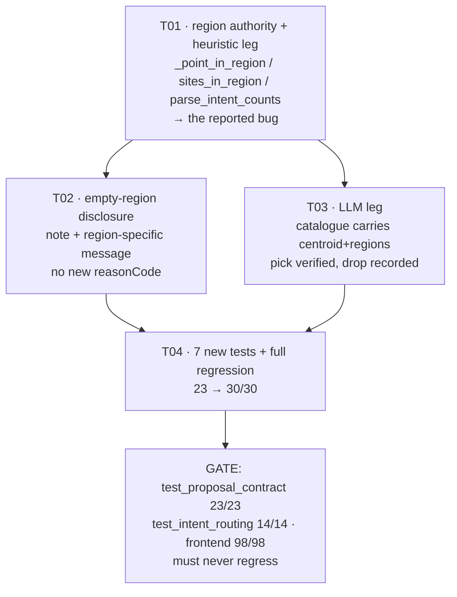

# Phase 3 RULING — the requested region is ignored in site selection

**Author:** 高见远 (Gao), Architect · **Date:** 19 Oct 2026
**Repo:** `Hack4sdg/T1` · **Branch:** `main` · **HEAD:** `f596ad2`
**Baseline:** `tests/test_proposal_contract.py` **23/23** · `tests/test_intent_routing.py` **14/14** · frontend **98/98**
**Target:** 23 → **30/30**; 14/14 and 98/98 unchanged; no new deps; no new `reasonCode`.

This is a **decision document**. No production code was written. Every number below was measured on this HEAD
by running the code, not reasoned about. Where the briefing I inherited is wrong, I say so and rule
according to the measurement.

---

## 0. Measured facts this ruling rests on

### 0.1 The bug, confirmed at the source

| # | Measurement | Value |
|---|---|---|
| M1 | `parse_intent` signature (`ai_plan.py:1081-1101`) | `list[tuple[str, int]]` — **`(kind, count)`; the region is never read** |
| M2 | `HeuristicProvider.propose` (`ai_plan.py:1354-1373`) | `for site in sites[:count]` (`:1368`) — the first N, region never consulted |
| M3 | Count default (`ai_plan.py:1099`) | `… next((v for w, v in words.items() if w in window), 1)` — **and `words` contains `"a ": 1`, so the indefinite article is read as a count of 1** |
| M4 | `HeuristicProvider.propose("add a water reservoir in the <region>")` × 5 regions | **1 feature, the identical site, every time** — reproduced; matches the owner's report |
| M5 | `build_prompt` catalogue entry (`ai_plan.py:1643-1651`) | `{site_id, intervention_type, area_ha, evidence, metrics}` — **no centroid, no region, no coordinates of any kind** |
| M6 | `_match_region` (`ai_plan.py:715-726`) | exists, deterministic, returns a region code from 10 synonyms; already the single authority — `agent/intent.py:33` imports it |
| M7 | `parse_intervention_intent` (`agent/intent.py:164`) | already parses the region and returns a normalised hint — but it is a *routing* function; it does not place anything |

**M5 is the finding that changes the LLM-leg ruling.** The model is asked to "choose from the supplied site
ids" while being shown nine sites and **told nothing about where any of them is**. It is not disobeying a
region instruction it can see — it is structurally unable to obey one, so it picks the first/largest and
**confabulates a region into the rationale**. That is a grounding gap on our side, not a model failure, and
the fix is to put the fact in the prompt rather than to filter the model's guess afterwards.

### 0.2 The data supports region filtering (measured, not assumed)

Study-area bounds `(113.9922, 22.4310, 113.9994, 22.4363)`. Region membership below is **centroid-in-rectangle**
against `REGION_FRACTIONS` (`ai_plan.py:683-694`), normalised to the bbox.

| Pool site | centroid fraction (x, y) | `areaHa` | regions containing its **centroid** |
|---|---|---|---|
| `reservoir#0` | (0.59, 0.72) | 4.7 | north, east, **centre** |
| `reservoir#1` | (0.10, 0.82) | 1.2 | north, west |
| `reservoir#2` | (0.36, 0.77) | 0.2 | north, west |
| `green#0` | (0.53, 0.53) | 0.6 | north, east, **centre** |
| `green#1` | (0.60, 0.06) | 0.4 | **south**, east |
| `green#2` | (0.34, 0.74) | 0.3 | north, west, **centre** |
| `paving#0` | (0.65, 0.70) | 9.0 | north, east, **centre** |
| `paving#1` | (0.07, 0.68) | 1.6 | north, west |
| `paving#2` | (0.28, 0.17) | 4.6 | **south**, west |

Two consequences the ruling must respect:

- **The regions overlap** (they are rectangles over one bbox, not a partition). A site legitimately lies in
  several. "In the north" therefore means *"whose centroid is in the northern half"*, not *"uniquely
  northern"*. This must be stated on the wire, not implied.
- **`water_reservoir` has no candidate in the south.** All three reservoir centroids are at y ≥ 0.72. So the
  empty-region case is not hypothetical — it is reachable from the demo's own instruction vocabulary, and it
  is the case most likely to produce a fabricated site if handled carelessly.

### 0.3 Overlap is not a reason to offer fewer sites

Pairwise cell overlap (`_polygon_cells`, real grids):

| Pair | shared cells |
|---|---|
| any two sites **within one pool** | **0** (all nine pairs — the pools are disjoint by construction) |
| `reservoir#0` ∩ `paving#0` | 1,226 |
| `reservoir#1` ∩ `paving#1` | 352 |
| `reservoir#0` ∩ `green#0` | 177 |
| `reservoir#0` ∩ `paving#2` | 107 |
| `reservoir#1` ∩ `green#1` | 80 |
| `reservoir#2` ∩ `green#2` | 68 |
| all `green × paving` | 0 |

Within-pool disjointness is what makes "offer the whole region" safe: two candidates of the same kind can
never collide with each other, so offering three reservoir candidates cannot manufacture an
`OVERLAPS_STAGED` refusal *among themselves*. Cross-kind collisions exist and are **correct** — the batch
guard refuses the later one and says whose ground it was.

---

## 1. RULING 1 — Region semantics: **filter**, never rank

**A site is eligible for a requested region iff its centroid lies inside that region's rectangle. If no
candidate of the kind is eligible, return nothing for that kind, with a stated reason. Never return a site
from outside the requested region, however labelled.**

### Why filter and not "rank by distance, label the mismatch"

The alternative — always return something, ranked by distance to the region, labelled *"not actually in the
north"* — is rejected for three reasons, the first of which is that **this codebase has already ruled on
exactly this question**:

1. **Precedent, already in the code and already justified.** `resolve_scope` (`ai_plan.py:741`) resolves a
   named scope to a real polygon and returns **`None`** for anything it cannot honour. Its docstring is
   explicit: *"Returning None for anything unrecognised is deliberate. The alternative — falling back to
   'all' — is the exact bug this function exists to remove: a scoped request would then be answered with an
   unscoped edit."* A region filter that "falls back" to an out-of-region site is that same bug wearing a
   label. Consistency here is not style — the two paths answer the same kind of question and must give the
   same kind of answer.
2. **The PRD forbids it outright.** `PRD_proposals.md` §4, *Must never show*: *"a re-sited proposal presented
   as the one that was asked for."* A row whose geometry is in the south cannot be presented as the answer to
   "in the north", and the label does not fix it — the geometry is what gets applied and scored.
3. **The label would have to be louder than the row.** For the label to be honest it must say the site is
   outside the requested region, that it is the nearest candidate, and what "nearest" means. At that point
   the user is reading a paragraph to learn that their request was not honoured — where "no candidate in the
   south" is one short sentence and is *true*. The disclose-everything instinct is right in general and wrong
   here: this is not a number with a caveat, it is an answer to a different question.

### Why centroid, not extent

A site's **centroid** decides membership (M0.2), not whether its polygon overlaps the region.

- Extent-based membership is degenerate on this data and would reproduce the bug. `reservoir#0`'s ring spans
  **x ∈ [0.34, 1.00], y ∈ [0.00, 1.00]** — the outer two-thirds of the scene in *both* axes. An
  "overlaps the region" test would put that one site in **every** region, and "add a water reservoir in the
  <anywhere>" would again return the identical geometry. Measured, not hypothesised.
- The centroid is already the site's published identity: `site()` (`ai_plan.py:225-249`) computes it, and
  `_feature` (`ai_plan.py:1025-1051`) already publishes it as `params.siteCentroid`. Membership therefore adds
  **no new number about a site** — it reads one the site already carries.
- It is a single point, so the predicate is total, order-free, and cheap: no ring-vs-ring geometry, no new
  dependency (D7), no second opinion about where a site is.

**Boundary rule:** the rectangle test is **inclusive** (`w ≤ fx ≤ e and s ≤ fy ≤ n`). Inclusive is the safe
direction for a filter: at a seam a candidate is offered rather than hidden, so the rule can never silently
empty a pool that has a legitimate candidate. `"all"` short-circuits to "every site", so an unscoped
instruction is unchanged.

### The empty-region case, and why it carries no `reasonCode`

When the filter yields nothing for a kind, the response must say so. **It does not become a
`rejected[]` entry.**

- `rejected[]` is defined (`schemas/intervention.py`, `ProposalRejection`) as *"the refusals that did not
  survive the constraint engine"* — it carries `reasonCode`, `buildingOverlapCells`, `overlapCells`. Those are
  **constraint** facts. "There is no reservoir in the south" is not a constraint failure; there was never a
  candidate to constrain. Filing it under the closed constraint vocabulary would make two different physical
  facts indistinguishable to a client grouping refusals by code — the exact defect the closed set exists to
  prevent.
- The established channel for "the pool is empty" is the **note**, and it already exists:
  `load_grounding` appends *"no wetgrid_hsk.npy; run scripts/make_wetgrid.py"* and
  `generate_proposals` (`ai_plan.py:2333-2351`) already returns a `message` beginning *"Nothing could be
  placed: …"*. The empty-region case belongs in both, with text that names the region **and where the kind
  does have candidates** — so the answer is actionable rather than merely negative.
- Consequence: **`REASON_CODES` stays at its nine members.** No §2.2 amendment, no client vocabulary change.

If the lead prefers a machine-readable refusal here, the only honest route is a new code
(`NO_CANDIDATE_IN_REGION`) — an explicit growth of the frozen set. **I do not recommend it**, and this ruling
does not require it.

---

## 2. RULING 2 — How many, and in what order

**The region narrows the pool first. The count is applied to the narrowed pool. A count is only "stated" when
the user gives a number; when none is stated, offer every eligible candidate in the region.**

### 2.1 Region narrows, then count — not the other way round

This order is load-bearing and is not a preference. Measured on the real pools:

| Instruction | narrow-then-cap (ruled) | cap-then-narrow (rejected) |
|---|---|---|
| "add two water reservoirs in the west" | west = {#1, #2} → **2** ✔ | first two overall = {#0, #1} → west → **1** ✘ |
| "add a water reservoir in the south" | south = {} → **0, with a reason** ✔ | first one = {#0} → south → **0**, but for the wrong reason ✘ |

Cap-first answers a question the user did not ask and then reports the shortfall as if the region were
empty. Narrow-first is the only order that answers "two reservoirs **in the west**".

### 2.2 Counting: the indefinite article is not a count

M3: `parse_intent`'s `words` maps `"a "` and `"an "` to `1`. That conflates two different statements:

- *"add **a** water reservoir"* — names **what** is wanted. It is not a quantity.
- *"add **two** water reservoirs"* / *"add **3** …"* — states a quantity.

**Ruling:** only a numeral or a quantity word (`one…five`, `several`, `some`) counts as stated. `a`/`an` do
not. When no count is stated, the offer is **every eligible candidate in the region**, bounded by the pool's
own ceiling (3 — `ai_plan.py:355, 391, 450`) and by `max_features`.

### 2.3 Why "all in region" and not 1

The confirm gate is a **checklist the user selects from** — the owner's own complaint is *"not new individual
proposals"*. A single row per kind cannot be a checklist, and with one row per kind the *only* thing a
different region can change is which single site appears — which is why the two halves of this bug were
reported together. Offering the region's candidates makes the gate do its job and is the smallest change that
answers the complaint: measured, "add a water reservoir in the north" goes from **1** site to **3 distinct**
sites (3,596 / 649 / 1,836-cell-class candidates across the pool), and "add permeable paving in the north"
from 1 to 2.

Two guard-rails, both mandatory:

- **An explicit count still caps.** "add two water reservoirs in the west" returns exactly two. A stated
  number is a user instruction and is never inflated to fill a checklist.
- **Every row is a candidate, never a commitment.** The proposal `warning` must say how many candidates the
  region produced and that none is applied until accepted. The gate has always worked this way
  (`apply=false` persists nothing); this ruling makes the count visible.

### 2.4 Ordering within the narrowed pool — preserve pool order, never sort by region

Candidates keep the pool's existing order (largest-first, `_components_cells` is largest-first and stable).
**Do not sort by distance to the region centre.** Such a sort introduces a new floating-point key with real
ties (two sites equidistant), and the tie-break would fall back on list order — which is exactly the
"whatever the set gave" class of nondeterminism this project forbids. Pool order is already deterministic and
already means something (size rank), so it is both the safe and the honest choice.

---

## 3. RULING 3 — The LLM leg: fix the prompt, then verify the pick

The LLM leg is worse than the heuristic leg today because it **confabulates a justification** for a choice it
had no information to make. Both halves are ruled on.

### 3.1 Give the model the fact: the catalogue must carry where each site is

**M5: the catalogue carries no spatial information at all.** The model is asked to honour "in the north"
while being shown `{site_id, intervention_type, area_ha, evidence, metrics}`. It cannot.

**Ruling:** every catalogue entry gains **`centroid: [lon, lat]`** and **`regions: [...]`** — the region codes
containing that centroid, computed by the same predicate the filter uses (one authority, §4).

- `regions` is what makes the instruction's own words matchable: the user says "north", the entry says
  `"regions": ["north", "east", "centre"]`. No geometry for the model to do, no distance for it to invent.
- `centroid` is the number the membership is derived from, so the entry is auditable against the pool and the
  model's rationale can be true rather than plausible.
- **Provenance:** both are read from `site["centroid"]` — a value the site already carries (§1). The entry
  states *where the site is*; it claims nothing new.

### 3.2 Narrow the catalogue too, and short-circuit an empty region before paying for a call

**Ruling:** when the instruction names a region, the catalogue offered to the model contains **only eligible
sites**. Two reasons:

- Same reason as §3.1, one level stronger: the model cannot pick a site it was not shown. This is the module's
  own stated design move — *"Hallucinated geometry becomes structurally impossible rather than filtered"*
  (`ai_plan.py:~1385`) — applied to *region* instead of coordinates.
- The selection is then a choice among legal answers, which is the one thing the design says language models
  are reliable at.

**And if the region yields no candidate for the requested kind(s), refuse without calling the provider.**
Measured, that case is reachable ("add a water reservoir in the south"). Calling a model with an empty
candidate list and a region instruction is an invitation to invent a site, and it costs a rate-limited call
to do it. Refuse up front with the §1 note.

### 3.3 What the server does with an out-of-region pick: **drop it, and record the drop**

**Ruling: reject, do not accept-and-label.** A model selection whose site is not in the requested region is
dropped, and the drop is **recorded in `grounding.notes`** so it reaches the client as `groundingNotes`.

- **Why reject rather than accept-and-label.** Accepting serves geometry the user did not ask for, and — the
  decisive part — it serves it *with the model's confident rationale attached*. A wrong pick under a
  confabulated justification is strictly worse than the heuristic's silent wrong pick, because it looks
  evidenced. The owner reported both halves of this and the confabulation is the half that can mislead a
  planner.
- **Why record rather than drop silently.** The server-side guarantee is that no ungrounded selection is
  served (existing behaviour: `_materialise` drops *"an id we did not offer"*). But a **silent** drop is the
  D5 failure — a shorter list that looks exhaustive. So the drop is named: which candidate, which region was
  asked for, that it was not served. This reuses the existing note channel; **no new `reasonCode`**, for the
  reason in §1.
- **Two guards, deliberately.** Narrowing the catalogue (§3.2) *prevents* the pick; the `_materialise` check
  (this section) *detects* it if it happens anyway (a stale prompt, a provider that ignores the schema, a
  future third provider). Prevention without detection would be a claim we cannot test; detection without
  prevention would leave us paying for confabulations.

### 3.4 The rationale is never evidence

Already true and must stay true: the model's `rationale` is prose carried in `params.rationale`; `basis`
comes from `site["evidence"]`, which is **code-owned**. This ruling does not change that division. It removes
the *cause* of the false rationales (M5) rather than trying to detect false prose after the fact — we cannot
police a sentence, but we can stop inviting the lie.

---

## 4. The one new authority (and the one the briefing got slightly wrong)

**Ruling — one predicate, used by every path:**

```
_point_in_region(lon, lat, bounds, region) -> bool     # inclusive rectangle test
sites_in_region(pool, region, bounds) -> list[(index, site)]   # preserves original indices
```

`sites_in_region` **must keep each site's original pool index**, because `site_id` is `f"{kind}#{i}"` over
`enumerate(pool)`, and both `_materialise` (`ai_plan.py:1727`, `:1880`) and `resolve_scope` (`ai_plan.py:741`)
resolve an id by indexing the **full** pool. Renumbering the narrowed list would silently re-point every id.
The narrowed list is a *view* over the pool, never a replacement for it.

**Correction to the brief.** The brief says to reuse `parse_intervention_intent`. That function lives in
`app/agent/intent.py:164` and returns a **normalised hint string**, not a region code — and it imports from
`app.services.ai_plan` (`intent.py:33`), so importing it back from `ai_plan` would be a **circular import**.

**Ruling: reuse `ai_plan._match_region`** (`ai_plan.py:715`), which is the *same function*
`parse_intervention_intent` itself calls (`intent.py:185`). One region authority, no cycle, no
string-round-trip. `agent/intent.py` is **not modified by this work** — its routing behaviour is correct and
its 14/14 must not move.

---

## 5. RULING 4 — Determinism

The same instruction twice must return the identical site, and it currently does. The fix must not break it.

| Rule | Why |
|---|---|
| Membership is a **pure function** of `(centroid, bounds, REGION_FRACTIONS)` | No clock, no RNG, no state |
| Filter is a **list comprehension over an ordered list** | Never iterate a `set`/`dict` to build or order candidates |
| Order is **pool order**, unchanged | Ranking by a float distance would tie and fall back on iteration order |
| `_match_region` unchanged | Already deterministic: first matching synonym in a literal dict |
| `"all"` short-circuits | An unscoped instruction keeps today's exact code path |
| No new `time` / `random` / `datetime` anywhere in the change | Project invariant 7 |

**Mandatory test:** the same instruction driven 3× must produce byte-identical `site_id`s and `geometry`
(§7, T04 test 5). A filter is so nearly order-free that this looks like a formality; it is not — the failure
mode it guards against (sorting by distance, then tying) is the natural way to write this and is invisible
without the test.

---

## 6. RULING 5 — Regression risk and frozen contract

### 6.1 Frozen contract: **none**

| Frozen thing | Change |
|---|---|
| `REASON_CODES` (`proposal_constraints.py:71-81`, nine members) | **none** — §1 rules the empty-region case out of `rejected[]` |
| `validate_proposal` / `validate_batch` signatures | **none** |
| `AIPlanResponse` / `InterventionProposal` / `ProposalRejection` fields | **none** — the refusal travels in `message` + `groundingNotes`, both already declared |
| `_match_region` / `REGION_FRACTIONS` / `REGION_SYNONYMS` | **none** — read, not changed |
| `resolve_scope` / `_fraction_ring` | **none** |
| `parse_intent(instruction) -> list[tuple[str,int]]` | **none** — kept exactly, because `test_ai_plan.py:233-242` pins it. A *new* function carries the richer view |
| `POOL_FOR_KIND` / `STYLE_FOR_KIND` / `load_grounding` pools | **none** — the pools are not touched; only *selection* becomes region-aware |
| `contracts/openapi.json` | **no regeneration needed** — `params` is a free-form dict; no schema moves |
| New dependencies | **none** (D7) |

`params` gains one optional key, `region` (§6.3). That is inside a free-form dict with a default, so no wire
schema, no client type, and no contract test moves.

### 6.2 Tests that must change, and tests that must not

**Must NOT change — if any of these needs an edit, the change is wrong:**
- `tests/test_intent_routing.py` (14/14) — `agent/intent.py` is untouched.
- `tests/test_ai_plan.py::test_intent_parsing_reads_counts` — `parse_intent`'s contract is preserved.
- `tests/test_ai_plan.py::test_vague_instruction_invents_nothing` — `"make it nicer" → []` is unaffected (no
  kind, so no pool, so no region to honour).
- `tests/test_ai_plan.py::test_llm_choices_become_real_grounded_geometry` — the LLM leg's count comes from the
  recorded transport, not from a default; `len(out) == 1` still holds.
- `tests/test_grounding_pools.py` — pools are unchanged.

**Must be re-run and is expected to stay green, but watch these five** (all in `test_proposal_contract.py`):

| Test | Line | Why it is exposed | Expected |
|---|---|---|---|
| `test_every_proposal_kind_round_trips_through_ai_plan` | 301 | Uses north/centre for all five kinds. Measured: reservoir-north = 3, green-centre = 2, paving-north = 2, drainage(→reservoir)-north = 3, road(→paving)-north = 2 — **all non-empty** | green |
| `test_rejected_refusals_reach_the_wire` | 871 | Needs ≥1 refusal from "add a water reservoir and green space in the centre". Measured: `reservoir#0 ∩ green#0 = 177` cells, so the narrower region still produces the collision | green |
| `test_PENDING_proposals_respect_the_coverage_cap` | 650 | Now checks more proposals per instruction; each is measured individually against 25% (paving#0 = 20.8% is the binding one) | green |
| `test_PENDING_proposals_avoid_existing_buildings` | 691 | More rows, each checked; pools are building-free by construction, and the gate's clip guard is unchanged | green |
| `test_heuristic_proposal_set_moves_the_ledger` | 604 | Applies a larger set; needs ≥1 confirmed set to move the ledger. Cumulative for paving-north = 24.5% < 40% | green |

**The one genuine unknown** is whether any of those five asserts an implicit *count* rather than a property.
I read all five and none does — each asserts a property (`non-empty`, `no overlap`, `moved`, `≤ cap`). But
this is the single thing to re-measure first, because it is the only place a count change could surface.

### 6.3 Provenance of the region itself (one optional addition)

**Ruling:** each served feature gains `params["region"] = <region code>` (`"all"` when unscoped), and the
`evidence`/`basis` string keeps its existing text **plus** the region the candidate was selected for.

Why: the geometry is now a function of the region, so the region is part of what the number *means*. Without
it, two proposals served for different regions are indistinguishable in the stored record, and the record
cannot be audited against the instruction that produced it. It is one string key in a dict that already takes
free-form keys — the cheapest possible provenance for a genuinely new input.

---

## 7. Task list (ordered by dependency)

Three implementation tasks and one verification task. **Run the full backend suite after every task.**

```
cd T1/backend && ./.venv/bin/python tests/test_proposal_contract.py
cd T1/backend && ./.venv/bin/python tests/test_intent_routing.py
cd T1/backend && ./.venv/bin/python tests/test_ai_plan.py
```
(`test_overlay_masking.py` has no `__main__` — a script run is a **false pass**; CI runs it under pytest.)

### T01 — The region authority + the heuristic leg *(the owner's reported bug)*
- **Files:** `backend/app/services/ai_plan.py`
- **Functions and lines:**
  - **new** `_point_in_region(lon, lat, bounds, region) -> bool` — place beside `_match_region` (line 715).
  - **new** `sites_in_region(sites, region, bounds) -> list[tuple[int, dict]]` — preserves original indices (§4).
  - **extract** the count logic out of `parse_intent` (lines 1091-1101) into `_stated_count(text, alias) -> int | None`, returning `None` for an unstated count and **not** treating `"a "`/`"an "` as a count (§2.2).
  - `parse_intent` (1081-1101) becomes a **wrapper** over `_stated_count` that maps `None → 1`. Its signature and return type are unchanged.
  - **new** `parse_intent_counts(instruction) -> list[tuple[str, int | None]]` — same scan, `None` preserved.
  - `HeuristicProvider.propose` (1354-1373): resolve `region = _match_region(instruction) or "all"` **once**, narrow via `sites_in_region` **then** cap with the count (`count if count is not None else len(eligible)`).
- **Depends on:** —
- **Goes green:** the reported bug (`M4`) — five regions now return five different geometries, or none with a reason.
- **Regression risk:** the heuristic path only. **Detect:** `test_ai_plan.py` in full, then
  `test_proposal_contract.py` (watching the five in §6.2).
- **Priority:** P0

### T02 — The empty-region disclosure
- **Files:** `backend/app/services/ai_plan.py`
- **Functions and lines:** `generate_proposals` empty branch (2333-2351) and the note it appends; the
  `grounding.notes` line in `load_grounding`'s caller.
- **Change:** when a named region yields no eligible candidate for a requested kind, append a note naming
  **the region** and **which regions do contain that kind**, and make the `message` region-specific rather
  than the current generic *"Nothing could be placed …"*. No `rejected[]` entry (§1), no new code.
- **Depends on:** T01
- **Goes green:** the "add a water reservoir in the south" case — reachable (M0.2), and today it would return a
  northern site.
- **Regression risk:** the `message` is asserted nowhere today; the note is additive. **Detect:** the
  non-empty-`message` assertion in T04 test 3.
- **Priority:** P0

### T03 — The LLM leg: catalogue carries the region; the pick is verified
- **Files:** `backend/app/services/ai_plan.py`
- **Functions and lines:**
  - `build_prompt` catalogue build (1640-1651): add `centroid` and `regions` to each entry, and **narrow the
    catalogue** to the requested region when one is named.
  - `build_prompt` / its caller: short-circuit before the provider call when the narrowed pool is empty (§3.2).
  - `LLMProvider._materialise` (1727) and `OpenAICompatProvider._materialise` (1880): after resolving a site,
    verify its centroid is in the requested region; if not, drop it and append the drop to `grounding.notes`.
  - `_feature` (1025-1051): add `params["region"]` (§6.3).
- **Depends on:** T01 (uses `_point_in_region` / `sites_in_region`; one predicate, §4)
- **Goes green:** the confabulated-rationale half of the report — the model is no longer asked to choose without
  spatial information, and a wrong pick cannot be served.
- **Regression risk:** `build_prompt`'s payload shape is asserted in `test_ai_plan.py` (the catalogue/site-id
  tests around lines 100-180). Added keys must not break the "site ids are selection handles" assertion.
  **Detect:** `test_ai_plan.py` in full, plus T04 tests 6-7.
- **Priority:** P0

### T04 — Tests, then full regression
- **Files:** `backend/tests/test_proposal_contract.py` (new tests), `backend/tests/test_ai_plan.py` (if a
  catalogue-shape assertion needs the new keys named).
- **Depends on:** T01, T02, T03
- **Goes green:** gating suite **23 → 30/30**.
- **Regression risk:** this task touches only tests, but it is where a wrong ruling shows up. Run
  `test_proposal_contract`, `test_intent_routing`, `test_ai_plan`, `test_grounding_pools`, `test_run`,
  `test_scenario`, `test_ledger`, and the frontend `npx vitest run`.
- **Priority:** P0

### Dependency graph



---

## 8. New tests Phase 3 must add — 7, taking the gate 23 → **30**

All in `backend/tests/test_proposal_contract.py` unless noted. Each names the ruling it pins.

| # | Test | Rule | Asserts |
|---|---|---|---|
| 1 | `test_a_named_region_is_honoured_by_site_selection` | R1 | For each of north/south/east/west/centre: drive `_propose` and **independently recompute** each proposal's centroid membership against `REGION_FRACTIONS`; assert every served proposal's centroid is inside the requested region. Fails today: all five regions return the same geometry (M4) |
| 2 | `test_different_regions_select_different_sites` | R1 | The owner's bug, stated directly. Collect the served `site_id`/geometry hash per region; assert the non-empty regions do **not** all collapse to one geometry. (Measured target: reservoir gives north = 3 sites, east = 1, west = 2, centre = 1 — not all identical) |
| 3 | `test_a_region_with_no_candidate_refuses_and_names_where_candidates_are` | R2 + T02 | "add a water reservoir in the south" → **0 proposals**, `features == 0`, **non-empty `message`** naming the region, and a `groundingNotes` entry naming the regions that *do* hold reservoir candidates. Asserts no site was substituted and `rejected` stayed empty (no constraint refusal was fabricated) |
| 4 | `test_a_stated_count_caps_but_the_region_narrows_first` | R2 | "add two water reservoirs in the west" → **exactly 2**, and both centroids in the west. The measured contrast: cap-first would give 1. Also asserts an unstated count ("add a water reservoir in the north") offers the region's candidates, and that the warning says none is applied until accepted |
| 5 | `test_region_selection_is_deterministic` | R4 | Same instruction 3× → byte-identical `site_id`s and `geometry` coordinates. Guards the distance-sort failure mode |
| 6 | `test_the_model_catalogue_carries_where_each_site_is` | R3.1 + R3.2 | Inspect `build_prompt`'s payload: every `candidate_sites` entry has `centroid` **and** `regions`; every listed `site_id` resolves into the pool; and for a named region, the listed ids are **exactly** the eligible set. Fails today: entries carry neither key (M5) |
| 7 | `test_an_out_of_region_model_pick_is_dropped_and_recorded` | R3.3 | Drive `LLMProvider` with a recorded transport returning an in-pool site that is **outside** the requested region. Assert: it is **not** served, and a `groundingNotes` entry names the dropped candidate and the region asked for. Complements `test_llm_cannot_invent_a_site_id`, which covers ids we never offered |

**Also add one pinned-context assertion** to `tests/test_intent_routing.py` (not counted in the 30): the
existing 14/14 already covers `parse_intervention_intent`; no new test is needed there, and **none of its
existing assertions may change**.

---

## 9. Honesty invariants — confirmation

| # | Invariant | Holds? | Note |
|---|---|---|---|
| 1 | No combined score across heat/wind/drainage | **YES** | This change selects *where*, never *which is better*. Nothing ranks sites across axes; within a pool the order is size rank, which is not a score |
| 2 | No pass/fail verdict | **YES** | A region with no candidate is a stated fact ("no reservoir in the south"), not a verdict on the instruction or the site |
| 3 | `status` + non-empty `warning` on every AI output | **YES, strengthened** | Every proposal already carries both. This ruling adds: the warning states how many candidates the region produced and that none is applied until accepted (R2.3), and the empty-region case carries a non-empty `message` + note |
| 4 | Provenance on every number | **YES, strengthened** | `regions` and `centroid` are read from the site's existing `centroid`, not derived afresh; the region itself travels as `params.region` (R6.3). No number is invented by this change |
| 5 | The model supplies an assumption, never a result; grounding is code | **YES, strengthened** | This is the ruling's whole shape. `_point_in_region` is code; the model chooses from a code-narrowed, code-described menu; an out-of-region pick is dropped by code and recorded. The model's rationale stays prose, never evidence (R3.4) |
| 6 | `reasonCode` inside the frozen set | **YES** | The empty-region case is deliberately kept out of `rejected[]` (§1), so the set stays at nine. Verified by import on this HEAD |
| 7 | Determinism | **YES** | R4: pure predicate, list comprehension over an ordered list, pool order preserved, no distance sort, no `time`/`random`. Pinned by test 5 |

### Most at risk: **#4 (provenance)**

The failure mode is specific and it is our project's named worst one. The new predicate is
**centroid-in-rectangle**, and a site is a *polygon*. It is entirely possible to produce a row whose `source`
sting points at real code while the served geometry is described by a label that is only true of its
centroid — e.g. a site whose centroid is north but whose ring reaches the south edge (`reservoir#0` is
exactly that shape: centroid (0.59, 0.72), ring down to y = 0.00).

**Mandatory mitigations, not optional:**
1. The membership rule must be **stated where it is used** — evidence/warning must say the site was selected
   for the region *by its centroid*, so the basis of the claim is readable.
2. `regions` on the catalogue entry is the same list the filter used — **one predicate**, so the entry and the
   filter cannot disagree (§4).
3. Test 1 recomputes membership **independently** rather than reading back the value the server used.

### Second most at risk: **#3, via the empty-region path**

The natural way to write "no candidate here" is an empty list, and an empty list with no text is the D5
failure this project already fixed once. T02's region-specific `message` + note is what keeps an empty answer
honest, and test 3 asserts the text is present rather than trusting it.

---

## 10. Residual risks I am not ruling away

1. **The regions overlap, so "in the north" is not a partition.** A site whose centroid is in the north-east
   is legitimately offered for *both* north and east. That is a fact about `REGION_FRACTIONS`, not a bug, and
   changing the rectangles is out of scope — they are shared with `resolve_scope` and massing. The wire must
   keep saying "centroid in region", not "entirely within region".
2. **`reservoir#0` is 4.7 ha with a ring spanning most of the scene** while its centroid is in one place. A
   planner asking for "north" and receiving a basin that also reaches south is seeing a true statement about
   the centroid and a surprising statement about the shape. If that proves confusing in the demo, the fix is
   to *show* the extent (the site's geometry is already served), not to change the membership rule — changing
   the rule re-opens the bug (§1, measured on `reservoir#0`).
3. **Offering all in-region candidates will surface more cross-kind collisions.** Measured pairs
   (§0.3) mean a batch like "a reservoir and paving in the north" can now refuse the paving with
   `OVERLAPS_STAGED`. That is correct designed behaviour with a named owner, but it will look like a
   regression the first time it appears — the refusals are carried, and the note should not read as an error.
4. **The count change is a behaviour change, not just a bug fix.** "add a water reservoir" now offers 3 rows
   where it offered 1. It is one expression in `HeuristicProvider.propose` to revert to
   `min(count, len(eligible))` with a `1`-default if the lead prefers a smaller blast radius — but that
   reintroduces the "not new individual proposals" half of the complaint, so I do not recommend it.
5. **`parse_intent`'s `"a " → 1` reading is load-bearing for two pinned tests.** The refactor must keep
   `parse_intent`'s observable output identical. If the engineer changes `parse_intent` directly instead of
   wrapping it, `test_intent_parsing_reads_counts` moves — and that test is *correct*, so the change would be
   wrong.
6. **The provider that ignores the schema.** `_materialise`'s region check (§3.3) exists for exactly this. It
   is currently unreachable through the heuristic and hard to reach through the LLM, so it is **defence in
   depth with no live trigger** — write it anyway, and test it with a recorded transport (test 7), because an
   untested guard is indistinguishable from no guard.
7. **A third provider added later** would inherit `_materialise` only if it is shared. `LLMProvider` and
   `OpenAICompatProvider` each define their own (1727, 1880). The engineer should extract the region check so
   a third provider cannot forget it — but that is a refactor of two near-duplicate methods, and I am leaving
   it as the engineer's call rather than widening this change.
