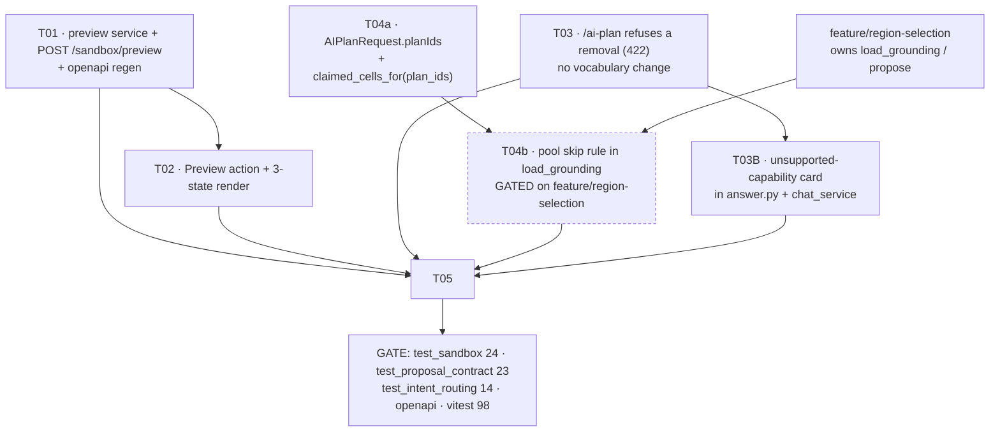

# Phase 4 RULING — preview the change, account for prior work, and refuse what the executor cannot do

**Author:** 高见远 (Gao), Architect · **Date:** 19 Oct 2026
**Branch:** `feature/preview-and-context` · **Base:** `cbd4cef` (`feat(stage4): the sandbox loop`)
**Baselines:** `test_sandbox` **24/24** · `test_proposal_contract` **23/23** · `test_intent_routing` **14/14** · frontend **98/98**
**Conflict:** a concurrent engineer is rewriting the `/ai-plan` **proposal-selection** code on
`feature/region-selection`. §6 states exactly which functions are theirs and how this work composes with it.
**No production code was written.**

The owner's request, verbatim:

> *"Add an option to preview the changes. In addition, to also have the future response take into
> consideration the prior work (for instance, don't remove the water reservoir that was established
> previously."*

Two features, both underspecified. The first thing both rulings require is an **audit of `cbd4cef`**, because
that commit already ships a partial version of each — and building a second one beside a shipping one is the
failure this document exists to prevent.

**§3B was added on 19 Oct 2026** after the owner's third report — *"When I want to add buildings or other
objects, it does not respond in an intended manner."* It is a **sibling ruling to §3**, not a fourth document:
the same class of defect (an instruction the executor cannot honour, answered by producing something else),
a different mechanism. §3B.1 shows the mechanism is **not** an unmatched noun falling back — it is a **forced
tool with a closed enum**, and the substitution is *the only response the schema permits*.

---

## 0. AUDIT of `cbd4cef` — what already exists, measured

### 0.1 Feature A — "preview": the **shape** ships, the **effect** does not

| Piece | Where | What it does |
|---|---|---|
| Draft block layer | `frontend/src/view/proposalLayer.ts` | Draws each unconfirmed proposal as a 2.5D block at `opacity × 0.5`, `extrusionHeight × 0.4`, plus a dashed white companion polyline (Cesium's polygon outline cannot dash) |
| Draft store | `frontend/src/state/planStore.ts:43` | `proposals` — the draft set the viewer mounts the layer from |
| Mount / dispose | `frontend/src/view/SandboxViewer.tsx:854-882` | Keyed on the draft array identity; cleanup disposes, so a dismissed draft disappears |
| Suggestion → preview | `frontend/src/components/ChatPanel.tsx:1139`, `:592` | Picking a suggestion converts it to a draft proposal so the same layer draws it |

**Covered:** the **geometry** of a proposal, before it is confirmed. Critically it draws the **served**
geometry the server already clipped and contoured, never the model's `requested` ask — the layer's own
docstring says so, and that is the correct choice.

**Not covered — the whole of the owner's likely meaning:** there is no **effect** preview.
- The layer draws shapes. It computes **no numbers**: no delta, no storage, no green/paved/impervious change.
- There is no path that runs the ledger over an *uncommitted* intervention. `GET /ledger` resolves features
  from a `plan_id` (`routers/scenes.py`, `intervention_features(chosen)`); a proposal is not a plan until it
  is pinned. `/run` composes `plan_ids` from the store.

**Verdict on the lead's reading: CONFIRMED.** "Preview the changes" almost certainly means *preview the
effect* — see the delta before committing. The shape preview already exists and answers a different question.

### 0.2 Feature B — "prior work": **half** ships, and the half that ships is asymmetric

| Piece | Where | What it does |
|---|---|---|
| Suggestions skip taken ground | `services/sandbox.py:180-240` (`run_suggestions`) | `taken = claimed_cells(grids, plan_ids + staged)`; a candidate overlapping it is **skipped for the next one on its axis** |
| Confirm pins into one plan | `services/sandbox.py:248-288` (`stage`) → `pins.pin` | Prior work accumulates in the scene's staged plan — one list, three consumers (panel, viewer, run) |
| `/ai-plan/apply` now pins there | `services/ai_plan.py` `apply_proposals` → `sandbox.stage` | A confirmed proposal joins the same staged plan instead of a new plan that was never selected |
| Removal resolution | `services/sandbox.py:322-395` (`resolve_removal`), `routers/sandbox.py:120` | A staged intervention → **unpin**; a planned project → **toggle off**; buildings and today's land cover → **never match** |

**M1 — the asymmetry, measured on this HEAD.** Pin one reservoir, then ask the identical question again:

```
BEFORE pinning:  /ai-plan "add a water reservoir in the north"  -> proposals=[water_reservoir 1876 cells]
STAGE that proposal onto the sandbox                            -> 200, planId ..., featureIds [...]
AFTER pinning:   /ai-plan "add a water reservoir in the north"  -> proposals=[]  features=0
                rejected=[('OVERLAPS_STAGED', 1876 cells)]
```

So the proposal path **does** consider prior work — and then **dead-ends**. Two free reservoir candidates
still exist (`reservoir#1`, `#2`); the user gets nothing. The **suggestion** path, given the same situation,
skips to the next candidate and offers it. **Same data, same store, opposite behaviour.** That gap *is* the
owner's complaint, and it is measurable rather than a matter of taste.

**M2 — `/ai-plan` cannot see a toggled project at all.** `AIPlanRequest` (`schemas/plan.py:94-125`) carries
`instruction`, `provider`, `max_features`, `apply`, `allowed_types` — **no `planIds`**. And its claimed set is
built by `proposal_constraints.claimed_cells_for(scene_id, grids)`, which resolves **only**
`pins.staged_plan_id`. `run_suggestions`, by contrast, receives the run's `plan_ids`. So the proposal path is
structurally unable to exclude a toggled project's ground; the suggestion path does it. This is not a bug in
the guard — the guard is correct for what it is given.

**M3 — a removal instruction is inverted into an addition on the API, reproduced:**

```
POST /api/scenes/{id}/ai-plan  {"instruction": "remove the water reservoir near the south"}
  -> proposals=[('water_reservoir', 1876 cells)]   features=1      <- it ADDS one
POST /api/scenes/{id}/ai-plan  {"instruction": "delete the pond in the south"}
  -> proposals=[('water_reservoir', 1876 cells)]   features=1
```

The removal capability **does exist** (`resolve_removal`, correctly implemented, reachable at
`POST /sandbox/resolve-removal`). The **dispatch** is what is wrong, and the dispatch lives in the **client**:
`ChatPanel.tsx:113` `isRemoval(text)` → `resolveRemoval(...)` at `:1076-1097`, checked *before* the add path.
The browser therefore behaves; **every other client does not**, and the server contradicts itself: its own
`classify_turn` emits `intent="intervention"` with a `remove the … near …` hint, and `/ai-plan` then executes
that hint as a *creation*.

**M4 — no conversation awareness whatsoever.** `history` reaches `chat_service.answer` / `stream_events`
(`routers/chat.py:29,50`) for the **card**, and `AIPlanRequest` has **no `history` field**. The proposal path
is stateless with respect to the conversation.

---

## 1. RULING — Feature A: preview the **effect**, as a dedicated endpoint

### 1.1 What it is

A new **`POST /api/scenes/{sceneId}/sandbox/preview`** that composes *what is on the sandbox now* with the
*supplied candidates*, runs the project's own ledger over both, and returns **three states per figure** —
now / with the change / the difference — persisting nothing, rendering nothing, and calling no model.

It is placed in `routers/sandbox.py` because it previews a **sandbox** change: candidates that are not on the
sandbox yet, measured against what is. It is the missing half of the existing preview: the dashed layer shows
the shape, this shows the consequence.

### 1.2 Why a dedicated endpoint, and not (a) or (b)

**Against (a) `dryRun: true` on `/run`.** `run_scenario` is contractually *"one live run"* and its side
effects are load-bearing, each of which a preview must not have:

| What `/run` does | Why a preview must not |
|---|---|
| Writes `wetgrid_{id}.png`, `heatmap_{id}.png`, `wetgrid_{id}.json`, `heatmap_{id}.json` (`run_service.py:791-879`) | A previewed overlay is indistinguishable from a real one in `data/rasters/run/` |
| Calls `_prune_run_dir(run_dir, keep=20)` (`:881, :953`) | **A preview would evict real runs from the 20-file history.** Previewing repeatedly would delete the record of what was actually run |
| Mints a `runId`, returns overlay URLs | A preview would consume a run identity |
| Calls `_llm_explanation` → returns an `explanationCard` | Cost, and a *result card* for something that has not happened — the precise confusion this project forbids |

Adding a flag would make one endpoint return two shapes with different side effects. That is the
shape-failure class that has already produced two live bugs in this project (`STATUS.md`), and it would put
the run history at risk. **Rejected.**

**Against (b) a transient plan marked `draft`.** A plan is a persisted store object. The confirm gate
(plan v2 §5) exists *specifically* so that nothing is persisted until the user confirms; a preview that
writes a row inverts the gate. It would then have to be excluded from **every** reader — `pins.staged_features`
(the Interventions panel), `scene_service.list_plans`, the run's `plan_ids` composition, `claimed_cells_for`
(which would start refusing real proposals against a preview), `GET /ledger`, and the cascade delete. Any one
missed exclusion makes a preview visible as committed work, and the failure is silent. It also needs cleanup
or it accumulates. **Rejected.**

### 1.3 The response contract

```
POST /api/scenes/{sceneId}/sandbox/preview
{ "interventions": [ <feature>... ],        // candidates, as /ai-plan/apply would receive them
  "values":        [ {storageDepthM: ...} | null, ... ],   // the input card's answers, per candidate
  "planIds":       ["..."],                 // the run's toggled projects
  "rainfallMm":    450.0 }

200 ->
{ "status":  "PREVIEW_NOT_A_RUN_UNCOMMITTED_CHANGE",
  "warning": "<non-empty, always — see §1.4>",
  "scope":   "the level-pool ledger only: runoff, unstored volume, storage capacity, green, paved,
              impervious share, green-and-water area. NOT the flood extent, NOT the overlay,
              NOT the surface-temperature field.",
  "rainfallMm": 450.0,
  "now":      { <ledger scenario block> },   // staged plan + toggled projects
  "preview":  { <ledger scenario block> },   // the same + the candidates
  "previewDelta": { <per-key preview - now> },
  "runDelta":     { <ledger_for_scenario's own delta: scenario - today's land cover> },
  "interventionsApplied": [...],             // what the run would apply
  "interventionsSkipped": [...],             // what the run would SKIP, each with its `why`
  "sources": { "terrain": ..., "landCover": ... },
  "ledgerSource": "sandbox_model.ledger_for_scenario / apply_interventions — the same arithmetic a run uses" }
```

Every field defaulted. **No `runId`, no `overlayUrls`, no `explanationCard` key at all** — absent by
construction, not empty. An empty `runId` is a value a client can render; a missing key cannot be.

### 1.4 RULING: the preview must be unmistakable, and the three deltas must never be conflated

**This is the load-bearing part of Feature A.**

**(i) Three different deltas will now exist. They are not interchangeable.**

| Figure | Definition | Where it is legitimate |
|---|---|---|
| `runDelta` / `delta` | scenario − **today's land cover** (no interventions) | `/run`, `GET /ledger` — the existing, published meaning |
| `now` | the **current scenario state**: staged plan + toggled projects, measured against today | new; the answer to "where am I" |
| `previewDelta` | preview − **now** = the **marginal** effect of the candidates | new; the answer to "what would this change" |

Once prior work exists, `previewDelta ≠ runDelta` — and they differ by exactly the prior work. Quoting the
marginal figure under the key `delta` would publish the run's number while showing the change's number: a
wrong figure under a `source` string that points at real code, which this project names as its worst failure
mode.

**Ruling:** `previewDelta` must **not** reuse the key `delta`; both must be present and separately labelled;
and each carries its own `source` naming the two ledger readings it is the difference of. A client that shows
one must be able to see the other.

**(ii) The preview must label itself in the payload, not only in the UI.**
`status = "PREVIEW_NOT_A_RUN_UNCOMMITTED_CHANGE"` — visibly distinct from the run's own
`SCREENING_LIVE_RUN_FLOOD_EXTENT` — plus a **non-empty `warning`** stating: this is a preview of an
uncommitted change; nothing has been applied; the arithmetic is the ledger's own and is the number a run
would produce, but **this is not a run's record**. A preview whose numbers look like a run's on the wire is
the failure this ruling exists to prevent; a UI-only convention would leave the payload able to mislead any
other client.

**(iii) Scope must be declared, not implied.** The level-pool ledger does not consume `tideState` — the tide
enters the *routed cascade* and the flood-extent figure, not `_scenario_ledger`. So the preview **does not
accept `tideState` at all** (accepting an input it ignores would imply the preview reflects the tide) and it
declares in `scope` that the flood extent, the overlay and the temperature field are out of scope. Declining a
figure is honest; approximating it is not.

### 1.5 Cost and determinism

- **Deterministic, and identical to the eventual run — structurally, not coincidentally.** The preview must
  call the **same** functions the run calls (`apply_interventions` → `_scenario_ledger` /
  `ledger_for_scenario`). Equality with the applied run is then a property of there being one implementation,
  not of two implementations agreeing. A test asserts it (§8, A1).
- **Cheap, and cheaper than a run.** The preview skips exactly the expensive, side-effecting parts: no
  overlay render, no PNG encode, no temperature-field solve, no sky-view/massing terms, no sanity-check sweep,
  no model call. What remains is `storage_ledger` over the land-class grid, which is the cheap half of a run
  (the run's own docstring says the heavy terrain conditioning is cached *because* it does not change with a
  slider; the ledger does). Cost is bounded by the same grid arithmetic the ledger already performs per
  request on `GET /ledger`.
- **Byte-identical on repeat.** Same inputs twice → identical figures. No `time`, no `random`. The one
  ordering hazard is the feature list itself: compose it in a stable order (staged rows by id, then toggled
  plans in the order given, then candidates in the order sent) so `interventionsApplied`'s order — and hence
  any `claimed |=` accumulation — cannot vary.

### 1.6 The input-card trap

The input card changes the ledger: `storageDepthM` is read by `apply_interventions`. So a preview that ignores
the card's answers previews a **different intervention** than the one about to be confirmed. **Ruling:** the
preview must run candidates through `sandbox.apply_inputs(kind, params, values[i])` — the same function
`/ai-plan/apply` uses — before measuring. Previewing the estimate while the user has typed a depth shows a
number that will not happen.

---

## 2. RULING — Feature B, part 1: prior work is the **claimed cell set**, and the response must **skip**, not dead-end

### 2.1 Representation: the claimed cell set. Not the transcript, not a prose list

**Ruling: prior work is represented as the set of cells already claimed, computed by code**
(`proposal_constraints.claimed_cells` / `claimed_cells_for`), sourced from
`pins.staged_features(scene_id)` plus every toggled project's plan.

Why, against the alternatives:

- **The conversation transcript** (`history`) is unverifiable prose. Making exclusion depend on it makes the
  guarantee model-dependent, and the project's rule is *grounding is code, not prompt text* (PRD D2). A model
  that summarises its own earlier turns can be wrong, and it would be wrong *in the direction of silently
  allowing* a proposal over existing work. **Rejected.**
- **A list of placed interventions as objects** is the right *source* but the wrong *interface*: the guard
  needs cells to test geometry against, and `claimed_cells` is already that vocabulary. It also carries an
  owner per cell, which is what makes `OVERLAPS_STAGED` able to say *whose* ground it was (`overlapsWith`).
- **The claimed set is already the project's answer** — it is what the overlap guard and the suggestion path
  both use. One representation, one set of cells, checkable.

### 2.2 Behaviour: skip to the next candidate — do not refuse the whole kind

**M1 is the ruling's justification.** Today the proposal path refuses (`OVERLAPS_STAGED`) and returns an
empty list while free candidates exist. The suggestion path skips. **Ruling: the proposal path must narrow
its pools by the claimed set, so a taken candidate is never offered and a free one is.** The overlap guard is
**not** weakened — it stays exactly as it is, as the backstop for anything that still collides (a coordinate
request, a race with a concurrent pin). Skip at selection; refuse at the gate. Both, for the same reason the
region work needed both: prevention without detection cannot be tested, detection without prevention
dead-ends.

This is not a new mechanism. It is `run_suggestions`' existing rule
(`if taken and _cells_of(...) & taken: continue`) applied to the other entrance to the same sandbox.

### 2.3 `/ai-plan` must be able to see the toggled projects

**M2: it structurally cannot today.** `AIPlanRequest` has no `planIds`, and `claimed_cells_for` resolves only
the staged plan.

**Ruling:** `AIPlanRequest` gains `planIds: list[str] = []` (additive, defaulted — an existing client is
unaffected), and `generate_proposals` passes the composed claimed set into pool selection. The frontend
already holds the selection in `planStore`; it need only forward it.

### 2.4 RULED OUT: conversation awareness as a proposal input

**`AIPlanRequest` must NOT gain `history`.** Three reasons:

1. It would make exclusion depend on the model's memory of its own prior prose — model-dependent grounding,
   against D2 (§2.1).
2. The owner's own example does not need it. *"Don't remove the water reservoir that was established
   previously"* is satisfied by the **placed** reservoir, and once confirmed that reservoir is in the staged
   plan and §2.2 handles it. Conversation awareness would only add the case "proposed but not confirmed",
   which is a *draft* — and a draft has never claimed cells (correctly: `cbd4cef`'s note that "unpinned rows
   no longer claim cells in the overlap check" is the same insight).
3. **"Prior work *in this response*" already holds**: `validate_batch` owns `claimed |= cells` in provider
   order, so two proposals in one batch cannot claim the same ground. That is the only sense in which a
   *response* can consider *its own* prior work, and it is already guaranteed by code.

**If the lead wants the model to see what has been placed**, the honest and cheap shape is a **facts block
read from the store** — the staged rows' kind/area/region, and the toggled projects' names — added to
`build_prompt`'s payload. That is *prompt context*, never a filter, and never the transcript. It is a P2
nice-to-have and I do not recommend it before §2.2 lands, because a model told about placed work and still
offered the taken site would be worse than a model not told.

---

## 3. RULING — Feature B, part 2: the removal inversion

### 3.1 What is wrong is the **dispatch**, and it lives in the client

M3 establishes: `resolve_removal` exists and is correct; the removal verbs are advertised; the server's own
classifier routes a removal as `intent="intervention"`; and `/ai-plan` then **creates** the thing the user
asked to destroy. The browser escapes this only because `ChatPanel.tsx:113` intercepts removals first — a
**client-side** predicate. Every other client, and the API itself, gets the inversion.

### 3.2 RULING: `/ai-plan` must refuse a removal, not perform one

**The executor refuses; the capability stays.**

- **`/ai-plan` detects a removal instruction and refuses it with HTTP 422**, `detail` naming
  `POST /api/scenes/{sceneId}/sandbox/resolve-removal` as the route that honours it. 422 rather than 500,
  matching the existing precedent in the same handler (`PlanGenerationError → 422`: *"the request was
  well-formed, the machine simply cannot honour it, and the client needs to know which"*).
- **The detection is server-side and reuses the server's own vocabulary** — the normalised hint
  `agent.intent.parse_intervention_intent` already produces starts with `remove ` for these turns. Using the
  server's own determination avoids a second, drifting regex. A client-side fast path may remain (it saves a
  round trip); the *guarantee* no longer depends on it.
- **A mixed instruction refuses too.** "remove the paving and add a reservoir" normalises to a `remove …`
  hint. Ruling: refuse, and the `detail` says the sentence mixes a removal with an addition and to send them
  separately. Silently executing the addition half of a destructive+constructive sentence is the same class
  of lie as the inversion.

### 3.3 Why **not** the alternative the briefing offered ("stop the vocabulary advertising the verb")

**Rejected, decisively, and the reason is mechanical.** `contracts/intent_vocabulary.json` is pinned
three ways (`test_intent_routing.py` ↔ `app/agent/intent.py` ↔ `frontend/src/api/intentVocabulary.ts`). The
frontend's `isRemoval` reads `INTENT_VOCABULARY.removalVerbs` **from that same pinned fixture**. So dropping
`remove/delete/drop/take out` from the server vocabulary would, **by the pin's own construction**, drop them
from the client's — `isRemoval` would return `false` for every sentence, removals would fall through to
`/ai-plan`, and the API-only inversion would become a **UI-wide** inversion. The "fix" converts a bug that one
client already avoids into one that no client avoids.

Also: the capability is not missing. `resolve_removal` correctly unpins a staged intervention and toggles off
a planned project, and the sandbox suite pins it (`a planned project resolves to a toggle-off, never a
delete`, `existing buildings are not removable`, `unpinning takes it off the sandbox and out of the run`).
Removing the verbs would delete working, tested, user-facing capability to paper over a dispatch hole.

### 3.4 Severity, stated honestly

This is the worst of the three defects in this document, and it is worse than its size suggests: it is
**wrong in the destructive direction**, **silent**, and it **looks like success** — the user is shown a
plausible, legal, accepted proposal. It is masked in our own UI by a client-side check, which means it will
survive every browser walkthrough and appear only to an API consumer. `docs/TEST_PLAN_intervention_loop.md`
already identifies this class as its test #1.

---

## 3B. RULING — the third case: a **capability** the executor does not have

*(Added 19 Oct 2026 on the lead's measured report. Same class as §3, different mechanism — so the ruling is
the sibling of §3.2, not a repetition of it.)*

The owner: *"When I want to add buildings or other objects, it does not respond in an intended manner."*
Reproduced on `cbd4cef`. **`buildings` / `school` / `hospital` / `office block` / `tower` are not capabilities
this sandbox has**, and nothing tells the user that.

### 3B.1 The mechanism is not "the noun falls back" — it is a forced tool with a closed enum

Three compounding causes, **all on our side**. The heuristic provider is innocent: measured,
`HeuristicProvider().propose()` returns **0 features** for every one of the five building phrasings. The
substitution happens on the **LLM leg only**, and it is forced.

| # | Cause | Where | Measured |
|---|---|---|---|
| **C1** | `route_tools` **forces** `select_intervention_sites` for any turn that is not massing, and `tool_choice` is `{"type": "tool", "name": forced}` | `ai_plan.py:1989`, `:1721` | `route_tools("add a school")` → `forced=select_intervention_sites` |
| **C2** | That tool's schema **requires** `selections`, and each item **requires** `intervention_type` from a **closed enum** | `CHOOSE_TOOL`, `ai_plan.py:1390`; the enum at `:1407` | `enum=['drainage','green_space','permeable_paving','road','water_reservoir']`; `required=['selections']`; item `required=['site_id','intervention_type','rationale']` |
| **C3** | The system prompt's escape (*"If no site is appropriate, return an empty selection list"*) is **weaker than the schema's `required`**, so declining means violating the schema | `build_prompt`, `:1656` | — |

So for *"add a school"* the server **forces** a tool whose schema **has no way to say "I cannot"**. The
model's only legal move is to return one of the five kinds — `green_space` — and the tool *requires* a
`rationale`, so it narrates the substitution: *"The largest contiguous vegetated block is the most suitable
for adding a school."* **That sentence is not the model disobeying us. It is the model filling the only shape
we permitted.**

And when the model declines anyway (*"add a hospital"*), `generate_proposals` returns the generic
*"Nothing could be placed: no candidate survived the constraints, or no provider returned a usable answer for
this instruction"* — which **blames the instruction or the provider** for a capability gap that is ours.

**Class, stated once.** Same as the removal inversion: *an instruction the executor cannot honour, resolved by
producing something from the pool instead of declining.* Removal's shape was `parse_intent`'s `(kind, count)`
with no removal op; this one's is a forced tool with a closed kind enum. The family is what matters — it has
now appeared twice with the same signature, and §3B.6 rules one shared refusal path because of it.

### 3B.2 RULING: refuse with **422**, from a guard that runs **before any provider is called**

Not a 200 with an empty `features` and a stated reason. Five reasons, each from the reasoning already used in
§3.2:

1. **A 422 makes the response not-an-AI-output, and that is what keeps invariant 3 honest.** The invariant is
   *"a `status` plus a non-empty `warning` on every AI output."* `AIPlanResponse` has **no top-level
   `status`/`warning`** (`schemas/plan.py:127-155`) — only per-proposal ones. So `200 {features: 0,
   proposals: []}` is an "output" carrying **neither**, and being honest about it would mean widening
   `AIPlanResponse` — a wire change and an openapi regeneration — **for a case where no model ran**. A 422
   sidesteps that: no model ran, so there is no output to label.
2. **A 200 cannot be distinguished from success by a client that does not read prose.** The entire defect is
   that the failure *looks like success*. A status code is the one signal no client can render as a plausible
   result by accident.
3. **It removes the opportunity for substitution rather than filtering its product.** The model is never
   asked, so it cannot confabulate a rationale. Same move as §1.3's short-circuit for an empty region, and the
   same reason: do not pay for a call that can only produce something wrong.
4. **Precedent and consistency.** `PlanGenerationError → 422` is already this handler's rule — *"the request
   was well-formed, the machine simply cannot honour it, and the client needs to know which"* — and §3.2
   ruled removal the same way. One status for "cannot honour", **two distinguishable `detail`s**.
5. **It is already legible to the existing client.** `frontend/src/api/client.ts:75` resolves
   `data.detail` into `ApiError.message`, so a readable `detail` renders today with **no client change**.

**Two empty-result cases that must stay distinct — and this is why 422 rather than a blanket rule:**

- **(i) The executor never ran the model** (no supported capability named) → **422**, no AI output.
- **(ii) The model ran and legitimately chose nothing** (*"no site is appropriate"*) → **200** with `message`
  + notes, exactly as today.

Case (ii) is a real AI output that today carries **no top-level `status`/`warning`**. That is a **pre-existing
latent gap in invariant 3**, not something this ruling introduces, and I am **not** fixing it here — it needs a
wire change and an openapi regeneration, and it should be its own decision. Flagged in §8 so it is not
mistaken for part of this work.

### 3B.3 What the message must name — and a correction to the briefing

Three lists, each **built from one source of truth, never typed**:

| What | Source of truth | Measured value |
|---|---|---|
| the kinds it can **create** | `sorted(set(POOL_FOR_KIND))` — **the same expression `CHOOSE_TOOL`'s enum is built from** (`ai_plan.py:1407`) | **5**: `drainage, green_space, permeable_paving, road, water_reservoir` |
| the massing ops it **does** have | `MASSING_TOOL["input_schema"]["properties"]["edits"]["items"]["properties"]["op"]["enum"]` | **6**: `scale_all, set_site, rotate, move, reset, resize` |
| the regions it understands | `sorted(REGION_FRACTIONS)` | 10, including `all` |

**CORRECTION — the briefing's list named six kinds including *floodable ground*. That is wrong for this
route.** `flood_storage` is in `KIND_WORD` (6) and `STYLE_FOR_KIND` (6) but is **absent from `POOL_FOR_KIND`
(5)**, so the `CHOOSE_TOOL` enum has no such member and the heuristic has no pool for it: **`/ai-plan` cannot
propose floodable ground.** Naming it in the message would promise a capability the endpoint does not have —
the same class of error as the substitution it is meant to explain.

**Why the source matters here specifically.** There are **three** kind vocabularies and they disagree by
design: `KIND_WORD` (6 — the router's nouns), `POOL_FOR_KIND` (5 — what `/ai-plan` can propose),
`STYLE_FOR_KIND` (6 — what the renderer can draw). Typing the list, or reading the wrong one, produces a
message that lies. `/ai-plan`'s message must be **generated from `POOL_FOR_KIND`.**

### 3B.4 The message's shape, and the false positive it must not create

The detector is *"a creation verb is present, **no supported noun matches**, and the turn is not
interrogative"*. That predicate is **also true of phrasings whose intent IS supported but whose noun is a
synonym** — four of them are already pinned in `test_proposal_contract.py` as `PROPOSAL_SHAPED_GAPS`:
*"plant a green corridor along the riverfront"*, *"put a permeable plaza in the centre"*, *"dig a basin in the
north"*, *"create a wetland in the east"*. Those users want green space or a reservoir. A message that told
them their request is unsupported would be **worse than today's silence.**

**Ruling — every clause must be a fact about the *system*, never a claim about the *user's sentence*:**

```
I could not match this to an intervention I can create.
  create: water reservoir, green space, permeable paving, drainage, road
  reshape existing buildings: scale taller/shorter by %, set a height, rotate, move, resize, reset
Existing buildings come from the surveyed city model and can be reshaped, not created.
If you meant one of the above, name it — e.g. "add a water reservoir in the north".
```

- It answers **"add a school"** and **"add 3 buildings"**: the reshape line shows what happens to buildings —
  the user learns the real boundary **without us asserting that we understood the sentence**.
- It answers **"plant a green corridor"**: `green space` is listed, so the retry is obvious.
- **It never says "a school is impossible"**, which we do not know. We know only that no supported noun
  matched, and the message says exactly that.

**Explicitly rejected: a building-noun vocabulary** (`school`, `hospital`, `office`, `tower`, …) for a
custom message. I checked: **there is no reusable building-noun list** — `parse_massing_intent` is regex
patterns plus scope words and has no noun table. Adding one would be a **fourth** vocabulary, incomplete by
construction, and free to drift. The capability statement above needs no noun list and is true for every
trigger.

### 3B.5 The chat side: the card is the seam, and the cause is currently **misattributed**

**Measured.** `classify_turn("add a school in the north", card)` → `intent="ambiguous"`,
`intent_source="parser"`, `hint=None`. And `template_card(facts)` returns `_empty_card()` when `facts` is
empty — the card titled **"Nothing to explain yet"**.

**Ruling: do NOT widen `intent`.** Your instinct is right; here is the full justification.

1. `agent/intent.py` is a **pin** — 14/14 plus the three-way vocabulary round-trip. A new member changes the
   precedence ladder **and** the pinned fixture.
2. **The information needed is not an *intent*, it is a *reason*.** The card already has first-class fields
   for exactly this: `cause`, `todo`, `confidence.note`. It is filling them with the **wrong cause**.
3. That wrongness is itself an honesty defect, and it is measurable. `_empty_card` says
   `confidence.note = "No run in scope yet: there is nothing to explain until a scenario has been run"` and
   `todo = "Press Run Simulation in the Scenario Inputs panel."` For **"add a school"** both are **false** — a
   run may well exist, and pressing Run Simulation does not help. **The card attributes a capability gap to a
   missing run.** Its own docstring is careful that it *"must not blame a missing model"*; it currently blames
   something else that is equally not the cause.

**Ruling: a sibling card**, a pure builder in `answer.py`, e.g.
`unsupported_capability_card(question, card)`, filling `cause` / `todo` / `confidence.note` with the true
cause and carrying §3B.4's text.

**Where it is selected — one seam, not seven.** `classify_turn` is called at **seven** sites in
`chat_service.py` (`:202, :210, :212, :214, :230, :259, :363`). Ruling: add a single wrapper
`_classify(question, card)` in `chat_service` that calls `classify_turn` and then applies the card, and
replace the seven call sites. **`agent/intent.py` is not modified at all** — its ladder, vocabulary and pin
are untouched.

**Trigger precision.** The card applies when `intent == "ambiguous"`, `intent_source == "parser"`, and a
creation verb is present. An interrogative (*"can I add a school?"*) is already `question` and must keep its
normal card — the selector must not fire on a question. The classifier already computes the distinguishing
state, so the selector needs **no new data**.

### 3B.6 Scope separation: **one shared refusal path, two detectors, two messages**

| | removal (§3.2) | unsupported capability (§3B) |
|---|---|---|
| **detector** | a **removal verb** is present (the pinned `REMOVAL_VERBS`) | a **creation verb** is present **and no supported noun matches** |
| **source of truth** | the pinned removal vocabulary | `EN_ALIASES` ∩ `POOL_FOR_KIND` |
| **`detail` names** | the supported kinds, and the route that honours it: `/sandbox/resolve-removal` | the supported kinds **and** the massing ops |
| **shared** | the **refusal path**: one helper raising the handler's existing `PlanGenerationError`-shaped 422 with a code-built `detail` | same |

**Do not write one detector to cover both.** The inputs differ (a verb class vs. a verb-plus-missing-noun),
and merging them would blur the two `detail`s — after which a client grouping by status alone could no longer
tell *"you asked to destroy, which is a different endpoint"* from *"you asked to create something we do not
make"*. **Share the mechanism; keep the detectors and the messages separate.**

**Overlap with `feature/region-selection`: none**, provided §3B.7 is respected. Both detectors live in
`routers/scenes.py` + a predicate in `agent/intent.py`; the chat card lives in `answer.py` +
`chat_service.py`. None of those is the proposal-selection path.

### 3B.7 Do NOT "fix" the forced tool — close the door instead

C1 and C2 are the **mechanism**, and both tempting fixes are wrong:

- **Do not widen the `intervention_type` enum.** That enum is the grounding guarantee — it is why a model
  cannot label a park a reservoir, and why `_materialise` can trust the id's pool over the model's own
  `intervention_type` field. Widening it re-opens the free-form-kind problem the enum exists to close.
- **Do not remove the forced `tool_choice`.** `route_tools` forcing the tool is what makes the routing
  guarantee real — the module's own note says *"The tool is chosen in route_tools(), not by the model … Forcing
  it is what makes that guarantee real."* Making it `auto` would let a model answer a proposal request in
  prose, which the grounding check would then have to police.

The pre-provider guard (§3B.2) makes the forced-tool path **unreachable** for an unsupported request. **Close
the door rather than loosen the schema.** C1 and C2 stay exactly as they are — which is also why this work
does not touch the concurrent branch.

---

## 4. Honesty invariants — confirmation for all three cases

| # | Invariant | Feature A (preview) | Feature B (prior work) | 3B (missing capability) |
|---|---|---|---|---|
| 1 | No combined score across heat/wind/drainage | Per-axis figures only; the preview reports each ledger term independently and adds no ranking | The claimed set is cells, not a score; skipping a taken candidate is not a preference | The refusal ranks nothing; it lists what exists |
| 2 | No pass/fail verdict | A preview states three states and their difference; it does not advise | A refusal keeps its `reasonCode`; a skip is not a verdict on the site | The message states the system's capability, not a verdict on the request (§3B.4) |
| 3 | `status` + non-empty `warning` on every AI output | **Strengthened:** `PREVIEW_NOT_A_RUN_UNCOMMITTED_CHANGE` + a mandatory warning that says what it is and what it is not (§1.4ii) | Unchanged; the 422 carries a `detail` naming the route | **Satisfied by producing no AI output at all:** the guard runs before the provider, so a 422 is not an output to label (§3B.2.1). *But* it also fixes a live violation: `_empty_card` currently dates the cause wrongly (§3B.5) |
| 4 | Provenance on every number | Each figure is a ledger reading; `previewDelta` names the two readings it is the difference of; `scope` declares what is *not* included | The claimed set is cells read from the store; the exclusion is code | Each list in the message is generated from its owning constant (`POOL_FOR_KIND`, the massing op enum), never typed (§3B.3) |
| 5 | The model supplies an assumption, never a result; grounding is code | The preview computes nothing the model wrote; a preview is arithmetic over the user's candidates | §2.1: exclusion is code, never the transcript | **This is the invariant the substitution violated** — the model was forced to supply a *result* (a kind) for an assumption it could not ground. The guard restores the rule by not asking (§3B.1) |
| 6 | `reasonCode` inside the frozen set | **none added** — a preview produces no refusals of its own; it reports the run's own `interventionsSkipped` | **none added** — the removal refusal is a 422, not a `reasonCode`, for the reason in §3.2 | **none added** — the same 422 path, for the same reason |
| 7 | Determinism | Stable composition order; no `time`/`random`; equality with the applied run asserted | Iteration over an ordered list; no set ordering anywhere | The detector is a pure function of the sentence; the guard runs before any provider call |

### Most at risk: **#4, in Feature A — via the three deltas**

The mechanism is precise and it is the same shape as the project's named worst failure: once prior work
exists, `previewDelta` and `runDelta` differ, and both are legitimate ledger figures with real sources. A
response that publishes the marginal figure under the key `delta` — or a UI that shows one and calls it the
other — puts a correct number under a label that describes a different quantity. **Mandatory mitigations:**
the two keys are distinct and both present; each carries a `source` naming its operands; and test A5 asserts
they differ once prior work exists, so the distinction cannot silently collapse.

### Second most at risk: **#3, in Feature A**

A preview is the most tempting thing in this project to let look like a run: it returns the same ledger keys
with the same arithmetic. The whole of §1.4 exists to keep that honest. The specific trap is the **absent
keys** — the honest way to say "there is no flood extent here" is a missing key plus a `scope` sentence, not
a `null` or an empty string a client can render as "no flooding".

---

## 5. Sequencing, and the conflict with `feature/region-selection`

A separate engineer is rewriting the `/ai-plan` **proposal-selection** code on `feature/region-selection`.
Their scope, from their ruling: `_point_in_region`, `sites_in_region`, `parse_intent_counts` (**new**),
`HeuristicProvider.propose` (`ai_plan.py:1354-1373`), `build_prompt` (`:1640-1651`), `_materialise`
(`:1727`, `:1880`), `_feature` (`:1025-1051`).

**This document's overlap is §2.2 only.** Both changes narrow the same pools by a predicate. Two rewrites of
`HeuristicProvider.propose` will conflict. **Do not land them as two edits to one function.** The resolution
I rule:

```
load_grounding(region: str | None = None, claimed: set[tuple[int,int]] | None = None) -> Grounding
```

Both parameters **optional, default `None` = today's exact behaviour**, so no existing caller changes. Inside,
each pool is narrowed by a single composed pipeline, in this order:

```
pool   ->  sites_in_region(pool, region, bounds)      # feature/region-selection, T01
       ->  sites_free_of(eligible, claimed)           # this branch, §2.2
       ->  pool's own ceiling
```

Both steps are list comprehensions over an already-ordered list; `sites_free_of` is one line
(`[s for s in sites if not (_cells_of(geography, s["geometry"]) & claimed)]`). Whichever branch lands second
adds one line and one optional parameter. Both the heuristic **and** the catalogue then read the same
narrowed pools from one place, which is why the filter belongs in `load_grounding` rather than in
`build_prompt` — otherwise the model would be offered sites the filter already excluded, which is the drift
the region ruling's §3 forbids.

**Ordering rule:** land the **region** change first (it is on its own branch and is the narrower edit), then
rebase this branch and add the claimed filter. Do **not** attempt both at once.

Everything else in this document is **conflict-free**: the preview is a new endpoint and a new service
function; the removal guard and the missing-capability guard (§3B) live in `routers/scenes.py` + predicates in
`agent/intent.py`; the chat card lives in `answer.py` + `chat_service.py`; the `planIds` field is a schema
addition. None of them touches the region engineer's functions.

**One explicit boundary from §3B.7:** that ruling requires **no change to `ai_plan.py` at all** — C1
(`route_tools`'s forced `tool_choice`) and C2 (`CHOOSE_TOOL`'s closed enum) stay exactly as they are, and the
guard makes them unreachable for an unsupported request. So the third case adds **zero** overlap with
`feature/region-selection`, and T03 can land in parallel with it.

---

## 6. Task list (ordered by dependency)

Six tasks (T01–T05, with T03B added by §3B). **No two touch `ai_plan.py`'s proposal-selection functions
except T04b**, which is gated on the region branch merging.

### T01 — The preview endpoint and its ledger path
- **Files:** `backend/app/services/preview.py` (**new**); `backend/app/routers/sandbox.py` (new route);
  `backend/app/schemas/sandbox.py` or the router's local `WireModel`s (**new** request/response models)
- **Functions:**
  - `preview.compose_features(scene_id, plan_ids)` — staged pinned rows + toggled plans, **stable order**
    (staged rows by id, plans in the order given). Reuses `intervention_features_many` semantics for the
    plan side rather than a second composition.
  - `preview.preview(scene_id, interventions, values, plan_ids, rainfall_mm)` — runs `apply_inputs` per
    candidate, composes `now` and `preview` through `sandbox_model.ledger_for_scenario`, returns the block in
    §1.3. **No file writes, no model call, no `runId`.**
  - The `now` reading is one `ledger_for_scenario` call, so "where am I" and "what would change" come from the
    same function.
- **Depends on:** —
- **Wire change:** **yes** — a new path and new schemas ⇒ `contracts/openapi.json` **must be regenerated** as
  part of this task (`/tmp/v_pin/bin/python -m app.export_openapi` from `backend/`), or
  `test_openapi_contract.py` fails. Regeneration is not a separate task; it is the last step of this one.
- **Priority:** P0

### T02 — Preview labelling and the frontend surface
- **Files:** `frontend/src/api/sandboxApi.ts` (+ `types.ts`); `frontend/src/components/ChatPanel.tsx`
  (the confirm gate's action bar); `frontend/src/state/planStore.ts` (hold the preview reading beside the
  draft set)
- **Change:** a **Preview** action beside Apply/Dismiss that calls T01 and renders the three states. It must
  display `status`/`warning`/`scope` **verbatim** and must not present `previewDelta` as the run's `delta`
  (§1.4i). The dashed geometry preview already on screen is the shape half; this adds the numbers half.
- **Depends on:** T01
- **Priority:** P0

### T03 — The shared refusal path, with **two** detectors
- **Files:** `backend/app/agent/intent.py` (a predicate reusing the normalised hint, plus the
  creation-verb-and-no-supported-noun predicate — **no vocabulary or ladder change**),
  `backend/app/routers/scenes.py` (`create_ai_plan`: the guard **before** `generate_proposals` and the shared
  422 raiser), tests in `test_proposal_contract.py` / `test_sandbox.py`
- **Change — one path, two detectors (§3B.6):**
  - **removal (§3.2):** a removal verb is present → 422, `detail` names the route that honours it.
  - **missing capability (§3B):** a creation verb is present and no supported noun matches, and the turn is not
    interrogative → 422, `detail` carries §3B.4's capability statement.
  - The `detail` lists are **generated from `POOL_FOR_KIND`**, the massing op **enum**, and
    `sorted(REGION_FRACTIONS)` — never typed (§3B.3).
  - **Nothing in `ai_plan.py` is touched.** C1/C2 stay exactly as they are (§3B.7): do not widen the enum, do
    not un-force the tool. The guard closes the door; it does not loosen the schema.
- **Depends on:** —
- **Conflict:** none — `agent/intent.py` and `routers/scenes.py` are outside the region engineer's scope, and
  this task does not enter `ai_plan.py`'s proposal-selection path.
- **Priority:** P0 — this covers the worst defect in the document (§3.4) **and** the substitution (§3B.1).

### T03B — The chat card for a capability the sandbox does not have
- **Files:** `backend/app/agent/answer.py` (`unsupported_capability_card`, a sibling of `_empty_card` at
  `:318`); `backend/app/agent/chat_service.py` (a `_classify(question, card)` wrapper replacing the **seven**
  `classify_turn` call sites at `:202, :210, :212, :214, :230, :259, :363`)
- **Change:** when the classifier returns `intent="ambiguous"` **from the parser** with a creation verb
  present, replace the *card* — filling `cause` / `todo` / `confidence.note` with the true cause and carrying
  §3B.4's text. **`agent/intent.py` is not modified.**
- **Why this is the seam, not `intent`:** the card already has `cause`/`todo`/`confidence.note`, and
  `_empty_card` is currently filling them with a **false** cause — it tells the user to press Run Simulation
  for a capability gap, and dates it to a missing run (§3B.5).
- **Depends on:** T03 (shares the detector predicate and the capability statement)
- **Regression risk:** `test_intent_routing.py` **must not move** — no ladder change, so all 14 stay. Watch
  `test_proposal_contract.py`'s four `PROPOSAL_SHAPED_GAPS` phrasings (§3B.4): they must get the *"could not
  match"* wording, never a claim that their request is unsupported.
- **Priority:** P1

### T04 — Prior work: `planIds` on the request, and the skip rule
- **Files:** `backend/app/schemas/plan.py` (`AIPlanRequest.planIds`),
  `backend/app/routers/scenes.py` (forward it), `backend/app/services/ai_plan.py` (`generate_proposals`
  computes the composed claimed set **before** `load_grounding` and passes it in),
  `backend/app/services/proposal_constraints.py` (`claimed_cells_for` gains an optional `plan_ids` so the
  staged plan and the toggled projects come from one call)
- **Depends on:** **the region branch must have landed** (§5) — the skip rule is the second line of the same
  pool pipeline. If it has not, land the schema/routing half (conflict-free) and hold the filter.
- **Priority:** P0 for the schema half; the filter is P0 but **gated**.

### T05 — Tests, then full regression
- **Files:** `backend/tests/test_sandbox.py` (preview cases), `backend/tests/test_proposal_contract.py`
  (prior-work and removal cases)
- **Depends on:** T01–T04
- **Must not regress:** `test_sandbox` 24/24 · `test_proposal_contract` 23/23 · `test_intent_routing` 14/14 ·
  `test_openapi_contract` · `test_contract` · frontend 98/98.
- **Priority:** P0

### Dependency graph



---

## 7. Tests Phase 4 must add

### Feature A — preview (7)

| # | Test | Asserts |
|---|---|---|
| A1 | `test_a_preview_equals_the_run_it_previews` | Preview a candidate set, then apply it and run; the **ledger figures are equal**. This is the ruling's central claim, and it is the reason the preview must call the same functions rather than a parallel path |
| A2 | `test_a_preview_persists_nothing` | After a preview: the staged plan's pinned rows are unchanged, no new plan exists, `pins.staged_features` is identical. Guards the "transient plan" design that was rejected |
| A3 | `test_a_preview_writes_no_run_artefacts` | The count of files in `data/rasters/run/` is unchanged by a preview. Guards the history/prune hazard that ruled out `dryRun` on `/run` |
| A4 | `test_a_preview_is_labelled_and_carries_no_run_identity` | `status` is the preview constant (≠ `RUN_STATUS`), `warning` is non-empty, `scope` names what is excluded, and **`runId` / `overlayUrls` / `explanationCard` are absent keys** — not null, absent |
| A5 | `test_preview_delta_is_not_the_run_delta` | With prior work pinned, `previewDelta != runDelta`, both present, each with a `source` naming its operands. **The invariant-4 pin** |
| A6 | `test_a_preview_uses_the_input_card_values` | A candidate whose `storageDepthM` differs from the class default previews the **typed** number: change the value, the preview changes. Guards §1.6 |
| A7 | `test_a_preview_reports_a_skip_with_its_reason` | A candidate the run would refuse on the cumulative cap appears in `interventionsSkipped` with a non-empty `why` — **not** silently absent, and **not** an inflated total |

### Feature B — prior work (5)

| # | Test | Asserts |
|---|---|---|
| B1 | `test_a_removal_instruction_is_refused_by_ai_plan_not_inverted` | For each of `remove / delete / drop / take out`: `/ai-plan` returns **no proposal of that kind**. Today it returns a 1,876-cell `water_reservoir` (M3). This is the document's headline test |
| B2 | `test_a_removal_refusal_names_the_removal_route` | The refusal names `/sandbox/resolve-removal`, and (if 422) the status is 422. A refusal that does not say where to go is not actionable |
| B3 | `test_the_removal_capability_still_works` | `/sandbox/resolve-removal` still unpins a staged intervention and toggles off a project; the vocabulary pin is intact. Guards against "fixing" B1 by deleting the verbs (§3.3) |
| B4 | `test_the_proposal_path_skips_ground_that_is_already_placed` | Pin one candidate, re-ask: a **different, free** candidate is proposed — not an empty list (M1's asymmetry, fixed) |
| B5 | `test_the_proposal_path_accounts_for_a_toggled_project` | With a project toggled on and its `planIds` forwarded, `/ai-plan` excludes its cells. Impossible today: no field carries the selection (M2) |

### Feature B, part 2 — a missing capability (6, by §3B)

| # | Test | Asserts |
|---|---|---|
| C1 | `test_a_building_request_is_refused_not_substituted` | For each of `add a school`, `add 3 buildings`, `add a hospital`, `add an office block`: `/ai-plan` returns **no proposal at all** — and in particular **no `green_space` with a rationale naming the requested building**. Today `add a school` yields `green_space` 252 cells with *"the most suitable for adding a school"* (§3B.1). Mirrors B1 for the LLM leg |
| C2 | `test_the_substitution_is_still_reproducible_from_the_schema` | Drives `LLMProvider` with a **recorded transport** returning a selection for a building instruction, proving the substitution is a *server-permitted* response and not a stray model behaviour — i.e. that C2's forced closed-enum tool is the real cause. Pins the diagnosis so a later reader does not "fix" the model |
| C3 | `test_a_missing_capability_refusal_names_the_supported_set` | The `detail` contains **all five** `sorted(set(POOL_FOR_KIND))` kinds **and all six** massing ops, each read from its owning constant — and specifically **does not contain `flood_storage`** (§3B.3's correction). This is the anti-drift pin: the list must be generated, not typed |
| C4 | `test_a_synonym_phrasing_is_not_told_it_is_unsupported` | For each of the four `PROPOSAL_SHAPED_GAPS` phrasings: the message must **not** assert the request is unsupported, and **must** list `green space` / `water_reservoir` so the retry is obvious. Guards §3B.4's false positive — the failure that would be *worse than today's silence* |
| C5 | `test_the_unsupported_card_dates_the_cause_correctly` | With a **run already in scope**, `add a school` must not return `_empty_card`: `confidence.note` must not say *"No run in scope yet"* and `todo` must not say *"Press Run Simulation"*. Fails today, and it is an invariant-3 defect in its own right (§3B.5) |
| C6 | `test_the_guard_does_not_fire_on_a_question` | *"can you add a school?"* and *"what would happen if I added buildings?"* keep their normal card and are **not** refused by `/ai-plan`. The detector must not fire on an interrogative |

**Also pin one negative:** `test_history_does_not_change_a_proposal` — the same instruction with and without a
`history` payload yields identical proposals, pinning §2.4 (conversation awareness is *not* an input, and a
later contributor who "fixes" that must move this test deliberately).

**And one that must NOT move:** `test_intent_routing.py` 14/14. T03B changes a **card**, never the ladder —
if any of the 14 needs an edit, the change is wrong (§3B.5).

---

## 8. Residual risks I am not ruling away

1. **The preview and the run can diverge in the parts the preview declines.** The preview covers the
   level-pool ledger; the run additionally solves the temperature field, the routed cascade and the flood
   extent. Those are out of scope by §1.4(iii) and declared in `scope` — but a planner who reads a preview's
   storage figure and then sees a *flood extent* in the run has to hold two different scopes in their head.
   The mitigation is the `scope` sentence, repeated on the card, not a shared figure.
2. **The run's own `delta` is still scenario − today**, so "now" is not a figure either endpoint currently
   publishes. A planner comparing "preview vs run" will find the preview's `now` unfamiliar. That is honest —
   it is the state they are actually in — but it is new vocabulary and the UI must introduce it rather than
   assume it.
3. **`previewDelta` assumes nothing changes between preview and apply.** A concurrent pin, or a changed
   slider, invalidates it. The response must carry `rainfallMm` and the composed plan ids so a client can see
   whether the state it previewed is still the state it is confirming. I have not ruled on a staleness
   *invalidation* mechanism; if the lead wants one, it is a follow-up, not part of this change.
4. **Skipping changes which candidate is proposed, so a re-ask after a pin returns a *different* site.** That
   is the fix, and it is also a surprise: the user says the same sentence twice and gets a different site the
   second time. The `evidence` string must therefore always name *why this site*, and the response should say
   that a taken site was skipped — otherwise the new site looks arbitrary.
5. **The removal guard refuses a mixed add+remove sentence** (§3.2). That is deliberate and honest, but it is a
   behaviour change for a phrasing the browser currently half-handles (`isRemoval` fires on any removal verb,
   so today the addition half is dropped anyway). Neither behaviour is good; refusing is at least explicit.
6. **`resolve_removal` matches by name tokens and region** (`_in_region` uses centroid membership — the same
   rule the region ruling adopted, and consistent). It can therefore match nothing for a sentence a person
   reads as a removal, and its no-match message already says so. Not changed here; noted so it is not
   mistaken for a regression when B1 makes refusals more visible.
7. **A preview of a candidate that would be *skipped* is the most useful preview and the least tested.** A7
   covers it, but the fixture must deliberately overshoot the cumulative cap — a fixture that happens to fit
   would exercise nothing (the same trap `test_overlap_guard_...` documents).

### Added by §3B (the missing-capability case)

8. **The guard's false positive is the biggest risk in §3B, and it is silent.** The detector is *"creation verb
   present, no supported noun matched"*, and that is **also true of a synonym** (§3B.4). A user who typed
   *"plant a green corridor"* would be told their request is not recognised when the intent IS supported and
   only the noun is unfamiliar. The message's shape — every clause a fact about the system, never a claim
   about the sentence — is what keeps this honest, and **C4 is the test that holds it**. If a later contributor
   "sharpens" the wording into *"a school is not supported"*, they break this risk and C4 should fail.
9. **The substitution is masked in the browser, exactly like the removal inversion.** `route_tools` forces
   `select_intervention_sites` only on the `/ai-plan` path; the frontend's `isRemoval` already diverts
   removals, and a chat turn for *"add a school"* returns `ambiguous` and never reaches the gate. **So the
   substitution is reachable mainly through the API**, and it will survive a browser walkthrough — the same
   reason the removal bug did. C1 must therefore drive the endpoint directly, not the UI.
10. **A third entry to this family is likely, and the family is the finding.** Removal (a verb with no
   executor), capability (a request with no executor), and earlier `drop the trees` → three reservoirs (an
   unmatched noun falling back to a default kind) are three instances of one signature: *the executor cannot
   honour the instruction, and instead of declining it produces something from the pool.* I have ruled the two
   measured instances; I have **not** audited the vocabulary for further nouns that fall back
   (`EN_ALIASES` → `POOL_FOR_KIND` is the pair to check). That audit is worth one pass before the pitch and is
   not part of these tasks.
11. **Case (ii) of §3B.2 is an open invariant-3 gap I deliberately did not close.** A 200 response with
   `features: 0` carries no top-level `status`/`warning` (`AIPlanResponse` has neither), so the one legitimate
   "the model chose nothing" path is the only AI output in the system that is not labelled. Closing it needs a
   wire change and an openapi regeneration. **It should be its own decision**, and it should not be
   opportunistically folded into T03 — but it should not be forgotten either.
12. **`route_tools` forcing the site tool for a non-massing turn remains a latent trap.** §3B.7 rules against
   changing it *now*, because the guard makes it unreachable for unsupported requests. But any future entry
   point that reaches `route_tools` **without** passing through the `/ai-plan` guard would re-expose C1+C2
   instantly. The guard must live in the shared path, not only in the router, if a second caller appears.