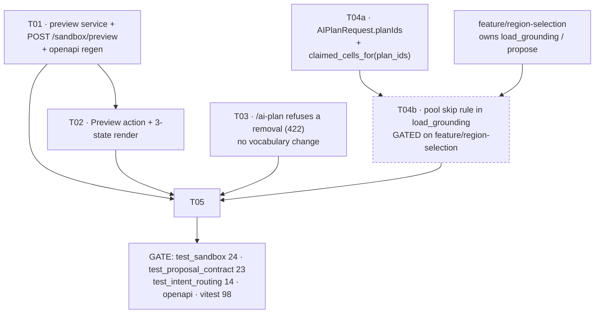

# Phase 4 RULING — preview the change, and account for prior work

**Author:** 高见远 (Gao), Architect · **Date:** 19 Oct 2026
**Branch:** `feature/preview-and-context` · **Base:** `cbd4cef` (`feat(stage4): the sandbox loop`)
**Baselines:** `test_sandbox` **24/24** · `test_proposal_contract` **23/23** · `test_intent_routing` **14/14** · frontend **98/98**
**Conflict:** a concurrent engineer is rewriting the `/ai-plan` **proposal-selection** code on
`feature/region-selection`. §6 states exactly which functions are theirs and how this work composes with it.
**No production code was written.**

The owner's request, verbatim:

> *"Add an option to preview the changes. In addition, to also have the future response take into
> consideration the prior work (for instance, don't remove the water reservoir that was established
> previously."*

Two features, both underspecified. The first thing both rulings require is an **audit of `cbd4cef`**, because
that commit already ships a partial version of each — and building a second one beside a shipping one is the
failure this document exists to prevent.

---

## 0. AUDIT of `cbd4cef` — what already exists, measured

### 0.1 Feature A — "preview": the **shape** ships, the **effect** does not

| Piece | Where | What it does |
|---|---|---|
| Draft block layer | `frontend/src/view/proposalLayer.ts` | Draws each unconfirmed proposal as a 2.5D block at `opacity × 0.5`, `extrusionHeight × 0.4`, plus a dashed white companion polyline (Cesium's polygon outline cannot dash) |
| Draft store | `frontend/src/state/planStore.ts:43` | `proposals` — the draft set the viewer mounts the layer from |
| Mount / dispose | `frontend/src/view/SandboxViewer.tsx:854-882` | Keyed on the draft array identity; cleanup disposes, so a dismissed draft disappears |
| Suggestion → preview | `frontend/src/components/ChatPanel.tsx:1139`, `:592` | Picking a suggestion converts it to a draft proposal so the same layer draws it |

**Covered:** the **geometry** of a proposal, before it is confirmed. Critically it draws the **served**
geometry the server already clipped and contoured, never the model's `requested` ask — the layer's own
docstring says so, and that is the correct choice.

**Not covered — the whole of the owner's likely meaning:** there is no **effect** preview.
- The layer draws shapes. It computes **no numbers**: no delta, no storage, no green/paved/impervious change.
- There is no path that runs the ledger over an *uncommitted* intervention. `GET /ledger` resolves features
  from a `plan_id` (`routers/scenes.py`, `intervention_features(chosen)`); a proposal is not a plan until it
  is pinned. `/run` composes `plan_ids` from the store.

**Verdict on the lead's reading: CONFIRMED.** "Preview the changes" almost certainly means *preview the
effect* — see the delta before committing. The shape preview already exists and answers a different question.

### 0.2 Feature B — "prior work": **half** ships, and the half that ships is asymmetric

| Piece | Where | What it does |
|---|---|---|
| Suggestions skip taken ground | `services/sandbox.py:180-240` (`run_suggestions`) | `taken = claimed_cells(grids, plan_ids + staged)`; a candidate overlapping it is **skipped for the next one on its axis** |
| Confirm pins into one plan | `services/sandbox.py:248-288` (`stage`) → `pins.pin` | Prior work accumulates in the scene's staged plan — one list, three consumers (panel, viewer, run) |
| `/ai-plan/apply` now pins there | `services/ai_plan.py` `apply_proposals` → `sandbox.stage` | A confirmed proposal joins the same staged plan instead of a new plan that was never selected |
| Removal resolution | `services/sandbox.py:322-395` (`resolve_removal`), `routers/sandbox.py:120` | A staged intervention → **unpin**; a planned project → **toggle off**; buildings and today's land cover → **never match** |

**M1 — the asymmetry, measured on this HEAD.** Pin one reservoir, then ask the identical question again:

```
BEFORE pinning:  /ai-plan "add a water reservoir in the north"  -> proposals=[water_reservoir 1876 cells]
STAGE that proposal onto the sandbox                            -> 200, planId ..., featureIds [...]
AFTER pinning:   /ai-plan "add a water reservoir in the north"  -> proposals=[]  features=0
                rejected=[('OVERLAPS_STAGED', 1876 cells)]
```

So the proposal path **does** consider prior work — and then **dead-ends**. Two free reservoir candidates
still exist (`reservoir#1`, `#2`); the user gets nothing. The **suggestion** path, given the same situation,
skips to the next candidate and offers it. **Same data, same store, opposite behaviour.** That gap *is* the
owner's complaint, and it is measurable rather than a matter of taste.

**M2 — `/ai-plan` cannot see a toggled project at all.** `AIPlanRequest` (`schemas/plan.py:94-125`) carries
`instruction`, `provider`, `max_features`, `apply`, `allowed_types` — **no `planIds`**. And its claimed set is
built by `proposal_constraints.claimed_cells_for(scene_id, grids)`, which resolves **only**
`pins.staged_plan_id`. `run_suggestions`, by contrast, receives the run's `plan_ids`. So the proposal path is
structurally unable to exclude a toggled project's ground; the suggestion path does it. This is not a bug in
the guard — the guard is correct for what it is given.

**M3 — a removal instruction is inverted into an addition on the API, reproduced:**

```
POST /api/scenes/{id}/ai-plan  {"instruction": "remove the water reservoir near the south"}
  -> proposals=[('water_reservoir', 1876 cells)]   features=1      <- it ADDS one
POST /api/scenes/{id}/ai-plan  {"instruction": "delete the pond in the south"}
  -> proposals=[('water_reservoir', 1876 cells)]   features=1
```

The removal capability **does exist** (`resolve_removal`, correctly implemented, reachable at
`POST /sandbox/resolve-removal`). The **dispatch** is what is wrong, and the dispatch lives in the **client**:
`ChatPanel.tsx:113` `isRemoval(text)` → `resolveRemoval(...)` at `:1076-1097`, checked *before* the add path.
The browser therefore behaves; **every other client does not**, and the server contradicts itself: its own
`classify_turn` emits `intent="intervention"` with a `remove the … near …` hint, and `/ai-plan` then executes
that hint as a *creation*.

**M4 — no conversation awareness whatsoever.** `history` reaches `chat_service.answer` / `stream_events`
(`routers/chat.py:29,50`) for the **card**, and `AIPlanRequest` has **no `history` field**. The proposal path
is stateless with respect to the conversation.

---

## 1. RULING — Feature A: preview the **effect**, as a dedicated endpoint

### 1.1 What it is

A new **`POST /api/scenes/{sceneId}/sandbox/preview`** that composes *what is on the sandbox now* with the
*supplied candidates*, runs the project's own ledger over both, and returns **three states per figure** —
now / with the change / the difference — persisting nothing, rendering nothing, and calling no model.

It is placed in `routers/sandbox.py` because it previews a **sandbox** change: candidates that are not on the
sandbox yet, measured against what is. It is the missing half of the existing preview: the dashed layer shows
the shape, this shows the consequence.

### 1.2 Why a dedicated endpoint, and not (a) or (b)

**Against (a) `dryRun: true` on `/run`.** `run_scenario` is contractually *"one live run"* and its side
effects are load-bearing, each of which a preview must not have:

| What `/run` does | Why a preview must not |
|---|---|
| Writes `wetgrid_{id}.png`, `heatmap_{id}.png`, `wetgrid_{id}.json`, `heatmap_{id}.json` (`run_service.py:791-879`) | A previewed overlay is indistinguishable from a real one in `data/rasters/run/` |
| Calls `_prune_run_dir(run_dir, keep=20)` (`:881, :953`) | **A preview would evict real runs from the 20-file history.** Previewing repeatedly would delete the record of what was actually run |
| Mints a `runId`, returns overlay URLs | A preview would consume a run identity |
| Calls `_llm_explanation` → returns an `explanationCard` | Cost, and a *result card* for something that has not happened — the precise confusion this project forbids |

Adding a flag would make one endpoint return two shapes with different side effects. That is the
shape-failure class that has already produced two live bugs in this project (`STATUS.md`), and it would put
the run history at risk. **Rejected.**

**Against (b) a transient plan marked `draft`.** A plan is a persisted store object. The confirm gate
(plan v2 §5) exists *specifically* so that nothing is persisted until the user confirms; a preview that
writes a row inverts the gate. It would then have to be excluded from **every** reader — `pins.staged_features`
(the Interventions panel), `scene_service.list_plans`, the run's `plan_ids` composition, `claimed_cells_for`
(which would start refusing real proposals against a preview), `GET /ledger`, and the cascade delete. Any one
missed exclusion makes a preview visible as committed work, and the failure is silent. It also needs cleanup
or it accumulates. **Rejected.**

### 1.3 The response contract

```
POST /api/scenes/{sceneId}/sandbox/preview
{ "interventions": [ <feature>... ],        // candidates, as /ai-plan/apply would receive them
  "values":        [ {storageDepthM: ...} | null, ... ],   // the input card's answers, per candidate
  "planIds":       ["..."],                 // the run's toggled projects
  "rainfallMm":    450.0 }

200 ->
{ "status":  "PREVIEW_NOT_A_RUN_UNCOMMITTED_CHANGE",
  "warning": "<non-empty, always — see §1.4>",
  "scope":   "the level-pool ledger only: runoff, unstored volume, storage capacity, green, paved,
              impervious share, green-and-water area. NOT the flood extent, NOT the overlay,
              NOT the surface-temperature field.",
  "rainfallMm": 450.0,
  "now":      { <ledger scenario block> },   // staged plan + toggled projects
  "preview":  { <ledger scenario block> },   // the same + the candidates
  "previewDelta": { <per-key preview - now> },
  "runDelta":     { <ledger_for_scenario's own delta: scenario - today's land cover> },
  "interventionsApplied": [...],             // what the run would apply
  "interventionsSkipped": [...],             // what the run would SKIP, each with its `why`
  "sources": { "terrain": ..., "landCover": ... },
  "ledgerSource": "sandbox_model.ledger_for_scenario / apply_interventions — the same arithmetic a run uses" }
```

Every field defaulted. **No `runId`, no `overlayUrls`, no `explanationCard` key at all** — absent by
construction, not empty. An empty `runId` is a value a client can render; a missing key cannot be.

### 1.4 RULING: the preview must be unmistakable, and the three deltas must never be conflated

**This is the load-bearing part of Feature A.**

**(i) Three different deltas will now exist. They are not interchangeable.**

| Figure | Definition | Where it is legitimate |
|---|---|---|
| `runDelta` / `delta` | scenario − **today's land cover** (no interventions) | `/run`, `GET /ledger` — the existing, published meaning |
| `now` | the **current scenario state**: staged plan + toggled projects, measured against today | new; the answer to "where am I" |
| `previewDelta` | preview − **now** = the **marginal** effect of the candidates | new; the answer to "what would this change" |

Once prior work exists, `previewDelta ≠ runDelta` — and they differ by exactly the prior work. Quoting the
marginal figure under the key `delta` would publish the run's number while showing the change's number: a
wrong figure under a `source` string that points at real code, which this project names as its worst failure
mode.

**Ruling:** `previewDelta` must **not** reuse the key `delta`; both must be present and separately labelled;
and each carries its own `source` naming the two ledger readings it is the difference of. A client that shows
one must be able to see the other.

**(ii) The preview must label itself in the payload, not only in the UI.**
`status = "PREVIEW_NOT_A_RUN_UNCOMMITTED_CHANGE"` — visibly distinct from the run's own
`SCREENING_LIVE_RUN_FLOOD_EXTENT` — plus a **non-empty `warning`** stating: this is a preview of an
uncommitted change; nothing has been applied; the arithmetic is the ledger's own and is the number a run
would produce, but **this is not a run's record**. A preview whose numbers look like a run's on the wire is
the failure this ruling exists to prevent; a UI-only convention would leave the payload able to mislead any
other client.

**(iii) Scope must be declared, not implied.** The level-pool ledger does not consume `tideState` — the tide
enters the *routed cascade* and the flood-extent figure, not `_scenario_ledger`. So the preview **does not
accept `tideState` at all** (accepting an input it ignores would imply the preview reflects the tide) and it
declares in `scope` that the flood extent, the overlay and the temperature field are out of scope. Declining a
figure is honest; approximating it is not.

### 1.5 Cost and determinism

- **Deterministic, and identical to the eventual run — structurally, not coincidentally.** The preview must
  call the **same** functions the run calls (`apply_interventions` → `_scenario_ledger` /
  `ledger_for_scenario`). Equality with the applied run is then a property of there being one implementation,
  not of two implementations agreeing. A test asserts it (§8, A1).
- **Cheap, and cheaper than a run.** The preview skips exactly the expensive, side-effecting parts: no
  overlay render, no PNG encode, no temperature-field solve, no sky-view/massing terms, no sanity-check sweep,
  no model call. What remains is `storage_ledger` over the land-class grid, which is the cheap half of a run
  (the run's own docstring says the heavy terrain conditioning is cached *because* it does not change with a
  slider; the ledger does). Cost is bounded by the same grid arithmetic the ledger already performs per
  request on `GET /ledger`.
- **Byte-identical on repeat.** Same inputs twice → identical figures. No `time`, no `random`. The one
  ordering hazard is the feature list itself: compose it in a stable order (staged rows by id, then toggled
  plans in the order given, then candidates in the order sent) so `interventionsApplied`'s order — and hence
  any `claimed |=` accumulation — cannot vary.

### 1.6 The input-card trap

The input card changes the ledger: `storageDepthM` is read by `apply_interventions`. So a preview that ignores
the card's answers previews a **different intervention** than the one about to be confirmed. **Ruling:** the
preview must run candidates through `sandbox.apply_inputs(kind, params, values[i])` — the same function
`/ai-plan/apply` uses — before measuring. Previewing the estimate while the user has typed a depth shows a
number that will not happen.

---

## 2. RULING — Feature B, part 1: prior work is the **claimed cell set**, and the response must **skip**, not dead-end

### 2.1 Representation: the claimed cell set. Not the transcript, not a prose list

**Ruling: prior work is represented as the set of cells already claimed, computed by code**
(`proposal_constraints.claimed_cells` / `claimed_cells_for`), sourced from
`pins.staged_features(scene_id)` plus every toggled project's plan.

Why, against the alternatives:

- **The conversation transcript** (`history`) is unverifiable prose. Making exclusion depend on it makes the
  guarantee model-dependent, and the project's rule is *grounding is code, not prompt text* (PRD D2). A model
  that summarises its own earlier turns can be wrong, and it would be wrong *in the direction of silently
  allowing* a proposal over existing work. **Rejected.**
- **A list of placed interventions as objects** is the right *source* but the wrong *interface*: the guard
  needs cells to test geometry against, and `claimed_cells` is already that vocabulary. It also carries an
  owner per cell, which is what makes `OVERLAPS_STAGED` able to say *whose* ground it was (`overlapsWith`).
- **The claimed set is already the project's answer** — it is what the overlap guard and the suggestion path
  both use. One representation, one set of cells, checkable.

### 2.2 Behaviour: skip to the next candidate — do not refuse the whole kind

**M1 is the ruling's justification.** Today the proposal path refuses (`OVERLAPS_STAGED`) and returns an
empty list while free candidates exist. The suggestion path skips. **Ruling: the proposal path must narrow
its pools by the claimed set, so a taken candidate is never offered and a free one is.** The overlap guard is
**not** weakened — it stays exactly as it is, as the backstop for anything that still collides (a coordinate
request, a race with a concurrent pin). Skip at selection; refuse at the gate. Both, for the same reason the
region work needed both: prevention without detection cannot be tested, detection without prevention
dead-ends.

This is not a new mechanism. It is `run_suggestions`' existing rule
(`if taken and _cells_of(...) & taken: continue`) applied to the other entrance to the same sandbox.

### 2.3 `/ai-plan` must be able to see the toggled projects

**M2: it structurally cannot today.** `AIPlanRequest` has no `planIds`, and `claimed_cells_for` resolves only
the staged plan.

**Ruling:** `AIPlanRequest` gains `planIds: list[str] = []` (additive, defaulted — an existing client is
unaffected), and `generate_proposals` passes the composed claimed set into pool selection. The frontend
already holds the selection in `planStore`; it need only forward it.

### 2.4 RULED OUT: conversation awareness as a proposal input

**`AIPlanRequest` must NOT gain `history`.** Three reasons:

1. It would make exclusion depend on the model's memory of its own prior prose — model-dependent grounding,
   against D2 (§2.1).
2. The owner's own example does not need it. *"Don't remove the water reservoir that was established
   previously"* is satisfied by the **placed** reservoir, and once confirmed that reservoir is in the staged
   plan and §2.2 handles it. Conversation awareness would only add the case "proposed but not confirmed",
   which is a *draft* — and a draft has never claimed cells (correctly: `cbd4cef`'s note that "unpinned rows
   no longer claim cells in the overlap check" is the same insight).
3. **"Prior work *in this response*" already holds**: `validate_batch` owns `claimed |= cells` in provider
   order, so two proposals in one batch cannot claim the same ground. That is the only sense in which a
   *response* can consider *its own* prior work, and it is already guaranteed by code.

**If the lead wants the model to see what has been placed**, the honest and cheap shape is a **facts block
read from the store** — the staged rows' kind/area/region, and the toggled projects' names — added to
`build_prompt`'s payload. That is *prompt context*, never a filter, and never the transcript. It is a P2
nice-to-have and I do not recommend it before §2.2 lands, because a model told about placed work and still
offered the taken site would be worse than a model not told.

---

## 3. RULING — Feature B, part 2: the removal inversion

### 3.1 What is wrong is the **dispatch**, and it lives in the client

M3 establishes: `resolve_removal` exists and is correct; the removal verbs are advertised; the server's own
classifier routes a removal as `intent="intervention"`; and `/ai-plan` then **creates** the thing the user
asked to destroy. The browser escapes this only because `ChatPanel.tsx:113` intercepts removals first — a
**client-side** predicate. Every other client, and the API itself, gets the inversion.

### 3.2 RULING: `/ai-plan` must refuse a removal, not perform one

**The executor refuses; the capability stays.**

- **`/ai-plan` detects a removal instruction and refuses it with HTTP 422**, `detail` naming
  `POST /api/scenes/{sceneId}/sandbox/resolve-removal` as the route that honours it. 422 rather than 500,
  matching the existing precedent in the same handler (`PlanGenerationError → 422`: *"the request was
  well-formed, the machine simply cannot honour it, and the client needs to know which"*).
- **The detection is server-side and reuses the server's own vocabulary** — the normalised hint
  `agent.intent.parse_intervention_intent` already produces starts with `remove ` for these turns. Using the
  server's own determination avoids a second, drifting regex. A client-side fast path may remain (it saves a
  round trip); the *guarantee* no longer depends on it.
- **A mixed instruction refuses too.** "remove the paving and add a reservoir" normalises to a `remove …`
  hint. Ruling: refuse, and the `detail` says the sentence mixes a removal with an addition and to send them
  separately. Silently executing the addition half of a destructive+constructive sentence is the same class
  of lie as the inversion.

### 3.3 Why **not** the alternative the briefing offered ("stop the vocabulary advertising the verb")

**Rejected, decisively, and the reason is mechanical.** `contracts/intent_vocabulary.json` is pinned
three ways (`test_intent_routing.py` ↔ `app/agent/intent.py` ↔ `frontend/src/api/intentVocabulary.ts`). The
frontend's `isRemoval` reads `INTENT_VOCABULARY.removalVerbs` **from that same pinned fixture**. So dropping
`remove/delete/drop/take out` from the server vocabulary would, **by the pin's own construction**, drop them
from the client's — `isRemoval` would return `false` for every sentence, removals would fall through to
`/ai-plan`, and the API-only inversion would become a **UI-wide** inversion. The "fix" converts a bug that one
client already avoids into one that no client avoids.

Also: the capability is not missing. `resolve_removal` correctly unpins a staged intervention and toggles off
a planned project, and the sandbox suite pins it (`a planned project resolves to a toggle-off, never a
delete`, `existing buildings are not removable`, `unpinning takes it off the sandbox and out of the run`).
Removing the verbs would delete working, tested, user-facing capability to paper over a dispatch hole.

### 3.4 Severity, stated honestly

This is the worst of the three defects in this document, and it is worse than its size suggests: it is
**wrong in the destructive direction**, **silent**, and it **looks like success** — the user is shown a
plausible, legal, accepted proposal. It is masked in our own UI by a client-side check, which means it will
survive every browser walkthrough and appear only to an API consumer. `docs/TEST_PLAN_intervention_loop.md`
already identifies this class as its test #1.

---

## 4. Honesty invariants — confirmation for both features

| # | Invariant | Feature A (preview) | Feature B (prior work) |
|---|---|---|---|
| 1 | No combined score across heat/wind/drainage | Per-axis figures only; the preview reports each ledger term independently and adds no ranking | The claimed set is cells, not a score; skipping a taken candidate is not a preference |
| 2 | No pass/fail verdict | A preview states three states and their difference; it does not advise | A refusal keeps its `reasonCode`; a skip is not a verdict on the site |
| 3 | `status` + non-empty `warning` on every AI output | **Strengthened:** `PREVIEW_NOT_A_RUN_UNCOMMITTED_CHANGE` + a mandatory warning that says what it is and what it is not (§1.4ii) | Unchanged; the 422 carries a `detail` naming the route |
| 4 | Provenance on every number | Each figure is a ledger reading; `previewDelta` names the two readings it is the difference of; `scope` declares what is *not* included | The claimed set is cells read from the store; the exclusion is code |
| 5 | The model supplies an assumption, never a result; grounding is code | The preview computes nothing the model wrote; a preview is arithmetic over the user's candidates | §2.1: exclusion is code, never the transcript |
| 6 | `reasonCode` inside the frozen set | **none added** — a preview produces no refusals of its own; it reports the run's own `interventionsSkipped` | **none added** — the removal refusal is a 422, not a `reasonCode`, for the reason in §3.2 |
| 7 | Determinism | Stable composition order; no `time`/`random`; equality with the applied run asserted | Iteration over an ordered list; no set ordering anywhere |

### Most at risk: **#4, in Feature A — via the three deltas**

The mechanism is precise and it is the same shape as the project's named worst failure: once prior work
exists, `previewDelta` and `runDelta` differ, and both are legitimate ledger figures with real sources. A
response that publishes the marginal figure under the key `delta` — or a UI that shows one and calls it the
other — puts a correct number under a label that describes a different quantity. **Mandatory mitigations:**
the two keys are distinct and both present; each carries a `source` naming its operands; and test A5 asserts
they differ once prior work exists, so the distinction cannot silently collapse.

### Second most at risk: **#3, in Feature A**

A preview is the most tempting thing in this project to let look like a run: it returns the same ledger keys
with the same arithmetic. The whole of §1.4 exists to keep that honest. The specific trap is the **absent
keys** — the honest way to say "there is no flood extent here" is a missing key plus a `scope` sentence, not
a `null` or an empty string a client can render as "no flooding".

---

## 5. Sequencing, and the conflict with `feature/region-selection`

A separate engineer is rewriting the `/ai-plan` **proposal-selection** code on `feature/region-selection`.
Their scope, from their ruling: `_point_in_region`, `sites_in_region`, `parse_intent_counts` (**new**),
`HeuristicProvider.propose` (`ai_plan.py:1354-1373`), `build_prompt` (`:1640-1651`), `_materialise`
(`:1727`, `:1880`), `_feature` (`:1025-1051`).

**This document's overlap is §2.2 only.** Both changes narrow the same pools by a predicate. Two rewrites of
`HeuristicProvider.propose` will conflict. **Do not land them as two edits to one function.** The resolution
I rule:

```
load_grounding(region: str | None = None, claimed: set[tuple[int,int]] | None = None) -> Grounding
```

Both parameters **optional, default `None` = today's exact behaviour**, so no existing caller changes. Inside,
each pool is narrowed by a single composed pipeline, in this order:

```
pool   ->  sites_in_region(pool, region, bounds)      # feature/region-selection, T01
       ->  sites_free_of(eligible, claimed)           # this branch, §2.2
       ->  pool's own ceiling
```

Both steps are list comprehensions over an already-ordered list; `sites_free_of` is one line
(`[s for s in sites if not (_cells_of(geography, s["geometry"]) & claimed)]`). Whichever branch lands second
adds one line and one optional parameter. Both the heuristic **and** the catalogue then read the same
narrowed pools from one place, which is why the filter belongs in `load_grounding` rather than in
`build_prompt` — otherwise the model would be offered sites the filter already excluded, which is the drift
the region ruling's §3 forbids.

**Ordering rule:** land the **region** change first (it is on its own branch and is the narrower edit), then
rebase this branch and add the claimed filter. Do **not** attempt both at once.

Everything else in this document is **conflict-free**: the preview is a new endpoint and a new service
function; the removal guard lives in `routers/scenes.py` + `agent/intent.py`; the `planIds` field is a schema
addition. None of them touches the region engineer's functions.

---

## 6. Task list (ordered by dependency)

Five tasks. **No two touch `ai_plan.py`'s proposal-selection functions except T05**, which is gated on the
region branch merging.

### T01 — The preview endpoint and its ledger path
- **Files:** `backend/app/services/preview.py` (**new**); `backend/app/routers/sandbox.py` (new route);
  `backend/app/schemas/sandbox.py` or the router's local `WireModel`s (**new** request/response models)
- **Functions:**
  - `preview.compose_features(scene_id, plan_ids)` — staged pinned rows + toggled plans, **stable order**
    (staged rows by id, plans in the order given). Reuses `intervention_features_many` semantics for the
    plan side rather than a second composition.
  - `preview.preview(scene_id, interventions, values, plan_ids, rainfall_mm)` — runs `apply_inputs` per
    candidate, composes `now` and `preview` through `sandbox_model.ledger_for_scenario`, returns the block in
    §1.3. **No file writes, no model call, no `runId`.**
  - The `now` reading is one `ledger_for_scenario` call, so "where am I" and "what would change" come from the
    same function.
- **Depends on:** —
- **Wire change:** **yes** — a new path and new schemas ⇒ `contracts/openapi.json` **must be regenerated** as
  part of this task (`/tmp/v_pin/bin/python -m app.export_openapi` from `backend/`), or
  `test_openapi_contract.py` fails. Regeneration is not a separate task; it is the last step of this one.
- **Priority:** P0

### T02 — Preview labelling and the frontend surface
- **Files:** `frontend/src/api/sandboxApi.ts` (+ `types.ts`); `frontend/src/components/ChatPanel.tsx`
  (the confirm gate's action bar); `frontend/src/state/planStore.ts` (hold the preview reading beside the
  draft set)
- **Change:** a **Preview** action beside Apply/Dismiss that calls T01 and renders the three states. It must
  display `status`/`warning`/`scope` **verbatim** and must not present `previewDelta` as the run's `delta`
  (§1.4i). The dashed geometry preview already on screen is the shape half; this adds the numbers half.
- **Depends on:** T01
- **Priority:** P0

### T03 — `/ai-plan` refuses a removal instead of inverting it
- **Files:** `backend/app/agent/intent.py` (a one-line predicate reusing the existing normalised hint),
  `backend/app/routers/scenes.py` (`create_ai_plan`, the guard before `generate_proposals`),
  `backend/tests/test_proposal_contract.py` or `test_sandbox.py` (tests)
- **Change:** detect a `remove …` hint and raise 422 with a `detail` naming `/sandbox/resolve-removal`. The
  vocabulary, the classifier and `resolve_removal` are **not touched** (§3.3).
- **Depends on:** —
- **Conflict:** none — `agent/intent.py` and `routers/scenes.py` are outside the region engineer's scope.
- **Priority:** P0 — this is the worst defect in the document (§3.4).

### T04 — Prior work: `planIds` on the request, and the skip rule
- **Files:** `backend/app/schemas/plan.py` (`AIPlanRequest.planIds`),
  `backend/app/routers/scenes.py` (forward it), `backend/app/services/ai_plan.py` (`generate_proposals`
  computes the composed claimed set **before** `load_grounding` and passes it in),
  `backend/app/services/proposal_constraints.py` (`claimed_cells_for` gains an optional `plan_ids` so the
  staged plan and the toggled projects come from one call)
- **Depends on:** **the region branch must have landed** (§5) — the skip rule is the second line of the same
  pool pipeline. If it has not, land the schema/routing half (conflict-free) and hold the filter.
- **Priority:** P0 for the schema half; the filter is P0 but **gated**.

### T05 — Tests, then full regression
- **Files:** `backend/tests/test_sandbox.py` (preview cases), `backend/tests/test_proposal_contract.py`
  (prior-work and removal cases)
- **Depends on:** T01–T04
- **Must not regress:** `test_sandbox` 24/24 · `test_proposal_contract` 23/23 · `test_intent_routing` 14/14 ·
  `test_openapi_contract` · `test_contract` · frontend 98/98.
- **Priority:** P0

### Dependency graph



---

## 7. Tests Phase 4 must add

### Feature A — preview (7)

| # | Test | Asserts |
|---|---|---|
| A1 | `test_a_preview_equals_the_run_it_previews` | Preview a candidate set, then apply it and run; the **ledger figures are equal**. This is the ruling's central claim, and it is the reason the preview must call the same functions rather than a parallel path |
| A2 | `test_a_preview_persists_nothing` | After a preview: the staged plan's pinned rows are unchanged, no new plan exists, `pins.staged_features` is identical. Guards the "transient plan" design that was rejected |
| A3 | `test_a_preview_writes_no_run_artefacts` | The count of files in `data/rasters/run/` is unchanged by a preview. Guards the history/prune hazard that ruled out `dryRun` on `/run` |
| A4 | `test_a_preview_is_labelled_and_carries_no_run_identity` | `status` is the preview constant (≠ `RUN_STATUS`), `warning` is non-empty, `scope` names what is excluded, and **`runId` / `overlayUrls` / `explanationCard` are absent keys** — not null, absent |
| A5 | `test_preview_delta_is_not_the_run_delta` | With prior work pinned, `previewDelta != runDelta`, both present, each with a `source` naming its operands. **The invariant-4 pin** |
| A6 | `test_a_preview_uses_the_input_card_values` | A candidate whose `storageDepthM` differs from the class default previews the **typed** number: change the value, the preview changes. Guards §1.6 |
| A7 | `test_a_preview_reports_a_skip_with_its_reason` | A candidate the run would refuse on the cumulative cap appears in `interventionsSkipped` with a non-empty `why` — **not** silently absent, and **not** an inflated total |

### Feature B — prior work (5)

| # | Test | Asserts |
|---|---|---|
| B1 | `test_a_removal_instruction_is_refused_by_ai_plan_not_inverted` | For each of `remove / delete / drop / take out`: `/ai-plan` returns **no proposal of that kind**. Today it returns a 1,876-cell `water_reservoir` (M3). This is the document's headline test |
| B2 | `test_a_removal_refusal_names_the_removal_route` | The refusal names `/sandbox/resolve-removal`, and (if 422) the status is 422. A refusal that does not say where to go is not actionable |
| B3 | `test_the_removal_capability_still_works` | `/sandbox/resolve-removal` still unpins a staged intervention and toggles off a project; the vocabulary pin is intact. Guards against "fixing" B1 by deleting the verbs (§3.3) |
| B4 | `test_the_proposal_path_skips_ground_that_is_already_placed` | Pin one candidate, re-ask: a **different, free** candidate is proposed — not an empty list (M1's asymmetry, fixed) |
| B5 | `test_the_proposal_path_accounts_for_a_toggled_project` | With a project toggled on and its `planIds` forwarded, `/ai-plan` excludes its cells. Impossible today: no field carries the selection (M2) |

**Also pin one negative:** `test_history_does_not_change_a_proposal` — the same instruction with and without a
`history` payload yields identical proposals, pinning §2.4 (conversation awareness is *not* an input, and a
later contributor who "fixes" that must move this test deliberately).

---

## 8. Residual risks I am not ruling away

1. **The preview and the run can diverge in the parts the preview declines.** The preview covers the
   level-pool ledger; the run additionally solves the temperature field, the routed cascade and the flood
   extent. Those are out of scope by §1.4(iii) and declared in `scope` — but a planner who reads a preview's
   storage figure and then sees a *flood extent* in the run has to hold two different scopes in their head.
   The mitigation is the `scope` sentence, repeated on the card, not a shared figure.
2. **The run's own `delta` is still scenario − today**, so "now" is not a figure either endpoint currently
   publishes. A planner comparing "preview vs run" will find the preview's `now` unfamiliar. That is honest —
   it is the state they are actually in — but it is new vocabulary and the UI must introduce it rather than
   assume it.
3. **`previewDelta` assumes nothing changes between preview and apply.** A concurrent pin, or a changed
   slider, invalidates it. The response must carry `rainfallMm` and the composed plan ids so a client can see
   whether the state it previewed is still the state it is confirming. I have not ruled on a staleness
   *invalidation* mechanism; if the lead wants one, it is a follow-up, not part of this change.
4. **Skipping changes which candidate is proposed, so a re-ask after a pin returns a *different* site.** That
   is the fix, and it is also a surprise: the user says the same sentence twice and gets a different site the
   second time. The `evidence` string must therefore always name *why this site*, and the response should say
   that a taken site was skipped — otherwise the new site looks arbitrary.
5. **The removal guard refuses a mixed add+remove sentence** (§3.2). That is deliberate and honest, but it is a
   behaviour change for a phrasing the browser currently half-handles (`isRemoval` fires on any removal verb,
   so today the addition half is dropped anyway). Neither behaviour is good; refusing is at least explicit.
6. **`resolve_removal` matches by name tokens and region** (`_in_region` uses centroid membership — the same
   rule the region ruling adopted, and consistent). It can therefore match nothing for a sentence a person
   reads as a removal, and its no-match message already says so. Not changed here; noted so it is not
   mistaken for a regression when B1 makes refusals more visible.
7. **A preview of a candidate that would be *skipped* is the most useful preview and the least tested.** A7
   covers it, but the fixture must deliberately overshoot the cumulative cap — a fixture that happens to fit
   would exercise nothing (the same trap `test_overlap_guard_...` documents).