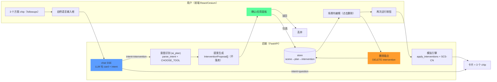

# 用户干预设计循环 — 技术方案 v2

> 本文档为**技术方案设计**（数据流向 + 实现步骤），不涉及实际开发。
> 对接现状：`README.md` / `STATUS.md` / `ARCHITECTURE.md`（2026-10-15 实测）。
> v2 相对 v1 的核心差异：**chat 作为默认入口，ai-plan 由 chat 根据 LLM 吐出的 `intent` 字段自动触发**；"模拟结果下方 3 个 AI 方案标题"**复用现有 `followups`**，不新增 schema。

---

## 0. 需求与闭环

实现一个**闭环干预循环**：

```
用户自然语言输入
  → chat（默认入口，SSE 流式）
      ├─ intent="question"  → 展示卡片 + 3 个干预指令 chip
      └─ intent="intervention"
            → 自动调 ai-plan → 提案 → 用户勾选确认 → 落库 draft plan
            → 场景渲染 2.5D 方块
            → 场景内编辑（点击删除/反查 id）
            → 再次 run → 最新结果 + 下方 3 个 chip 作为下一轮入口
            → (回到起点)
```

**关键改动相对 v1**：
1. 用户输入不再在前端按关键词二选一；统一先走 chat，由 LLM 在卡片 JSON 里吐 `intent` 决定是否触发 ai-plan。
2. "模拟结果下方 3 个 AI 方案标题"= 现有 `AnswerCard.followups` 收窄为"干预指令句"，点击即走同一入口。
3. 确认门（§5）硬前置于 chat intent 自动路由（§4）：否则 chat 一回句话场景就冒方块，违反预期。详见 §5.4、§10。

---

## 1. 项目现状对齐（决定方案骨架）

| 现状 | 结论 | 对本方案的影响 |
|---|---|---|
| 干预渲染 `interventionLayer.ts` 已实现 | `GeoJsonDataSource` + `clampToGround`，`style.color/opacity/extrusionHeight` 已生效 | 2.5D 方块已有基础，无需从零建 |
| `STYLE_FOR_KIND` 已给每种类型配色+挤出高度 | 蓄水池蓝 `#1f6feb` 14m、绿地绿 `#2ea043` 6m、透水/排水/道路**无挤出** | 颜色=类型已成立，补齐挤出即可 |
| 意图识别已有 `parse_intent`（确定性）+ `CHOOSE_TOOL`/`MASSING_TOOL` | 模型**只选站点 id，永不发坐标**（Decision 11） | 新循环必须继承"选站点不生成几何"约束 |
| `POST /scenes/{id}/ai-plan` 已把 NL → 草稿 plan | 返回 `features` + `planId`，`status=draft`，**同步落库** | 需拆成"生成提案（不落库）"+"落地勾选项"两段 |
| `POST /scenes/{id}/run` 已实现"应用干预→重算→出图" | `apply_interventions` + SCS-CN + 级联 + 双覆盖图 | "再次运行模拟"已存在 |
| `AnswerCard.followups` + 前端 Chip 渲染已存在 | `prompts.py:51-52` 要求 3 条 next steps；`ChatPanel.tsx:397, 565-571` 已把 chip onClick 接到 `send(c)` | **3 个方案标题的基础设施已就位**，仅需收窄内容偏向 |
| **chat 无 tool_use 协议** | `agent/llm.py` 只有 `complete_json` + `stream_text`；`chat_service.stream_events` 是三步死管线 | 不引入 tool-use，走"卡片新增 intent 字段"的轻路径 |
| **无单个干预删除端点** | `plans.py` 只有 PUT plan + GET interventions | 本方案要补的核心缺口（阶段 0） |
| **无 `remove` 操作** | parser 只认 add/place/scale | 需新增 `remove` 语义 |
| **无 AI 模型配置界面** | 仅 `backend/.env` + `/health.llm.configured` | 需新建（阶段 6） |
| **意图路由脆弱** | `ChatPanel.tsx:70-73` 仅 12 个英文动词；手输 dig/create/increase 静默进 chat 的"只解释"分支 | **本版用 LLM 吐 intent 字段替代前端关键词路由** |

**结论**：这是一个"在已有 `chat` + `ai-plan` + `run` 三条链路上，补上「确认门 + 场景编辑 + 删除 + intent 自动路由 + followups 收窄 + 模板白名单 + 配置面板」的增量方案"，而非推翻重建。

---

## 2. 总体架构与数据流向



### 关键数据流说明

1. **chat 是默认入口**。所有自然语言输入都先流到 `POST /api/scenes/{id}/chat/stream`，LLM 在 JSON 卡片里吐 `intent` 字段；前端据此决定是否自动触发 `createAiPlan`。前端不再用正则在客户端做意图分叉。
2. **ai-plan 只在 `intent=intervention` 时触发**，且只生成提案（不落库）；用户勾选后才写 store。这就是 §5 的"确认门"。
3. **chat 永不生成几何**：intent 字段只是**语义透出**（"用户想要干预什么类型、在哪个区域"），几何仍由 `ai_plan.generate_plan` 的 grounding 池从 DEM/土地覆被/湿网格派生——Decision 11 不被破坏。
4. **run 完成后的 3 个 chip = 下一轮入口**：`followups` 从"问题式"收窄为"干预指令句"，点 chip 即 `send(c)`，走同一 chat 入口，自然闭环。

---

## 3. 干预要素的 2.5D 方块定义

### 3.1 颜色 = 干预类型，高度 = 功能语义

| 干预类型 | 颜色 | 挤出高度 | 含义 |
|---|---|---|---|
| `water_reservoir` 蓄水池 | 蓝 `#1f6feb` | 14 m | 蓄水/滞洪 |
| `green_space` 绿地 | 绿 `#2ea043` | 6 m | 降温/下渗 |
| `permeable_paving` 透水铺装 | 紫 `#8957e5` | 2 m（**新增**） | 下渗 |
| `drainage` 排水 | 黄 `#e3b341` | 3 m（**新增**） | 导流 |
| `road` 道路 | 灰 `#6e7681` | 2 m（**新增**） | 通行 |

> 现状 `permeable_paving`/`drainage`/`road` 是贴地平面。统一给挤出高度后，"每种类型 = 一种颜色 + 一种高度"的图例可读。

### 3.2 现状限制与改进

现状干预是"轴向对齐的五点矩形环"（平板）。本方案在**保持 `clampToGround` 不变**的前提下，用 `extrusionHeight` 把它顶成 2.5D 方块即可满足"方块"要求，不强行做 basin 造型（造型化是后续独立项）。

---

## 4. chat 入口与 intent 自动路由

### 4.1 根因（为什么要改）

现状前端 `ChatPanel.tsx:70-73, 436` 用 12 个硬编码英文动词在客户端二选一：

```typescript
function looksLikeIntervention(text: string): boolean {
  if (/\?$/.test(text.trim())) return false
  return /\b(add|place|plant|fill|remove|rotate|resize|raise|lower|move|scale|build)\b/i.test(text)
}
```

与后端 `EN_ALIASES`/`parse_massing_intent`/`REGION_SYNONYMS` 严重不对称。用户稍换词（dig / create / increase greenery）就静默进入 chat 的"只解释"分支，用户感觉**没返回内容**。

### 4.2 方案：卡片新增 `intent` 字段 + 前端自动路由

**不引入** Anthropic tool_use / OpenAI function-calling 协议（当前 `backend/.env` 全部 LLM key 为空，加 tool-use 协议而 parser 又用不上，是纯负债）。采**轻路径**：

- `AnswerCard` 新增两个字段：
  - `intent: Literal["question", "intervention", "ambiguous"] = "question"`
  - `intent_hint: str | None = None`（当 intent=intervention 时，LLM 把规整后的英文指令句放这里）
- prompts.py 的 `SYSTEM` 末尾加判别规则，`JSON_CONTRACT` 加 keys
- 前端收到 `answer` 事件 → 看 `card.intent` → 若 `"intervention"` 则自动调 `createAiPlan(sceneId, card.intent_hint ?? trimmed)`

### 4.3 判别语义

| intent | 触发条件 | 前端行为 |
|---|---|---|
| `"question"` | 用户问"what/why/how"，或询问当前 run 的数值/原因 | 展示卡片 + 3 个 followup chip |
| `"intervention"` | 用户想**改变场景**：add/remove/replace 任何类型 | 展示卡片 + **自动调 createAiPlan** + 等用户在确认面板勾选 |
| `"ambiguous"` | 无法判定 | 展示卡片，提示"你是想问模拟结果，还是想加一个新的干预？" |

**判别放宽 ≠ 生成放宽**：`intent_hint` 只允许"类型 + 区域"的语义，Decision 11 保持不破。几何仍由 `ai_plan.generate_plan` 的 grounding 池派生。

### 4.4 实施步骤

| 步骤 | 文件 | 内容 |
|---|---|---|
| 4.1 | `backend/app/schemas/chat.py` | `AnswerCard` 新增可选 `intent`/`intent_hint`，默认 `question`/`None` |
| 4.2 | `backend/app/agent/prompts.py` | `SYSTEM` 追加 intent 判别规则；`JSON_CONTRACT` 的 keys 列表加 `intent`、`intent_hint` |
| 4.3 | `backend/app/agent/chat_service.py` | `_card_from` 把 draft 的 `intent/intent_hint` 透传到 `AnswerCard`；`_no_run_card`/`template_card` 兜底写 `intent="question"` |
| 4.4 | `backend/app/agent/run_card.py` | 模板兜底卡片写 `intent="question"`（保守默认） |
| 4.5 | `frontend/src/api/chatApi.ts` | `AnswerCard` 类型加 `intent`/`intent_hint` 字段 |
| 4.6 | `frontend/src/components/ChatPanel.tsx` | `send` 不再前置分叉；`answer` 事件分支按 `intent` 决定是否调 `createAiPlan`；原 435-456 的 ai-plan 分支逻辑搬到 answer 回调里 |
| 4.7 | `backend/app/export_openapi.py` 产物 | 重新生成 `contracts/openapi.json`，schema 变化契约测试必须通过 |

### 4.5 兜底：parser-only 部署仍可用

当 LLM 不可用（走 parser 或 template）时，卡片的 `intent` 保守默认为 `"question"`，前端收不到 `intent="intervention"` 就不会触发 ai-plan。此时 `looksLikeIntervention` 旧函数**保留为启发式兜底**：若 LLM 显式返回 `intent` 字段，走新路径；若字段缺失（JSON 老格式/template），回退到旧正则。无 key 场景行为**完全保持与现状一致**。

**验收**：
1. 手输 "dig a basin in the north" → 卡片 `intent="intervention"`，`intent_hint="add a water reservoir in the north"` → 自动触发 ai-plan → 场景出现提案。**无静默失败**。
2. 手输 "what changed?" → 卡片 `intent="question"` → 只展示卡片。
3. 清空 LLM key → `intent` 字段缺失 → 回退旧正则 → 与现状一致。
4. `tests/test_openapi_contract.py` 通过。

---

## 5. 确认门（提案 → 应用）

### 5.1 设计

现状 `ai-plan` 直接创建 `draft plan` 并选中渲染。本方案拆成两段：

- **提案态**（未持久化，仅前端内存）：返回 `InterventionProposal[]`，用户可逐条勾选/驳回
- **确认后**才写入 store（`status=draft`），进入场景渲染

### 5.2 实施步骤

| 步骤 | 文件 | 内容 |
|---|---|---|
| 5.1 | `backend/app/schemas/intervention.py` | 新增 `InterventionProposal` 输出模型（复用 feature 形状，加 `site_id`/`rationale`/`basis`） |
| 5.2 | `backend/app/services/ai_plan.py` | 拆出「生成提案」与「落地写库」两段，提案段不落库 |
| 5.3 | `backend/app/routers/scenes.py` | `ai-plan` 增加 `apply=false` 模式返回 proposal；新增 `POST /scenes/{id}/ai-plan/apply` 落地勾选项 |
| 5.4 | `frontend/src/components/ChatPanel.tsx` | 干预指令结果改为「确认面板」（勾选 + 应用/驳回），替代现在的直接 `selectPlan` |

**验收**：LLM 返回 3 条提案 → 用户勾 2 条 → 只有 2 个方块进场景。

### 5.3 粒度（Decision 1）

**逐条勾选**，不整包。

### 5.4 顺序约束

**阶段 2（确认门，本节）必须早于阶段 4（intent 自动触发，§4）上线**。否则 chat 一回句话、场景就自动冒出蓝方块，比现在的静默失败更违反用户预期。确认门把"立即落地"降级为"展示提案 → 用户勾选 → 落地"，intent 自动触发只是省掉"用户切 Design 面板再输入"的手动步骤，不能跳过 proposal 态。

---

## 6. 场景内编辑与删除

### 6.1 现状缺口

- 无单个干预删除端点（`plans.py` 只有 PUT plan + GET interventions；删除只在 scene 级联）
- parser 无 `remove` 操作（STATUS "planner can add but not take away"）

### 6.2 实施步骤

| 步骤 | 文件 | 内容 |
|---|---|---|
| 6.1 | `app/routers/plans.py` | 新增 `DELETE /plans/{plan_id}/interventions/{intervention_id}`（204） |
| 6.2 | `app/services/scene_service.py` | 新增 `delete_intervention(plan_id, intervention_id)`，含 404 处理 |
| 6.3 | `app/db.py` | 增补删除单条 intervention 的底层读/写 |
| 6.4 | `frontend/src/view/interventionLayer.ts` | 保留返回的 `entity → intervention id` 映射（供拾取反查） |
| 6.5 | `frontend/src/view/SandboxViewer.tsx` | 新增 `ScreenSpaceEventHandler`：`scene.pick` 命中干预实体 → 弹出删除确认 → 调 DELETE → 重载干预层 |
| 6.6 | `tests/test_contract.py` 等 | 补删除端点契约测试 + `isolate_store()` |

**持久性（Decision 2）**：**硬删除**，不做软删/undo。

**验收**：点选一个 2.5D 方块 → 删除 → 场景中消失 → 再次 run 结果不含它。

---

## 7. 模拟结果下方的 3 个 AI 方案标题（复用 followups）

### 7.1 现状基础设施（已就位）

- **schema**：`AnswerCard.followups: list[str]`（至多 3 条）
- **prompt**：`prompts.py:51-52` 要求 "at most three concrete next steps in this sandbox"
- **前端**：`ChatPanel.tsx:397` 存入 `m.chips`；`:565-571` 渲染为 Chip，`onClick={() => void send(c)}` 把 chip 文本当作用户输入**重新进入 `send()`**
- **兜底**：`run_card.py` 的模板卡片已预置 3 条备选

### 7.2 Gap 与修法

**Gap**：followups 现在允许"问题式"（"Is this better than baseline?"），不像"3 个 AI 方案标题"。

**修法**：改 prompts.py 规则 4 一句话 + run_card.py 兜底常量两处小改。

### 7.3 实施步骤

| 步骤 | 文件 | 内容 |
|---|---|---|
| 7.1 | `backend/app/agent/prompts.py` 规则 4 | `followups` 收窄为："at most three concrete **intervention instructions** the user can run next, each shaped like `add <type> in <region>` or `remove the <type> near <region>`. Each must name a type from {water reservoir, green space, permeable paving, drainage, road} and a region from {north, south, east, west, centre, whole area}." |
| 7.2 | `backend/app/agent/run_card.py` | 模板兜底的 followups 常量从"问题"改成 3 条干预指令句 |
| 7.3 | `frontend/src/components/ChatPanel.tsx` | Chip 样式微调（视觉上更像"方案卡"而非 tag）；行为不变 |

### 7.4 闭环

点击 chip → `send(c)` → chat → LLM 判出 `intent="intervention"` → 自动触发 ai-plan → 确认门 → 落地。**与 §4 共用同一入口，无额外分支**。

**验收**：
1. 任意 run 完成后，chat 卡片下显示 3 个 chip，每个都是 `add/remove ... in ...` 形式
2. 点击任一 chip → 场景按 ai-plan 流程生成提案（经确认门）
3. LLM 失败走 template 时，兜底 chip 仍是干预指令句

### 7.5 为什么不新增 `AnswerCard.proposals` 字段

考虑过"新开一个 `proposals: Array<{title, instruction}>` 字段专载 3 个方案"。否决理由：
- followups 和 proposals 功能高度重叠，并存会在 UI 下方出现 6 个 chip，用户困惑
- 新 schema 字段要走 OpenAPI 契约重新生成 + 契约测试更新 + 前端类型 + 兜底写 4 处，而现有 followups 改 prompt 一句话 + 兜底常量两处就能达成相同效果

如果后续用户反馈 followups 表达力不够，再评估是否升级为独立 schema——不在 v2 必要路径。

---

## 8. 类型白名单（最小模板机制）

### 8.1 定位

探索方向 A（"用户输入是否提供模板参考"）当前**没有**。方案：**最小类型白名单**（已拍板，完整模板库留后续）。

用户输入时可**限定干预类型范围**（白名单）作为意图约束，让 LLM 只在指定类型内选站点，降低幻觉。模板 = 一组 `allowedTypes` 约束，暂不做数量/区域等更丰富语义。

### 8.2 实施步骤

| 步骤 | 文件 | 内容 |
|---|---|---|
| 8.1 | `backend/app/services/ai_plan.py` | `generate_plan` 接受 `allowedTypes?: string[]`，注入 `CHOOSE_TOOL.intervention_type.enum` 白名单（未传 = 全类型，向后兼容） |
| 8.2 | `backend/app/schemas/chat.py` 或 `routers/scenes.py` | `ai-plan` 请求体新增可选 `allowedTypes` 字段 |
| 8.3 | `frontend/src/components/ChatPanel.tsx` | 输入框旁加"类型多选"控件（蓄水/绿地/透水/排水/道路） |
| 8.4 | `frontend/src/api/planApi.ts` | `createAiPlan` 支持传 `allowedTypes` |

**验收**：只勾"蓄水+绿地"后，LLM 提案只含这两类，其余类型不出现。

---

## 9. AI 配置面板

### 9.1 现状

模型配置只存在于 `backend/.env`（`LLM_BASE_URL` / `LLM_API_KEY` / `LLM_MODEL` / `LLM_FALLBACK_MODELS` / `LLM_JSON_MODE` / `ANTHROPIC_API_KEY`）。前端仅 `/health.llm.configured` 驱动一个状态点，无任何可改配置的 UI。

**2026-10-15 实测**：`backend/.env` 中 `ANTHROPIC_API_KEY`/`LLM_API_KEY`/`LLM_BASE_URL`/`LLM_MODEL` **均为空**，`LLM_ALLOW_NO_KEY=true`，当前走确定性启发式 parser。

### 9.2 方案

| 决策 | 结论 |
|---|---|
| 配置写回方式 | **运行时内存覆盖**（不落盘，重启失效） |
| 暴露字段 | 仅 `base_url`/`model`/`json_mode`，**永不回显 `api_key`**（密钥只写不读） |

### 9.3 实施步骤

| 步骤 | 文件 | 内容 |
|---|---|---|
| 9.1 | `app/routers/` 新增 `llm_config.py` | `GET /api/llm-config`（脱敏）+ `PUT /api/llm-config`（运行时覆盖，不写 .env） |
| 9.2 | `app/config.py` | 新增运行时可覆盖的 `llm` 配置（内存态，重启失效）；`get_provider` 读此覆盖值优先 |
| 9.3 | `frontend/src/components/` 新增 `LLMConfigPanel.tsx` | 显示 `/health.llm.configured` 状态点 + 可填 `base_url`/`model` 表单 |

**验收**：面板填入 `base_url`+`model` 后，状态点由黄（parser）转绿（live LLM）；密钥只写不读、不落盘。

---

## 10. 实施阶段总览

| 阶段 | 目标 | 文档章节 | 依赖 |
|---|---|---|---|
| 0 | 删除端点（最小闭环缺口） | §6 | — |
| 1 | 2.5D 方块规范化 + 图例 | §3 | — |
| 2 | 确认门（提案 → 应用） | §5 | — |
| 3 | followups 收窄为干预指令句 | §7 | — |
| 4 | **chat intent 自动路由** | §4 | **阶段 2 已上线** |
| 5 | 类型白名单 | §8 | 阶段 2 |
| 6 | AI 配置面板 | §9 | — |

**硬顺序**：阶段 4 必须在阶段 2 之后。其余可并行。

---

## 11. 契约 / 一致性约束

| 约束 | 来源 | 本方案如何遵守 |
|---|---|---|
| 模型**只选站点，永不发坐标** | Decision 11 | 提案/确认门只传 `site_id`；几何由 grounding 池附加 |
| `intent_hint` 透出 ≠ chat 生成几何 | 本方案 | `intent_hint` 只允许"类型+区域"语义；几何仍由 `ai_plan.generate_plan` 派生，chat 本身不写 store |
| AI 产出 `status=draft`，引擎拒绝在 draft 上计算 | ADR-030 | 确认门落地仍 `draft`；删除不改变此语义 |
| 手绘与 AI 共用同一管线 | ARCHITECTURE | 新增删除/确认门不分支，走同一 validate → store → render |
| 单一数据权威 | CLAUDE.md | 配置读写也走 API，前端不碰文件/库 |
| 每新输出带 `status`+`warning` | STATUS 约束 | proposal、删除结果、配置变更都带 `status` |
| chat 永不生成几何 | Decision 16 | 本方案 chat 仍只透出意图语义；几何创建在 ai-plan 路径 |
| 判别放宽 ≠ 生成放宽 | Decision 11 | LLM intent 判别放宽；`generate_plan` 的几何解析不变，识别不到返回 message，不发明坐标 |
| 单一词汇权威 | CLAUDE.md | 前端不再维护第二份动词表；LLM 用 intent 字段直接表态 |

---

## 12. 已拍板决策

| # | 决策项 | 结论 |
|---|---|---|
| 1 | 确认门粒度 | **逐条勾选** |
| 2 | 删除持久性 | **硬删除**（undo 留后续） |
| 3 | 模板库范围 | **最小"类型白名单"机制** |
| 4 | AI 配置面板 | **仍需做**（当前无可用 key） |
| 5 | 2.5D 方块高度 | **同意补挤出高度** |
| 6 | 意图识别语言 | **全英文可接受**，不维护中文别名 |
| 7 | chat → ai-plan 工具化路径 | **轻路径：卡片 JSON 新增 `intent`/`intent_hint` 字段**，不引入 tool_use 协议 |
| 8 | 3 个 AI 方案标题承载 | **复用 `AnswerCard.followups`**，不新增 schema |
| 9 | 执行顺序 | **阶段 2（确认门）必须早于阶段 4（intent 自动触发）** |

**决策 4 背景**：`backend/.env` 实测 `ANTHROPIC_API_KEY`、`LLM_API_KEY`、`LLM_BASE_URL`、`LLM_MODEL` **均为空**，无真实 LLM，配置页仍需落地。

**决策 7 背景**：当前无可用 LLM key，走 parser 兜底。加 Anthropic tool_use / OpenAI function-calling 协议而 parser 又用不上，是纯负债；等真实 key 落地再评估是否升级。

---

## 13. 端到端验证

1. **契约不破**：
   ```bash
   cd backend && python -m app.export_openapi
   PYTHONUTF8=1 python -m pytest -q tests/test_openapi_contract.py
   ```
2. **chat intent 回归**（新增测试）：
   - 构造 facts 为空的 run → 期望 `card.intent == "question"`（template 兜底）
   - 若有 LLM key：三轮固定问题 → 期望 intent/intent_hint 稳定
3. **前端 UX**（双端服务起来后手测）：
   - "what changed?" → 只回答，不生成方块
   - "dig a basin in the north" → chat 卡片 + 自动触发 ai-plan 面板
   - 点下方 followup chip → 走同一路径
4. **parser 兜底**：清空 `LLM_API_KEY` 后重启后端 → 卡片无 `intent` 字段 → 回退 `looksLikeIntervention` 旧逻辑 → 现状行为完全保持
5. **删除闭环**：点选方块 → 删除 → 再次 run → 结果不含它

---

## 14. 刻意不在本方案内的"升级"

- **不**引入 Anthropic tool_use / OpenAI function-calling 协议：当前无可用 key，加协议是纯负债；等真实 key 落地再评估
- **不**新增 `AnswerCard.proposals` 字段：与 followups 重叠会在 UI 出现 6 个 chip，是方案冗余
- **不**做 Ask/Design 分轨 Tab：intent 自动判别后，Tab 是重复输入模式
- **不**做完整模板库：先落最小类型白名单（§8），完整模板语义（数量/区域/组合）留后续

---

## 附：相关现状文件索引

- 干预渲染：`frontend/src/view/interventionLayer.ts`
- 意图/站点/样式：`backend/app/services/ai_plan.py`（`parse_intent`、`CHOOSE_TOOL`、`STYLE_FOR_KIND`）
- chat 流式 agent：`backend/app/agent/chat_service.py:28` `stream_events`
- chat prompts：`backend/app/agent/prompts.py`
- chat schema：`backend/app/schemas/chat.py`（`AnswerCard`）
- 模拟应用：`backend/app/services/run_service.py`（`apply_interventions`、`run_scenario`）
- 路由：`backend/app/routers/plans.py`（现仅 PUT/GET）、`scenes.py`（ai-plan/run）、`chat.py`
- 存储模型：`backend/app/models/intervention.py`、`schemas/intervention.py`
- LLM 客户端：`backend/app/agent/llm.py`（`complete_json`/`stream_text`；**无 tool_use**）
- 前端入口：`frontend/src/components/ChatPanel.tsx:70-73, 428-471, 565-571`
- 前端 API：`frontend/src/api/chatApi.ts`、`planApi.ts`、`sceneApi.ts`
